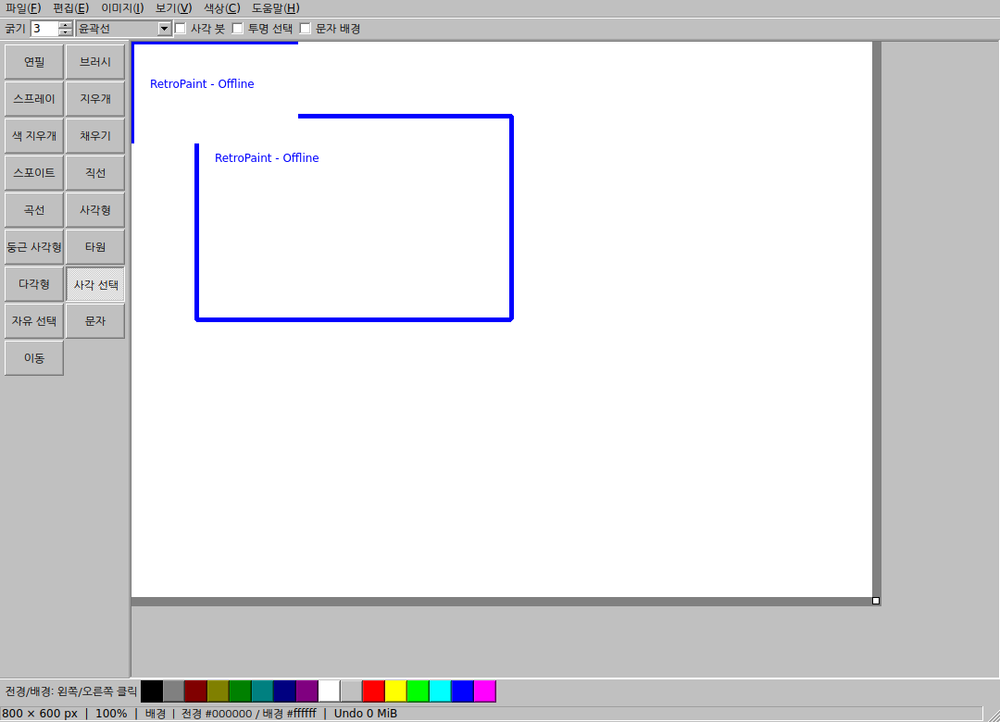

# myPaint

저장소: https://github.com/parkjh2568/myPaint

독립형 오프라인 그림판 프로젝트입니다. 현재 앱의 개발명과 실행 대상 이름은 **RetroPaint 0.1.0 / `retropaint`**입니다. 클라우드 개발 환경 설정은 [CLOUD_SETUP.md](docs/CLOUD_SETUP.md)를 참고하세요.

Windows 98 계열의 단순한 조작감을 목표로 만든 독립형 오프라인 그림판입니다. C++20, Qt Widgets, CMake를 사용합니다. 원본 Windows 그림판 실행 파일이나 REA의 코드를 가져오지 않았습니다.

**현재 상태: Linux에서 빌드·실행·자동 테스트한 개발 버전입니다. macOS·Windows는 같은 소스와 빌드 설정을 제공하지만, 해당 OS의 실제 실행·배포 검증은 아직 완료하지 않았습니다.**



## 구현 범위

| 영역 | 기능 |
| --- | --- |
| 기본 그리기 | 연필, 둥근/사각 브러시, 스프레이, 지우개, 색 지우개, 채우기, 스포이트 |
| 도형 | 직선, 곡선, 사각형, 둥근 사각형, 타원, 다각형; 선 굵기·윤곽선·채우기 설정 |
| 선택 | 사각/자유 선택, 배경색 투명 선택, 이동·크기 조절, 복사·잘라내기·붙여넣기, 삭제·자르기 |
| 이미지 | PNG/JPEG/BMP/GIF 열기, 사진 삽입·파일 드롭, 이미지 클립보드; GIF는 첫 프레임만 읽기 |
| 캔버스 | 작업 공간 크기 변경, 이미지 확대/축소, 90도 회전·좌우/상하 반전·가로 기울이기 |
| 문자 | 시스템 글꼴, 글꼴 크기·스타일, 한글 입력을 위한 Qt 텍스트 편집기, 문자 배경 선택 |
| 화면 | 확대/축소, 맞춤 보기, 픽셀 격자, 가운데 버튼 이동, 전경·배경 팔레트 |
| 레이어 | 선택 패널, 추가·삭제·순서·이름·표시·숨김·아래 레이어와 병합, 최대 16개 |
| 저장 | PNG/JPEG/BMP 이미지, 레이어 보존 `.rpaint`, Undo/Redo, 로컬 복구 사본 |

계정, AI, HTTP 요청, 외부 URL 열기, 원격 이미지, 광고, 텔레메트리, 자동 업데이트, 웹뷰를 구현하지 않았습니다. 앱은 Qt Network 모듈을 링크하지 않습니다. 빌드 도구 설치와 CI의 의존성 다운로드는 개발 단계이며 앱 실행 기능에 포함되지 않습니다.

## 빠른 사용법

1. `파일 → 열기`로 사진을 열거나, 클립보드 이미지를 붙여넣습니다. 사진 삽입/드롭은 현재 그림 위에 올립니다.
2. 붙여넣은 그림은 드래그로 이동하고 우하단에서 크기를 바꿉니다. Enter로 확정, Esc로 취소합니다. 방향키는 1픽셀, Shift+방향키는 10픽셀 이동합니다.
3. 우측·하단 여백을 끌거나 `이미지 → 캔버스 크기`에서 작업 공간을 조절합니다. `이미지 크기`는 그림 자체를 확대/축소하는 별도 명령입니다.
4. `보기 → 레이어`로 패널을 표시합니다. 패널을 숨겨도 레이어는 삭제·병합되지 않습니다.
5. 여러 레이어가 있거나 단일 레이어를 숨긴 문서는 `.rpaint`로 저장합니다. `이미지 내보내기`는 표시 중인 레이어를 합쳐 저장하며 프로젝트의 저장 완료 상태를 바꾸지 않습니다.

곡선은 끝점 드래그 후 제어점 두 번 클릭, 다각형은 꼭짓점 클릭 후 Enter/더블클릭으로 확정합니다. 문자는 Ctrl+Enter 또는 다른 도구 선택으로 확정합니다. 문자 확정 후에는 픽셀이 되므로 다시 입력 내용을 편집하려면 Undo가 필요합니다.

선택은 현재 레이어에 작용합니다. 선택 없이 복사하면 보이는 합성 이미지를 복사합니다. 숨겨진 레이어에 새로 그리면 해당 레이어를 표시합니다. 캔버스 확대는 좌상단 기준이며 우측/하단으로 나간 붙여넣기는 확정할 때 작업 공간을 넓힙니다. 음수 좌표의 내용은 캔버스 밖으로 잘립니다. 첫 붙여넣기는 기존 기본 캔버스보다 작아도 캔버스를 자동으로 줄이지 않습니다.

## 빌드

필수 도구: C++20 컴파일러, CMake 3.22+, Qt 6.4+의 Core/Gui/Widgets와 개발 도구. 테스트에는 Qt Test가 추가로 필요합니다. 최소 호환 버전은 보안 패치 권장 버전과 같은 의미가 아닙니다. 실제 배포에는 사용하는 Qt 배포판의 보안 패치를 확인해야 합니다.

### Linux

Ubuntu 계열 개발 환경 예:

```sh
sudo apt-get install build-essential cmake ninja-build qt6-base-dev qt6-base-dev-tools qt6-qpa-plugins libgl1-mesa-dev fonts-nanum
cmake -S . -B build -G Ninja -DCMAKE_BUILD_TYPE=Release
cmake --build build --parallel 2
ctest --test-dir build --output-on-failure
./build/retropaint
```

Qt SDK를 별도 경로에 설치했다면 구성 명령에 `-DCMAKE_PREFIX_PATH=/path/to/Qt/prefix`를 추가합니다. Linux 실행에는 디스플레이와 해당 Qt 플랫폼 플러그인이 필요합니다. 첨부한 Linux 개발 실행 파일은 Qt 런타임을 포함하지 않습니다.

### macOS

Xcode Command Line Tools, CMake와 macOS용 Qt SDK가 필요합니다. Qt 설치 경로를 실제 경로로 바꿉니다.

```sh
cmake -S . -B build -DCMAKE_BUILD_TYPE=Release -DCMAKE_PREFIX_PATH=/path/to/Qt/macos
cmake --build build --parallel 2
ctest --test-dir build --output-on-failure
open build/retropaint.app
```

호스트 아키텍처가 기본값입니다. Universal 빌드는 Universal Qt SDK에서 `-DCMAKE_OSX_ARCHITECTURES="arm64;x86_64"`를 지정합니다. 두 아키텍처의 실제 실행 검증은 별개로 필요합니다.

### Windows

Visual Studio 2022의 C++ 데스크톱 도구와 동일한 ABI의 Qt SDK를 사용합니다. 다음은 PowerShell 예입니다.

```powershell
$env:Path = 'C:\Qt\6.8.3\msvc2022_64\bin;' + $env:Path
cmake -S . -B build -G 'Visual Studio 17 2022' -A x64 -DCMAKE_PREFIX_PATH=C:/Qt/6.8.3/msvc2022_64
cmake --build build --config Release --parallel 2
ctest --test-dir build -C Release --output-on-failure
.\build\Release\retropaint.exe
```

6.8.3은 CI 설정의 고정 호환성 기준이며 최신 보안 버전이라는 뜻은 아닙니다. MSVC 소스 인코딩은 CMake에서 `/utf-8`로 지정합니다.

## 배포 준비

`RETROPAINT_DEPLOY_RUNTIME=ON`은 Qt의 네이티브 배포 스크립트를 사용합니다. macOS에서는 앱 번들, Windows에서는 실행 폴더로 Qt 의존성을 수집합니다. Linux의 이 기능은 Qt 6.5 이상이 필요하며 시스템 라이브러리까지 모두 모으는 범용 독립 실행 파일을 보장하지 않습니다.

```sh
cmake -S . -B build -DRETROPAINT_DEPLOY_RUNTIME=ON -DCMAKE_PREFIX_PATH=/path/to/Qt/prefix
cmake --build build --config Release
cmake --install build --config Release --prefix dist
```

배포 전에는 해당 Qt 빌드와 플러그인의 라이선스·소스 제공 요건, 깨끗한 OS에서의 실행, OS별 서명 및 macOS 공증을 완료해야 합니다. 이 프로젝트는 서명·공증 인증서를 포함하지 않습니다. CI는 빌드와 테스트 설정이며 배포를 자동 게시하지 않습니다.

## 구조와 문서

- `src/document.*`: 레이어·픽셀·변경 기록·이미지/프로젝트 입출력.
- `src/canvas.*`: 그리기 도구·선택·미리보기·입력 처리.
- `src/mainwindow.*`: 메뉴·저장 흐름·레이어 패널·복구.
- `src/main.cpp`: 앱 시작·클래식 스타일·단일 인스턴스·오류 경계.
- `tests/`: 편집/파일/실패 시나리오, UI 입력, Linux 오프라인 호출 검사와 성능 측정.
- [설계와 예외 처리](docs/ARCHITECTURE.md), [프로젝트 파일 형식](docs/FILE_FORMAT.md), [검증 결과와 남은 작업](docs/VERIFICATION.md).
- 컨벤션은 [AGENTS.md](AGENTS.md), 코드 정렬은 `.clang-format`을 따릅니다.

함수는 하나의 편집·저장 흐름을 소유하도록 구성했습니다. 크기 검증, 작업 실행 경계, 반복 사용하는 텍스트 스타일 반영처럼 의미를 공유하는 작업만 분리했습니다. 컨트롤러·서비스·리포지터리 계층을 추가로 겹치지 않았습니다.

앱 소스는 [MIT](LICENSE)입니다. 외부 의존성은 [NOTICE.md](NOTICE.md)를 확인하세요.
