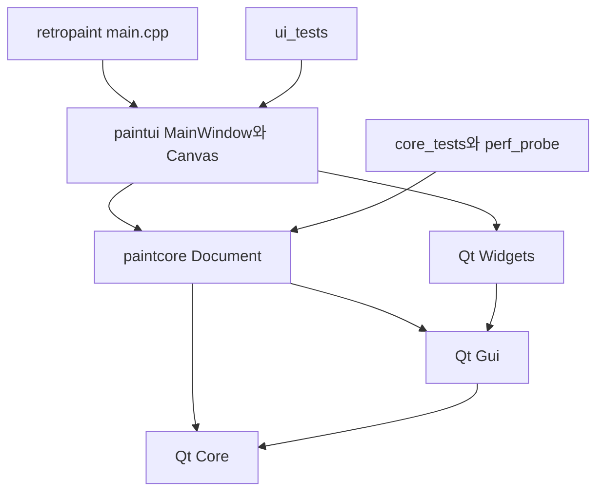

# RetroPaint 전체 코드 검토와 리팩터링 계획

기준일: 2026-11-03 한국 시간. 검토 기준 커밋: `942eb163ad369588962a905945f1cbe42f55506e`.

후속 구현 범위와 도구 아이콘 적용 상태는 [결함 수정과 도구 UI 작업계획](IMPLEMENTATION_PLAN.md), 실제 완료 항목과 검증은 [구현 결과](IMPLEMENTATION_RESULTS.md)에 기록한다. 아래 코드 줄 번호와 검증 결과는 최초 검토 시점 기준이다.

문서 엔진의 후보 상태 검증, revision 기반 저장 상태, 원자적 파일 교체는 유지할 가치가 있다. 우선 수정할 부분은 선택 데이터의 표시 크기와 실제 이미지 크기의 불일치, 잘라내기 대상과 클립보드 내용의 불일치, 복합 마우스 입력 중 임시 획 소실이다. 전면 재작성보다 편집 경계와 회귀 테스트를 먼저 보강하는 편이 위험과 비용이 낮다.

이번 변경은 분석 보고서와 재현 자료를 추가한다. 제품 소스와 기존 테스트의 동작은 수정하지 않았다. 아래의 발견 사항은 해결된 목록이 아니라 후속 수정 목록이다.

## 검토 범위와 반복 점검

기존 C++ 소스·헤더·테스트 12개 파일, 총 2,914줄을 모두 읽었다. `CMakeLists.txt` 70줄, CI 56줄, 숨김 설정, 프로젝트 규칙, README, 설계·파일 형식·검증·개발 환경 문서, 기존 검증 로그·성능 자료와 라이선스 안내도 대조했다. 외부 Qt 구현 전체와 라이선스 전문의 법률 검토는 범위에 포함하지 않는다.

| 점검 회차 | 범위 | 완료 조건과 결과 |
| --- | --- | --- |
| 1 | 전체 파일, 모듈 의존성, 상태 소유권 | 모든 제품·테스트 코드의 책임과 호출 경로 분류 완료 |
| 2 | 편집·입출력·Undo·복구의 실패 경로 | 후보 생성부터 확정·취소·예외까지 분기 확인 완료 |
| 3 | 의심 항목 재현, 빌드·테스트·정적 분석 | R01~R12 관찰 기록, 정상 대조 사례 R09 포함 |
| 4 | 재현 결과 역검토, 주석·문서·컨벤션·UI | 확인된 오류와 설계 권고를 분리하고 파일별 누락 재점검 완료 |

실행 가능한 코드 파일 중 검토하지 않은 파일은 없다. 플랫폼별 수동 검증과 실제 자원 고갈 시험은 아래의 검증 한도에 별도로 남긴다. 반복 점검 완료는 모든 결함의 부재를 의미하지 않는다.

### 파일별 검토 기록

| 파일 | 검토한 책임과 주요 결과 |
| --- | --- |
| `src/document.h` 79줄 | 공개 상태·이력 계약, revision, 예산. 활성 레이어의 문서/UI 상태 경계가 불명확하다. |
| `src/document.cpp` 368줄 | 모든 검증·할당·commit/apply·리사이즈·코덱·채우기 경로. F03, F09, S03 참조. |
| `src/canvas.h` 99줄 | 도구 열거형, 공개 옵션, 임시 상태·플래그 조합. F01~F08, S01~S02 참조. |
| `src/canvas.cpp` 772줄 | 그리기·선택·문자·합성 표시·채우기 작업·모든 입력 이벤트. 재현 오류가 가장 많이 모인다. |
| `src/mainwindow.h` 48줄 | 문서·Canvas 소유권, 저장·복구·실행 경계. 추가 서비스 계층은 현재 필수적이지 않다. |
| `src/mainwindow.cpp` 624줄 | 메뉴 연결, 레이어, 저장·내보내기, 복구 타이머, 종료. F04~F05, F10, S04~S05 참조. |
| `src/main.cpp` 104줄 | 앱 예외 경계, 단일 인스턴스 잠금, CLI·복구 시작, smoke. S04, S07 참조. |
| `tests/core_tests.cpp` 280줄 | 14개 동작 사례, 잘린 파일·위조 헤더·쓰기 실패·예산. 활성 레이어 Undo와 메타데이터 예산 사례가 없다. |
| `tests/ui_tests.cpp` 444줄 | 데이터 행 포함 26개 동작 사례. 개별 도구는 다루나 선택 후 변형·복합 버튼 등 조합 사례가 부족하다. |
| `tests/perf_probe.cpp` 51줄 | 1080p 편집·이력·입출력의 단일 표본. 최대 문서·많은 짧은 획·도형 드래그를 대표하지 않는다. |
| `tests/network_guard.cpp` 36줄 | Linux libc interpose만 수행. 제품 코드의 네트워크 기능이 아니다. 문서가 한계를 명시한다. |
| `tests/network_probe.cpp` 9줄 | 인터넷 소켓 요청 차단의 양성 대조. 종료 코드·메시지 확인 정밀도는 S07 참조. |
| CMake·CI·설정 | Core/Gui와 Widgets 경계 유지, 3개 OS 매트릭스, 포맷 일치. 테스트 경고 및 smoke 누락은 S06~S07 참조. |
| 문서·증거 | 자원 한도·포맷·실패 계약은 대체로 구현과 일치. 저장 취소·마우스 release 설명에는 F05, F08 조건이 빠져 있다. |

## 모듈 경계와 의존성



빌드 대상 및 프로젝트 헤더 include 그래프에서 순환 의존성은 발견하지 않았다. `mainwindow.h → canvas.h → document.h`의 단방향 구조이고, `paintcore`는 Widgets를 링크하지 않는다. Canvas의 `changed` 신호에 MainWindow가 즉시 `sync()`를 수행하는 런타임 호출 왕복은 존재하지만, 모듈 순환 의존성과 구분해야 한다.

`Document`는 편집 가능한 확정 상태, 이력, 제한 검증, 래스터 연산과 파일 형식을 맡는다. `Canvas`는 입력과 임시 편집, 미리보기, 문자 위젯, 채우기 작업 수명과 클립보드를 맡는다. `MainWindow`는 문서·Canvas를 소유하고 메뉴·레이어·파일 대화상자·복구 정책을 조율한다. `main`은 앱 전역 스타일·잠금·예외 경계·시작 흐름을 맡는다.

책임이 가장 많이 섞인 지점은 Canvas의 임시 편집 상태와 MainWindow의 전체 UI 동기화다. 파일 수나 클래스 수 자체보다, 상태가 바뀌었을 때 누가 확정·취소·알림을 책임지는지가 더 큰 문제다.

### 데이터 흐름과 핵심 실행 경로

1. **일반 획:** press에서 `working = doc.state()` → QImage 공유 복사 후 그리기 시 분리 → move에서 후보 수정 → release에서 `commit()` → `refresh()` → `changed` → `sync()`.
2. **도형:** 직선·사각형은 드래그 후보로, 곡선·다각형은 `points`로 유지 → 미리보기 → `settle()` 또는 release에서 확정한다. 도형 미리보기는 활성 레이어 전체를 복사해 그린다.
3. **선택:** 원본을 `selection`으로 복사하고 `working`에서 해당 부분을 지운다. 이동·크기 조절은 `selectionRect`를 바꾸며, 확정 때 두 버퍼를 합성한다. 선택만 했다면 원본을 보존한다. 이 이중 표현이 F01의 원인이다.
4. **문자:** QTextEdit에 입력 → 확정 때 새 QTextDocument로 재구성 → 활성 레이어에 래스터화 → editor를 폐기한다. 입력기 조합창과 plain-text commit 이벤트의 검증 수준은 다르다.
5. **채우기:** 후보 이미지 캡처 → `std::async` 작업에서 span flood → modal progress의 타이머가 완료·취소 관찰 → 결과 성공 시에만 commit한다. UI 이벤트 루프가 중첩되므로 장래 비동기화 시 revision 검사가 필요하다.
6. **Undo/Redo:** 픽셀 차이는 전후 이미지 조각, 구조 차이는 전후 State를 보관한다. `apply()`도 후보를 먼저 만든다. 활성 인덱스의 처리 차이는 F03이다.
7. **열기:** 새 파일 전체 파싱·검증 → 기존 임시 편집 settle → 저장 여부 확인 → `reset()` → 화면 갱신. 손상된 파일은 기존 선택을 확정하기 전에 거부한다.
8. **저장:** 임시 편집 settle → 경로·형식 결정 → QSaveFile 쓰기·commit → path·savedId 갱신 → 복구 파일 정리. 저장 대화상자 취소보다 settle이 먼저 실행되는 점은 F05다.
9. **복구:** 30초마다 dirty이면서 마지막 복구 revision과 다를 때 `.rpaint` 작성. 시작 시 수락하면 읽어서 unsaved로 표시하고, 거절하면 별도 이름으로 보존한다. 손상본 읽기 실패 시 `preserveRecovery`가 남아 덮어쓰기를 막는다.

### 상태와 외부 계약

| 상태 | 소유자 | 보존·변경 규칙 |
| --- | --- | --- |
| `State`, 레이어 픽셀·순서·이름·표시 | Document | 후보 검증 후 교체, 같은 크기의 premultiplied ARGB32 이미지 |
| `currentId/savedId/nextId` | Document | 저장 여부는 ID 비교, Undo 분기 뒤 새 편집도 고유 ID |
| 이력·cursor·이미지 바이트 예산 | Document | 마지막 항목 하나는 예산 초과여도 남음. 메타데이터는 예산에 포함하지 않음 |
| `active` | Document | 파일에는 저장하지만 setActive는 revision을 바꾸지 않음. 이력의 복원 규칙 정리가 필요 |
| 선택·문자·획·도형·캔버스 크기 미리보기 | Canvas | 확정 전 원본 문서를 유지. 저장 취소 시의 UI 상태 보존은 현재 미충족 |
| 합성 이미지 캐시 | Canvas | 문서 revision 변경 때 갱신. 줌만 바꿀 때 합성을 생략 |
| 색·굵기·글꼴·zoom·도구 | Canvas와 MainWindow | 공개 필드와 신호가 함께 사용되어 알림 누락 가능 |
| 복구 경로·보존 플래그·복구 revision | MainWindow | 정상 저장·종료·새 문서에서 정리, 손상·거절 사본은 보존 |

리팩터링 시 `RPAINT01`의 필드 순서·little-endian·PNG 레코드, 허용 이미지 형식과 제한, 저장 경로의 확장자 정책, 원자적 교체, 오프라인 제약을 유지해야 한다. 일반 이미지의 합성 내보내기가 프로젝트 savedId를 바꾸지 않는 계약도 유지한다.

## 확인된 동작 문제와 우선순위

P1은 편집 내용이 의도와 다르게 사라지거나 잘라내기의 보존 대상이 달라지는 문제다. P2는 편집 결과·Undo·상태 표시·성능 안정성 문제다. 비용은 기존 구조를 유지하는 1인 작업의 상대 추정이며, 플랫폼 수동 검증과 제품 정책 결정은 별도다. S는 대체로 반나절~1일, M은 1~3일, L은 3일 이상이다.

| ID | 우선순위 | 발견 사항 | 근거 | 비용 |
| --- | --- | --- | --- | --- |
| F01 | P2 | 선택 크기 조절 후 복사·회전이 화면의 크기를 잃음 | R02, R03 | M |
| F02 | P1 | 획 도중 가운데 버튼 입력으로 임시 획 소실 | R11 | S |
| F03 | P2 | 같은 이름·표시 상태의 레이어 순서 변경을 Undo하면 활성 레이어가 틀림 | R01 | S~M |
| F04 | P2 | 새 획·문자·도형 시작 시 편집 취소 메뉴 상태가 갱신되지 않음 | R04, R05 및 코드 | S |
| F05 | P2 | 저장 취소가 미확정 선택을 확정하고 revision을 변경 | R07 | M |
| F06 | P2 | 선택을 문서 밖으로 옮겨도 위젯 범위가 늘어나지 않아 가려짐 | R06 | S~M |
| F07 | P1 | 선택 없이 잘라내면 활성 레이어 삭제와 합성 이미지 복사가 혼재 | R10 | S |
| F08 | P2 | 마지막 move와 같은 위치에서 Shift를 누르고 release하면 제약이 반영되지 않음 | R08 | S |
| F09 | P2 | 이력 메타데이터·할당 정책 때문에 많은 작은 편집에서 예산과 비용이 커짐 | R12 및 코드 | M |
| F10 | P2 | 프로젝트 저장·복구와 큰 미리보기·commit이 UI 스레드를 오래 점유할 수 있음 | 코드·1080p 표본 | M~L |

### F01 선택의 표시 크기와 이미지 크기 불일치

위치: `src/canvas.cpp:216`, `254`, `592`. 크기 조절은 `selectionRect`만 변경한다. 화면과 settle은 사각형에 원본 이미지를 맞춰 그리지만, copy는 원본 `selection`을 그대로 클립보드에 넣는다. transform은 원본 이미지를 변형하고 사각형 크기를 그 결과로 덮어쓴다.

재현: 20×20 이미지를 붙여넣고 30×25로 늘린 뒤 복사하면 20×20이다. 이어 90도 회전하면 화면에서 기대하는 25×30 대신 20×20이 된다. 선택 크기 조절→복사/잘라내기/회전/반전/자르기를 하나의 조합으로 시험해야 한다.

수정 방향: 이미지 원본과 표시 사각형 중 어느 표현을 기준으로 할지 명확히 한다. 복사·변형이 소비할 때 현재 표시 크기를 후보 이미지로 실체화하고 한도 검사와 성공 이후 교체를 적용한다. 모든 mouseMove마다 이미지를 재샘플링하는 방식은 피한다. 같은 의미가 여러 경로에서 필요하면 선택 이미지 확정 연산 하나를 공유할 수 있지만, 단일 대입을 별도 헬퍼로 나누지는 않는다.

### F02 복합 마우스 입력 중 획 소실

위치: `src/canvas.cpp:488`, `608`. 이미 그리는 중이어도 가운데 버튼 press가 `dragging/panning/start`를 덮어쓴다. 가운데 버튼 release가 dragging을 끄고 반환하면 원래 왼쪽 버튼 release는 무시되어 working을 commit할 기회가 사라진다.

재현: 왼쪽 press→이동→왼쪽을 유지하며 가운데 press/release→왼쪽 release. R11에서 원래 획 픽셀은 남지 않고 pending도 false였다. 명시적인 Esc나 소유권 상실과 구분되는 조용한 폐기다.

수정 방향: 제스처를 시작한 버튼을 보관하고 해당 release만 종료하도록 한다. 진행 중 새 버튼은 무시하거나, 획 확정 이후 pan으로 전환하는 명시된 정책을 적용한다. 일반 pan 무변경·Esc 취소·UngrabMouse 취소 동작은 유지한다.

### F03 픽셀 이력에서 활성 레이어 복원 누락

위치: `src/document.cpp:64`, `130`; `src/mainwindow.cpp:354`. 구조 변경 판단에 active와 레이어 식별자가 없다. 두 레이어의 이름·표시 상태가 같으면 reorder도 픽셀 patch로 기록한다. apply의 patch 경로는 활성 레이어를 복원하지 않는다.

재현: 같은 이름의 흰 레이어와 빨간 레이어를 교환하면서 active를 0→1로 변경하고 Undo하면 픽셀은 원래로 돌아가지만 active는 1이다. 이후 그리기가 사용자가 예상한 레이어와 달라질 수 있다. 픽셀도 완전히 같은 레이어의 reorder는 변경 없음으로 판단될 수 있다.

수정 방향: 단순 레이어 선택을 이력에 남길지와 reorder의 active를 복원할지를 구분한다. 초기 수정은 구조 연산의 종류 또는 변경 전후 active를 이력에 명시해 처리할 수 있다. 영속적인 layer ID는 실제 필요가 생길 때 도입하며, 내부 ID 추가를 파일 포맷 변경과 묶을 필요는 없다.

### F04 미확정 편집 알림 누락

위치: `src/canvas.cpp:546`, `555`, `647`, `715`; `src/mainwindow.cpp:435`. `hasPendingEdit()`는 true가 되지만 일반 press, 다각형 시작, 곡선 첫 단계, beginText에서 changed가 발생하지 않는다. 문서가 깨끗하고 Undo가 비활성화된 상태에서는 그리기·문자 입력 후에도 메뉴가 비활성화된다. 기존 이력이 있으면 활성화는 유지되지만 문구가 이전 작업을 가리킬 수 있다.

R04·R05에서 pending=1, Undo enabled=0을 확인했다. Ctrl+Z의 QTextEdit 내부 처리와 앱 메뉴 취소는 별개다. 제스처 시작·종료·취소 시 알림을 일관되게 보내고, 픽셀 move마다 전체 sync를 수행하지 않도록 한다. 문자 편집 중에는 문자 Undo와 전체 문자 취소를 UI에서 구별한다.

### F05 저장 취소 전 상태 변경

위치: `src/mainwindow.cpp:465`, `541`, `609`; `src/canvas.cpp:93`. save는 경로를 받기 전에 settle한다. R07에서 미확정 붙여넣기 상태의 저장 대화상자를 취소했지만 선택은 사라지고 revision이 1→2가 됐다. 실패한 인코딩, 크기 변경 대화상자 취소, 종료 취소에서도 선행 settle의 영향을 검토해야 한다.

픽셀 자체는 Undo로 복원할 수 있고 기존 파일은 보존된다. 그러나 AGENTS의 실패·취소 시 상태 보존과 `docs/ARCHITECTURE.md`의 취소 설명을 미확정 UI 상태까지 포함해 해석하면 현재 동작은 충족하지 않는다. 기존 close 취소 테스트는 이미 settle한 문서만 검사해서 이 차이를 놓친다.

수정 방향: 저장 대상 후보와 현재 임시 UI를 분리하고, 경로 선택·쓰기 성공 전에는 선택·문자 상태를 폐기하지 않는다. 후보 저장 후 commit의 메모리 실패까지 고려해 이력 준비와 파일 쓰기의 순서를 정한다. 첫 단계에서는 대화상자 취소 전에 settle하지 않도록 좁혀 수정하고, 후속 단계에서 쓰기 실패 보존까지 시험한다. 저장 실패에도 편집을 확정하는 정책을 선택하려면 현재 프로젝트 규칙과 문서 계약부터 변경해야 한다.

### F06 선택 이동·크기 조절 후 스크롤 범위 누락

위치: `src/canvas.cpp:62`, `171`, `589`, `677`. paste는 최초 이미지 크기로 위젯을 늘리지만, 이동·크기 조절 이후에는 update만 호출한다. paintEvent가 넓은 paper를 계산해도 실제 위젯과 스크롤 범위를 넘어서는 부분은 볼 수 없다.

R06: 40×30 문서에 20×20을 붙여넣고 오른쪽으로 80픽셀 이동해도 위젯 너비는 50이었다. 확정하면 내용이 나타날 수 있지만 편집 중 위치를 확인하기 어렵다. 양의 좌표 선택 범위를 위젯 크기에 반영하고 viewport 가장자리의 자동 스크롤을 검토한다. 음수 좌표 잘림은 README의 기존 계약대로 유지하되 경고나 표시로 예측 가능하게 한다.

### F07 잘라내기 복사 대상 불일치

위치: `src/canvas.cpp:216`. 선택이 없을 때 copy(false)와 copy(true) 모두 `doc.composite()`를 복사한다. cut일 때는 이후 selectAll/removeSelection을 통해 활성 레이어만 지운다.

R10: 활성 아래 레이어는 빨강, 위 레이어는 파랑이다. 선택 없이 잘라내면 빨강이 지워지지만 클립보드에는 파랑 합성이 들어간다. 붙여넣기로 잘라낸 활성 픽셀을 복원할 수 없다. README의 선택은 현재 레이어에 작용한다는 설명과도 맞지 않는다.

수정 방향: 선택 없는 일반 복사는 합성 이미지라는 기존 계약을 유지하고, 잘라내기는 활성 레이어를 선택한 경우와 동일한 내용을 복사한 뒤 삭제한다. 필요하다면 합성 복사는 별도 명령으로 명확히 표시한다. 숨긴 활성 레이어, 반투명 픽셀, 선택 유무, Undo까지 검증한다.

### F08 release 시 modifier 반영 누락

위치: `src/canvas.cpp:608`. release는 documentPoint가 마지막 hover와 다를 때만 mouseMoveEvent를 호출한다. 위치가 같고 Shift 상태만 바뀌면 `constrained()`가 실행되지 않는다.

R08은 비제약 move와 같은 위치에서 Shift release를 전달했고 원래 비제약 끝점에 선이 그려졌다. 문서의 마지막 편집 위치 반영 설명은 modifier 변화까지 다루지 않는다. 위치·modifier를 release에서 항상 반영하되, selection·pan·free-select의 중복 처리 부작용을 함께 시험한다.

### F09 이력 예산과 컨테이너 비용

위치: `src/document.cpp:113`, `123`, `158`; `src/document.h:30`. 매 commit의 `reserve(history.size() + 1)`는 여유 capacity가 소진될 때 한 항목만 추가 예약하게 하므로 긴 이력에서 반복적인 재할당·이동을 유발할 수 있다. 예산 초과 때 vector 앞 항목 삭제도 남은 이력을 모두 이동한다.

R12의 이 장비에서 1픽셀 변경은 기록 이미지가 8바이트지만 `sizeof(Change)=192`, `sizeof(Patch)=72`였다. 동적 배열과 문자열·할당기 비용은 추가다. 이미지 데이터 256 MiB 예산이 프로세스 RSS 한도라는 주장은 기존 문서도 하지 않지만, 작은 편집이 매우 많으면 예산보다 훨씬 큰 실제 이력 메모리를 유지할 수 있다. 최대량까지 채우는 OOM 시험은 하지 않았다.

수정 방향: redo 보존을 위한 선예약은 유지하면서 capacity가 필요할 때 기하급수적 예약을 사용한다. 이미지 바이트와 별도로 항목 수 또는 메타데이터 추정 예산을 둔다. 앞 제거가 실제 병목이면 시작 오프셋·주기적 압축 또는 deque를 비교한다. 예산 setter가 기존 이력을 즉시 줄일지도 명시한다. 1픽셀 수천~수만 회, 분기 후 할당 실패, 마지막 큰 구조 항목 보존을 시험한다.

### F10 대형 편집과 저장의 응답성

위치: `src/document.cpp:79`, `247`; `src/canvas.cpp:433`, `454`; `src/mainwindow.cpp:411`. 획 commit은 변경 이미지 전체를 비교하며, 도형 미리보기는 활성 레이어 전체 버퍼를 분리해 그린다. 저장·열기·30초 복구 PNG 인코딩은 UI 스레드에서 수행한다.

이 장비의 1080p 단일 표본은 선 20회+commit 10ms, Undo/Redo 40회 9ms, 채우기 3ms, 프로젝트 저장 57ms/열기 5ms였다. 최대 문서의 멈춤 시간을 측정한 값은 아니다. 큰 캔버스의 작은 표시 영역만 순회하는 격자와 revision 합성 캐시는 이미 유효하게 최적화되어 있다.

수정 순서: 최대 허용 크기보다 작은 대표 대형 문서로 지연·RSS·반복 횟수를 먼저 측정한다. 그리기 경로가 알려 주는 변경 영역을 commit 비교의 힌트로 쓰되 기존 전체 비교를 안전망으로 남길 수 있다. 인코딩을 worker로 옮길 때는 불변 State 스냅샷, 저장 당시 revision, 완료 시 dirty 판정, 창 종료 중 작업 수명, 복구와 수동 저장의 직렬화가 필요하다. 측정 없이 타일 엔진·범용 작업 큐까지 한 번에 도입하지 않는다.

## 결합도와 유지보수 개선 항목

아래는 확인된 구조·검증 부채다. 재현된 픽셀 오류와 동일한 심각도로 취급하지 않는다.

| ID | 비용 | 근거와 권고 |
| --- | --- | --- |
| S01 | M | `canvas.h:31-38` 공개 옵션 직접 변경과 setter·신호가 혼재한다. 먼저 pending 전이와 도구 변경 알림만 통일하고 모든 필드에 기계적으로 getter/setter를 추가하지 않는다. |
| S02 | S~M | `tool <= ColorEraser`, `Line <= tool <= Polygon`, `Tool(i)`와 names 순서가 암묵적으로 결합된다. 명시적 도구·이름 대응표 또는 읽기 쉬운 switch로 의도를 드러내고, 17개 도구마다 클래스를 만들지 않는다. |
| S03 | S | active는 파일 State에 있지만 UI 선택 시 dirty가 바뀌지 않고 patch 이력에도 없다. F03 해결과 함께 UI 선택 상태인지 편집 상태인지 계약을 정한다. `path` 공개 변경·markSaved와 파일 쓰기도 성공 경계를 명확히 유지한다. |
| S04 | M | `MainWindow::run`은 예외 때 sync/update만 하고, `PaintApplication::notify`는 canvas.cancel까지 수행한다. 같은 오류가 진입 경로에 따라 임시 편집을 남기거나 없앤다. 메뉴·직접 입력·타이머의 실패별 pending 보존 규칙을 정한다. 실패한 refresh로 cancel 자체가 예외를 낼 수 있는 자원 부족도 고려한다. |
| S05 | S~M | `sync()`는 상태 변화마다 레이어 목록을 clear/rebuild한다. settle이 changed를 보내는 도중 다른 레이어 콜백 안에서 재진입할 수 있다. R09 체크박스 변경은 정상 완료했으며 충돌·UAF를 확인한 것은 아니다. 구조가 같으면 항목 값을 갱신하고, 필요할 때만 목록을 재구성한다. |
| S06 | S | 테스트의 `QVERIFY_EXCEPTION_THROWN` 14곳이 Qt 6.12 빌드에서 deprecation 경고를 낸다. 최소 지원 Qt에서 사용 가능한 `QVERIFY_THROWS_EXCEPTION`으로 교체하고 테스트에도 경고 옵션을 적용한다. 현재 CI에는 포맷·정적 분석 단계가 없다. |
| S07 | S~M | macOS/Windows CTest는 core/ui뿐이라 main의 시작·잠금·smoke를 직접 검사하지 않는다. 공통 smoke를 별도 등록하고 Linux에는 기존 guard를 유지한다. Linux의 UI와 offline_ui는 동일 테스트 데이터 경로를 사용하므로 병렬 CTest 시 충돌 가능성이 있다. RUN_SERIAL/RESOURCE_LOCK 또는 실행별 테스트 경로를 적용한다. guard selftest는 예상하지 않은 다른 0이 아닌 종료 코드도 성공으로 처리할 수 있어 정확한 코드·메시지 검사를 추가한다. |
| S08 | S | `Canvas::settle()` 반환 bool은 항상 true이고 호출자는 결과를 사용하지 않는다. void가 실제 계약을 표현한다. `textEditor`는 항상 QTextEdit인데 QWidget 포인터와 반복 static_cast를 쓴다. 전방 선언한 정확한 포인터 타입으로 단순화할 수 있다. |
| S09 | S~M | 프로젝트 이름은 QString::fromUtf8로 읽어 비정상 UTF-8을 대체문자로 수용한다. 엄격 거부가 필요한지 파일 계약을 정하고, UTF-8 오류·visible/PNG 길이·잘못된 내부 이미지·레이어 합계 경계값 테스트를 추가한다. 외부 입력을 실행하는 경로는 없다. |

### 과도한 분리와 중복에 대한 판단

과도한 컨트롤러·서비스·리포지터리 계층, 쓰이지 않는 큰 하위 시스템, 소스 파일 간 복제된 편집 엔진은 발견하지 않았다. `validateSize`, `allocate`, `drawShape`, `drawStroke`, `editLayer`, `run`은 공통 불변식·반복 의미·오류 경계를 실제로 공유하므로 인라인으로 합칠 대상이 아니다. 한 줄 함수라는 이유만으로 공통 오류 발생 함수나 의미 있는 접근자를 없앨 필요도 없다.

MainWindow 생성자는 길지만 대부분 순차적인 UI 조립이다. 각 라벨·버튼·connect를 개별 헬퍼로 추출하면 흐름을 따라가기 더 어려워진다. 현재 함수 안의 지역 배열·블록을 활용하고, 저장·내보내기의 확장자 결정 및 최종 경로 덮어쓰기 확인처럼 실제로 중복된 정책만 공유하는 것이 프로젝트 규칙에 맞는다.

리소스 제한 숫자가 core 파서·검증·UI·문서에 분산되어 있다. 입출력 한도를 의미 있는 상수로 모으는 것은 유용하지만, 문서까지 런타임 설정으로 만드는 과작업은 필요 없다. Layer add의 합계 검증도 validateSize와 같은 기준을 쓰되 할당 전에 검사하는 순서는 유지한다.

### 주석과 문서 정리

제품 코드의 설명 주석은 6곳이며 대부분 실패 보존, 투명 선택, 마우스 소유권 등 비자명한 이유를 설명한다. TODO/FIXME/HACK, 완료된 임시 작업 지시, 대량의 주석 처리 코드와 발견된 데드 함수는 없다. namespace 닫기 주석은 컨벤션으로 유지한다.

- `document.cpp:113`의 redo 선예약 주석은 여전히 필요하다. F09 수정 때도 이 불변식을 유지한다.
- `canvas.cpp:122`의 투명 선택 보존과 `766`의 spray 소유권 주석은 현재 회귀 위험을 설명하므로 유지한다.
- `main.cpp:21`의 transactional 설명은 단일 Document commit에는 맞지만 메뉴의 선행 settle까지 작업 전체를 원자적으로 만들지는 않는다. F05·S04 해결 후 범위를 정확히 적는다.
- `mainwindow.cpp:527`, `600`의 사전 파싱·거절 복구 보관 주석은 현재 로직을 설명하므로 제거하지 않는다.
- `ARCHITECTURE.md`의 “구현 중 수정한 사항”은 유용한 이력이지만 현재 보장과 섞여 있다. 남길 경우 해당 회귀 테스트와 연결하고, 오래된 작업 나열은 변경 기록으로 이동한다.
- `VERIFICATION.md`의 2026-10-30 Linux 결과는 역사적 증거로 보존한다. 이번 macOS offscreen 결과는 이 보고서의 별도 증거이며 Windows·IME·Retina 완료 주장으로 확대하지 않는다.
- 도움말의 Qt 라이선스 단정은 NOTICE가 설명하는 정확한 SDK별 선택 범위와 맞추어 “배포물 NOTICE 참고” 중심으로 정리한다. 라이선스 적합성 판단은 이번 코드 검토에서 확정하지 않는다.

기존 코드 전체는 저장소 `.clang-format`을 통과했다. CMake는 기존 2칸 들여쓰기를 사용해 일반 `.editorconfig` 4칸 규칙과 차이가 있지만 동작 오류는 아니며, 정리한다면 CMake 예외 규칙을 명시하는 편이 대규모 포맷 변경보다 낫다.

## 사용성과 안전성을 높이는 UI 계획

1. **편집 중임을 명확히 표시한다.** 선택·문자·도형에 “Enter 확정 / Esc 취소” 안내와 확정·취소 동작을 제공하고, pending이 있을 때 제목·상태줄에도 표시한다. Undo가 전체 문자 취소인지 입력 문자 Undo인지 구별한다. F04 수정 후 적용한다.
2. **잘라내기·복사의 범위를 드러낸다.** 활성 레이어 기준 잘라내기와 선택 없는 합성 복사를 도움말·메뉴에서 구별한다. 잘라낸 내용과 붙여넣을 내용이 같아야 한다. F07이 선행한다.
3. **레이어 보존 저장을 먼저 안내한다.** 프로젝트가 필요한 상태라면 저장 대화상자에서 프로젝트 필터만 제시하거나 이유를 미리 안내한다. 현재는 PNG를 선택한 뒤 정보창을 보고 저장 절차를 다시 시작해야 한다. 이미지 내보내기에는 숨김 제외·투명도 평탄화 범위를 설명한다.
4. **작업 위치를 볼 수 있게 한다.** 선택 핸들을 실제로 그리고 크기·좌표를 표시하며, 밖으로 이동하는 선택의 스크롤 범위를 갱신한다. 음수 좌표로 버려질 영역을 음영으로 보여준다. F01·F06 이후 적용한다.
5. **문자 미리보기와 결과를 맞춘다.** 현재 editor는 투명 문자여도 흰 배경이고, commit의 QTextDocument에는 편집기 높이에 대한 명시적인 clip이 없다. 긴 텍스트·줄바꿈·줌 25/100/400%·문자 배경·font 변경을 스냅샷으로 비교한 후 표시 폭·높이·margin·clip 정책을 통일한다. 네이티브 IME preedit 완료 여부도 별도 확인한다.
6. **사용 불가능한 명령을 미리 비활성화한다.** 선택 없는 자르기/삭제, 마지막 레이어 삭제, 끝 레이어 위·아래 이동, 숨긴 레이어 병합 등은 실행 후 무변경·오류보다 사전 설명이 쉽다. 메뉴 상태는 pending 전이 알림과 함께 갱신한다.
7. **큰 작업의 진행·취소와 복구 상태를 보여준다.** 자동 복구 실패를 15초 메시지로만 끝내지 말고 상태 표시와 직접 저장 동작을 제공한다. 긴 저장의 worker 전환은 F10의 revision·종료 수명 조건을 먼저 충족한다.
8. **접근성과 네이티브 조작을 점검한다.** 굵기·도형 옵션·색상 버튼에 accessibleName/설명과 label buddy를 연결한다. 색상 코드를 실제 accessible name으로 제공하고, 키보드 도구 탐색·macOS Command 단축키·Ctrl+휠 안내의 OS 차이를 확인한다. 글꼴은 강제 “Sans Serif”보다 시스템 기본값을 우선해 이 장비의 alias 탐색 경고도 줄일 수 있다.

## 실패와 예외 경로 점검

| 상황 | 현재 확인 | 후속 시험 |
| --- | --- | --- |
| 손상·잘린 프로젝트 | 모든 proper prefix, 주요 헤더 위조, trailing bytes 거부 시험 존재 | PNG payload·UTF-8·count/bytes 경계 확대 |
| 지원하지 않는 외부 형식 | 헤더 allowlist, 크기·디코딩 한도 검증 | EXIF 회전, 손상 코덱, 디코더가 실패하는 파일 표본 |
| 후보 commit 실패 | 검증·patch 준비·history reserve 이후 기존 상태 교체 | 할당 실패 주입, redo 분기 유지, 다중 레이어 patch |
| 저장 쓰기 실패 | direct fallback 없는 QSaveFile. 기존 Linux RLIMIT 시험 존재 | macOS/Windows 디스크 부족·권한 변경·commit 실패. F05 pending까지 보존 |
| 채우기 취소 | 후보 이미지만 부분 수정하고 문서는 유지 | UI 취소 버튼·창 닫기·연속 작업·worker 예외. 기존 시험은 주로 core 취소 |
| 획·스프레이 취소 | Esc·UngrabMouse 시험 존재 | F02 복합 버튼, release 버튼 불일치, 포커스/창 전환 |
| 취소된 저장·크기 변경·종료 | 확정 문서 보존 시험은 있으나 선행 settle이 상태를 바꿈 | 미확정 선택·문자·도형 각각으로 취소·쓰기 실패 시험 |
| 손상·거절 복구 | 손상본 보존·복구 거절 시 별도 파일 보관 로직 | rename 실패, remove 실패, 손상 파일 안내 뒤 새 작업의 복구 정책 |
| 복구 파일 삭제 실패 | QFile::remove 결과를 검사하지 않음 | 오래된 복구본이 다음 실행에서 다시 제시될 수 있음. 삭제 실패 표시·유효 revision 정책 검토 |
| 앱 데이터 경로 생성 실패 | mkpath 결과 무시, main의 잠금 실패에서 일반 안내 | 권한 거부·용량 부족·실행 중 인스턴스와 구별한 안내 |
| 운영체제 메모리 강제 종료 | catch로 복구할 수 없음 | 이력 항목 예산·최대 문서 RSS·안전한 자원 한도 측정 |

## 단계별 리팩터링과 회귀 조건

### 1단계 편집 손실과 결과 불일치 고정

F02·F07을 먼저 수정하고 F01·F03을 이어 처리한다. 버그 하나당 관찰 가능한 회귀 테스트와 최소 구현을 묶는다. R01~R03·R10·R11을 assertion 기반 기존 QtTest로 옮기되 진단 probe를 통과 테스트로 착각하지 않도록 한다. 파일 포맷, 클래스 경계, 일반 복사 의미는 유지한다.

완료 조건: 복합 버튼으로 획이 조용히 사라지지 않음; cut→paste가 활성 픽셀을 보존함; resize→copy/rotate가 현재 선택을 보존함; reorder Undo/Redo의 active·순서·픽셀이 함께 복원됨. core 및 offscreen UI CTest를 실행한다.

### 2단계 확정 취소와 UI 상태 경계 정리

F04~F06·F08을 처리한다. 먼저 취소 전 settle 순서와 pending 알림을 좁게 수정하고, 저장 후보 준비와 이력 준비의 실패 조건을 추가한다. `settle` 반환형과 textEditor 타입은 관련 부분을 수정할 때 함께 정리한다. UI 생성 코드는 함수 안의 순차 흐름을 유지한다.

완료 조건: 깨끗한 문서에서 새 문자·도형·획이 메뉴에 반영됨; 저장/종료/크기 대화상자 취소 후 임시 편집 보존; 쓰기 실패 후 파일·revision·redo·pending 보존; 선택 확장과 Shift release 결과 일치. offscreen 이후 네이티브 macOS/Windows IME·클립보드 수동 확인이 필요하다.

### 3단계 이력과 성능 예산 정비

F09의 컨테이너 예약·메타데이터 예산부터 수정한다. 이어 대표 대형 문서와 많은 작은 획의 commit·Undo·RSS, 도형 미리보기, recovery 지연을 측정한다. F10의 비동기 저장은 실제 지연이 사용자 작업을 막는 경우 별도 변경으로 진행한다.

완료 조건: redo 분기 실패 보존, savedId 고유성, 예산 축소·가지치기, 마지막 큰 항목 규칙 유지. 기존 1080p 표본과 새 최대 부하 표본을 환경·반복 수와 함께 보관한다. 성능 개선을 이유로 검증·원자적 저장을 생략하지 않는다.

### 4단계 구조 검증과 문서 정합성

도구 ordinal 결합, 레이어 목록 전체 재생성, 저장/내보내기 공통 정책, 테스트 경고를 작은 변경으로 정리한다. 공통 smoke·플랫폼별 실패 주입·테스트 파일 격리·포맷 검사를 CI에 추가한다. 사용자에게 보이는 의미가 바뀐 부분만 README·설계·검증 문서에 반영한다.

완료 조건: Qt 6.4 최소 지원과 CI 고정 버전에서 core/UI 동작 유지, 3개 OS build와 공통 smoke, Linux guard, native 입력 검증 결과의 분리 기록. 타일 엔진·도구별 클래스 계층·리포지터리 서비스 등 전면 재설계는 이 단계의 완료 조건이 아니다.

## 실제 검증 결과와 재현 방법

이번 환경은 macOS 27 ARM64, AppleClang 21.0.0, Qt 6.12.0, CMake 4.4.5다. Qt 6.4 또는 CI의 6.8.3 조합은 이번 장비에서 재실행하지 않았다.

| 검사 | 결과와 한계 |
| --- | --- |
| Release configure/build | 성공. 제품 소스 경고 없음, 테스트 deprecation 14건 |
| Release CTest | core/ui 2개 그룹 통과. core는 13개 동작 통과·Linux 전용 1개 skip, UI는 26개 동작 통과 |
| QtTest 합계 | core 15 pass/1 skip, UI 28 pass. 각각 init/cleanup 2개를 포함 |
| Debug ASan+UBSan CTest | core/ui 2개 그룹 통과, `detect_leaks=0`, `halt_on_error=1`. 누수 검증은 아님 |
| clang-format 21 | 기존 src/tests 전체 통과. 추가 probe도 같은 형식 적용 |
| Clang static analyzer | 제품 cpp 4개 translation unit 분석, 진단 없음. clang-tidy 검사와 구분 |
| 실행 대상 smoke | macOS 빌드 앱의 offscreen `--smoke` 종료 성공, 실제 위젯 이미지 확인 |
| 추가 진단 probe | R01~R12 출력 확인. R09는 정상 대조, R12는 메모리 크기 관찰. assertion 통과 테스트가 아님 |
| 성능 표본 | 1080p 1회. 기존 Linux 수치와 환경이 달라 성능 회귀 비교로 단정하지 않음 |
| diff whitespace | `git diff --check` 통과 |

최초 샌드박스 CTest의 복구 2개 사례는 Qt 테스트 데이터 폴더 쓰기 권한 때문에 실패했다. 같은 바이너리를 테스트 폴더 접근이 허용된 실행에서 다시 돌려 모두 통과했으므로 제품 결함으로 분류하지 않았다. 실제 사용자 문서나 복구 파일은 사용하지 않았다.

로그: [Release](evidence/review-macos-release.log), [ASan과 UBSan](evidence/review-macos-sanitize.log), [진단 probe 출력](evidence/review-probe.log), [성능](evidence/review-macos-performance.json), [smoke](evidence/review-macos-smoke.log). 재현 소스는 [review_probe.cpp](evidence/review-probe/review_probe.cpp), 독립 빌드 진입점은 [CMakeLists.txt](evidence/review-probe/CMakeLists.txt)다. probe는 기본 제품 빌드·CTest·설치에 포함하지 않았다.

```sh
cmake -S . -B build-audit -G Ninja -DCMAKE_BUILD_TYPE=Release \
  -DCMAKE_PREFIX_PATH=/path/to/Qt
cmake --build build-audit --parallel 2
ctest --test-dir build-audit --output-on-failure

cmake -S docs/evidence/review-probe -B build-audit-probe -G Ninja \
  -DCMAKE_BUILD_TYPE=Release -DCMAKE_PREFIX_PATH=/path/to/Qt
cmake --build build-audit-probe --target review_probe --parallel 2
QT_QPA_PLATFORM=offscreen ./build-audit-probe/review_probe

cmake -S . -B build-audit-sanitize -G Ninja -DCMAKE_BUILD_TYPE=Debug \
  -DCMAKE_PREFIX_PATH=/path/to/Qt \
  -DCMAKE_CXX_FLAGS='-fsanitize=address,undefined -fno-omit-frame-pointer' \
  -DCMAKE_EXE_LINKER_FLAGS='-fsanitize=address,undefined'
cmake --build build-audit-sanitize --parallel 2
ASAN_OPTIONS=detect_leaks=0 UBSAN_OPTIONS=halt_on_error=1 \
  ctest --test-dir build-audit-sanitize --output-on-failure

xcrun clang-format --dry-run --Werror src/*.cpp src/*.h tests/*.cpp
```

`/path/to/Qt`는 이번 장비에서는 `/opt/homebrew/opt/qt`였다. probe의 Qt 테스트 경로는 제품 및 기존 테스트와 다른 이름을 사용한다. 그래도 probe의 동시 실행은 피한다. Windows 실행 경로는 빌드 구성에 따라 `Release/review_probe.exe`가 된다.

남은 플랫폼 검증은 Windows 실행, Intel Mac, Retina·다중 모니터, 네이티브 파일 대화상자·시스템 클립보드·IME preedit, 디스크 용량 고갈·장치 분리·강제 종료 복구, 배포 런타임 수집·서명·공증이다. 이번 결과로 이 항목들의 완료를 주장하지 않는다. 현재 Qt 버전의 보안 상태나 라이선스 적합성도 별도 조사 없이 단정하지 않는다.
