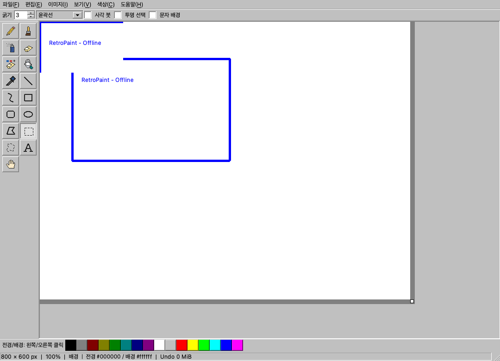

# RetroPaint 결함 수정과 도구 UI 작업계획

작성일: 2026-11-03 한국 시간. 기준: [전체 코드 검토](CODE_REVIEW.md)의 F01~F10, S01~S09와 현재 소스. 기존 보고서의 줄 번호는 아이콘 추가 전 기준이며, 아래에서는 함수 이름으로 작업 위치를 지정한다.

먼저 잘라내기와 복합 마우스 입력의 편집 손실을 막고, 선택·레이어 이력의 결과를 일치시킨다. 이어 확정·취소 경계를 정리한 뒤 이력 예산과 UI 응답성을 개선한다. 도구 아이콘과 결함 수정, 로컬 회귀 검사를 적용했다. 실제 변경과 검증 결과는 [구현 결과](IMPLEMENTATION_RESULTS.md)에 정리하며, 아래의 작업 순서와 계약을 기준으로 인수한다.

## 이번 작업에서 적용한 도구 아이콘

왼쪽 17개 도구를 2열 아이콘 버튼으로 변경했다. [JS Paint](https://jspaint.app/)의 클래식 도구 모음을 시각 참조하여 점선 선택, 기울어진 연필, 붓·스프레이·페인트통, 단순 도형 윤곽을 사용했다. 외부 아이콘 파일·Windows 리소스를 가져오지 않고 Qt QPainter로 직접 그렸다.

| 구분 | 적용 내용 |
| --- | --- |
| 표시 | 텍스트 버튼 → 아이콘만 표시하는 36×34 버튼, 아이콘 논리 크기 24×24 |
| 선명도 | DPR 1·2·3용 pixmap을 각각 렌더링해 QIcon에 보관 |
| 의미 | 연필, 붓, 스프레이, 지우개, 색 지우개, 채우기, 스포이트, 직선, 곡선, 사각형, 둥근 사각형, 타원, 다각형, 사각 선택, 자유 선택, 문자 A, 이동 손바닥 |
| 접근성 | 한국어 QAction 이름·툴팁·accessibleName 유지, 키보드 포커스와 기본 버튼 입력 유지 |
| 도구 연결 | 이름 배열 인덱스를 Tool로 캐스팅하던 연결을 명시적인 Tool·이름 대응표로 변경 |
| 선택 표시 | QAction data의 Tool 값으로 체크 상태 동기화. 배열 표시 순서와 도구 의미를 분리 |
| 의존성 | 기존 Qt Core/Gui/Widgets 사용. 추가 네트워크·SVG 플러그인·테마 아이콘 의존성 없음 |
| 코드 배치 | MainWindow의 도구 생성 루프 안에서 동기적으로 생성. 개별 도형·대입을 헬퍼 함수로 분리하지 않음 |

아이콘 교체 단계에서 Release 빌드, macOS ARM64 offscreen core/UI CTest 2개 그룹, 앱 `--smoke`와 화면 검토를 완료했다. 후속 전체 구현의 4개 그룹 검증은 [구현 결과](IMPLEMENTATION_RESULTS.md)를 따른다. 실제 Retina·Windows·고대비 테마 검증은 별도다. Qt action 매핑 개선으로 S02의 도구 모음 부분을 처리했지만, Canvas 내부의 도구 enum 범위 비교는 아직 남는다.

적용 화면은 아래와 같다. 검사 로그는 [CTest](evidence/icons-macos-ctest.log), [smoke](evidence/icons-macos-smoke.log), [17개 도구 클릭과 DPR 검사](evidence/icons-macos-tools.log)에 보관한다. 도구 클릭이 문서를 수정하지 않고 붙여넣기가 선택 도구의 체크 상태를 갱신하는 것도 확인했다. 클릭·DPR 검사는 별도 일회성 진단 프로그램으로 수행했으며 기본 CTest 사례 수에는 포함하지 않는다.

## 구현 전에 고정할 동작 계약

1. **일반 복사:** 선택이 없으면 보이는 합성 이미지를 복사한다. 선택이 있으면 현재 표시 크기의 선택 이미지를 복사한다.
2. **잘라내기:** 활성 레이어의 선택 픽셀을 복사하고 같은 픽셀을 삭제한다. 선택이 없으면 활성 레이어 전체 선택과 동일하게 동작한다. 합성 복사와 혼용하지 않는다.
3. **레이어 선택과 순서 변경:** 단순 활성 레이어 선택은 현재처럼 dirty·Undo를 만들지 않는다. 순서 변경은 구조 편집이므로 이름·픽셀이 같아도 이력에 남기고 전후 active를 복원한다.
4. **복합 버튼:** 제스처를 시작한 버튼이 끝날 때까지 다른 버튼으로 덮어쓰지 않는다. 진행 중 가운데 버튼은 무시하는 정책을 우선 적용한다. 기존 Esc·마우스 소유권 상실 취소는 유지한다.
5. **선택 변형:** 미리보기 크기와 복사·회전·확정 결과를 일치시킨다. 선택 원본은 드래그 중 보존해 반복 리샘플링 손실을 막는다.
6. **실패와 취소:** 파일 대화상자·편집 대화상자·종료 취소 또는 저장 실패는 문서 픽셀, revision, savedId, path, redo 분기, 미확정 편집을 보존한다. 명시적인 확정·Discard만 임시 상태를 폐기한다.
7. **파일과 자원 한도:** RPAINT01 형식, 허용 형식, 합계 픽셀 한도, QSaveFile의 직접 쓰기 fallback 금지를 유지한다. UI 단위 작업을 더 작은 헬퍼로 나누기 위해 새 계층을 만들지 않는다.

이 계약은 새 문서·열기·저장·내보내기·크기 변경·레이어 전환·닫기의 수명 주기를 함께 검토하는 기준이다. 메뉴마다 서로 다른 취소 의미를 도입하지 않는다.

## 작업 순서와 의존성

| 작업 | 대상 | 선행 조건 | 예상 규모 | 상태 |
| --- | --- | --- | --- | --- |
| W00 | 도구 아이콘, S02 일부 | 없음 | 작음 | 적용·검증 완료 |
| W01 | F02 복합 마우스 입력 | 없음 | 작음 | 코드 적용·로컬 검증 완료 |
| W02 | F07 잘라내기 대상 | 없음 | 작음 | 코드 적용·로컬 검증 완료 |
| W03 | F01·F06 선택 표현·표시 범위 | W02의 복사 계약 | 중간 | 코드 적용·로컬 검증 완료 |
| W04 | F03·S03 레이어 이력 | 없음 | 중간 | 코드 적용·로컬 검증 완료 |
| W05 | F04·F08·S01·S08 입력 전이·알림 | W01 | 중간 | 코드 적용·로컬 검증 완료 |
| W06 | F05·S04 확정·취소·저장 경계 | W03~W05 | 큼 | 코드 적용·로컬 검증 완료 |
| W07 | F09 이력 예산·컨테이너 | W04, W06의 이력 준비 계약 | 중간 | 코드 적용·로컬 검증 완료 |
| W08 | S02 잔여·S05, 문자·메뉴 UI | W03·W05·W06 | 중간 | 코드 적용·로컬 검증 완료 |
| W09 | S06·S07·S09 테스트·파서·CI | 작은 변경부터 착수 가능 | 중간 | 로컬 완료·원격 CI 미실행 |
| W10 | F10 성능 측정과 필요한 최적화 | W06·W07 | 측정 후 산정 | 코드 적용·로컬 검증 완료 |
| W11 | 주석·문서·플랫폼 인수 검사 | 각 작업 완료 때 병행 | 중간 | 문서 완료·네이티브 수동 인수 남음 |

작음은 대체로 반나절~1일, 중간은 1~3일, 큼은 3일 이상을 의미하는 상대 추정이다. 실제 소요는 실패 주입과 네이티브 플랫폼 검증에서 달라질 수 있으므로 확정 납기나 합산 일정으로 사용하지 않는다. 하나의 변경은 한 동작 계약과 그 회귀 테스트를 소유하도록 나눈다.

## W01 제스처를 시작한 버튼 보존

대상: `Canvas::mousePressEvent`, `mouseMoveEvent`, `mouseReleaseEvent`, `cancel`, `event`.

현재는 새 press가 start·dragging·panning을 덮어쓰고 어느 버튼의 release든 dragging을 끝낸다. 단순 bool 추가로 press만 막으면 다른 버튼 release에서 같은 문제가 남는다.

1. 제스처 소유 버튼을 Qt::MouseButton 값으로 기록하고 시작·종료·cancel에서 갱신한다.
2. dragging 중 추가 press와 소유하지 않은 release는 기존 제스처를 바꾸지 않고 처리한다.
3. pan과 stroke의 좌표 기준이 서로 다름을 유지한다. 중간 버튼 이벤트가 start를 바꾸지 않도록 한다.
4. Esc·UngrabMouse·WindowDeactivate는 후보와 타이머를 정리하고 버튼 소유권도 해제한다.

회귀 시험: 왼쪽 획 중 가운데·오른쪽 press/release, 오른쪽 획 중 왼쪽 입력, 일반 pan, spray 취소·소유권 상실, 다음 정상 획. 완료 조건은 원래 획이 해당 release에서 한 번 확정되거나 명시적으로 취소되고 잔여 타이머가 없는 것이다.

## W02 잘라내기와 클립보드 픽셀 일치

대상: `Canvas::copy`, `selectAll`, `liftSelection`, `removeSelection`.

일반 복사와 잘라내기의 선택 없는 분기를 분리한다. 잘라내기는 활성 레이어 선택을 먼저 준비한 뒤 그 선택의 픽셀을 복사하고 삭제한다. 삭제 후보와 클립보드 이미지를 모두 준비하기 전에 문서를 바꾸지 않는다. OS 클립보드 전송은 QSaveFile과 같은 원자적 외부 트랜잭션이 아니므로, 실패 시험에서 보장할 범위를 명시한다.

시험 조합은 단층/다층, 위·아래 활성 레이어, 숨김, 반투명, 자유 선택, 선택 없음이다. 빨강 아래 레이어·파랑 위 레이어에서 아래를 cut하면 클립보드는 빨강이고 위 레이어는 그대로여야 한다. Undo로 삭제 픽셀을 복원하고 일반 copy의 합성 이미지 계약은 유지한다. 잘라내기 오류 수정에 별도의 합성 복사 메뉴 추가를 묶을 필요는 없다.

## W03 선택 이미지와 표시 사각형 통일

대상: `Canvas::copy`, `transformSelection`, `settle`, `crop`, `refresh`, 마우스·방향키 선택 이동.

선택은 원본 이미지와 표시 사각형을 함께 유지하되, 복사·변형·확정이 소비하는 유효 이미지는 현재 사각형 크기로 정의한다. 여러 소비자가 실제로 같은 의미를 사용하므로, 필요하다면 “표시 크기의 선택 이미지 생성” 연산 하나만 공유한다. 드래그 좌표 대입·update 호출은 기존 함수 안에 둔다.

1. 목표 크기·픽셀 한도를 먼저 검증하고 후보 이미지가 성공한 후에만 선택 상태를 교체한다.
2. 회전·반전은 현재 표시 크기를 먼저 반영한 후보를 변형한다. transform 실패 시 원본 선택·rect·modified를 유지한다.
3. copy와 cut은 유효 선택 이미지를 전달하고, paste→resize→copy→paste의 픽셀이 같도록 한다.
4. 선택 이동·크기 조절·zoom 이후 문서와 양의 선택 범위의 합집합으로 위젯·스크롤 범위를 갱신한다.
5. 작은 화면에서도 선택 핸들이 보이도록 그리며, 음수 좌표 내용의 확정 시 잘림 계약은 유지한다. viewport 자동 스크롤은 이 수정 뒤 별도 UX 변경으로 둘 수 있다.

회귀 시험: 20×20→30×25→copy는 30×25, rotate 90은 25×30; 반투명·자유 선택 경계; 화면 밖 이동 후 스크롤 접근; 축소 후 확대의 후보 보존; 한도 초과 변형 후 선택 유지; unchanged selection의 dirty 불변. F06 해결을 위해 commit 전에 캔버스 자체를 늘리는 부작용을 넣지 않는다.

## W04 레이어 순서 변경을 구조 이력으로 기록

대상: `Document::commit`, `apply`, MainWindow 레이어 순서 변경 콜백.

active만 이력에 추가하면 픽셀이 동일한 두 레이어의 reorder는 여전히 no-op으로 빠진다. 따라서 명시적인 레이어 순서 변경을 구조 편집으로 지정할 수 있어야 한다.

기존 commit의 기본 동작은 유지하면서 이름 있는 구조 변경 모드 또는 동등한 작은 인터페이스를 추가한다. reorder 호출만 이를 명시하고, 구조 이력의 before/after State로 픽셀·순서·active를 함께 복원한다. 단순 setActive는 기존 비이력 UI 동작을 유지한다. 이 수정에 영속적인 layer ID나 RPAINT02를 도입하지 않는다.

회귀 시험: 같은 이름·같은 visible·다른 픽셀, 이름·visible·픽셀까지 동일한 레이어, 맨 위·아래 경계, reorder→Undo→다른 편집→Redo 분기 제거, 저장 후 Undo/Redo dirty 판정. 일반 픽셀 이력의 메모리 장점을 유지하는지도 확인한다.

## W05 편집 전이 알림과 마지막 입력 일치

대상: `Canvas::beginText`, 다각형·곡선·획 시작/끝, `mouseReleaseEvent`, `MainWindow::sync`, `canvas.h`.

pending이 false→true 또는 true→false가 되는 시점에 한 번 알린다. 모든 mouseMove에 changed를 보내 전체 레이어 목록을 재생성하지 않는다. 텍스트 입력의 앱 취소와 QTextEdit 내부 Undo는 별도 의미로 유지한다.

release에서는 위치가 같아도 마지막 modifier를 적용한다. W01의 소유 버튼 판정을 먼저 수행하고, pan·free-select·선택 크기 조절에서 끝점을 중복 추가하지 않도록 분기별로 검증한다. 관련 변경 중 `settle`의 항상 true 반환을 void로 바꾸고, textEditor를 정확한 QTextEdit 포인터로 정리한다. 이미 공개된 옵션 전부에 setter를 만드는 정리는 피한다.

회귀 시험: 깨끗한 문서의 획·문자·곡선·다각형 시작에서 앱 취소 메뉴 활성화; 취소 뒤 비활성화; 기존 Undo 이력의 메뉴 문구; 동일 위치 Shift press/release; 제약 이동 후 Shift 해제 release; 연속 획에 이전 modifier가 남지 않음.

## W06 저장과 대화상자의 취소 경계

대상: `Canvas::settle`의 후보 생성 부분, `Document::commit`의 준비·설치 경계, `MainWindow::save`, `maybeSave`, `openFile`, `changeSize`, `closeEvent`, 내보내기와 오류 처리.

가장 위험한 변경이다. settle을 대화상자 뒤로 옮기면 취소 문제 일부는 줄지만, 쓰기 실패 전에 pending이 확정되는 문제와 파일 저장 성공 후 commit 메모리 실패 문제는 남는다. 파일 성공과 문서 성공의 순서를 설계한 뒤 구현한다.

### 후보와 확정의 분리

Canvas는 임시 상태를 폐기하지 않고 저장·편집에 사용할 후보 State를 생성할 수 있어야 한다. 문서 합성·검증 실패는 기존 pending을 그대로 남긴다. 이 연산은 저장·내보내기·크기 변경에서 반복하는 실제 편집 의미이므로 작은 공유 연산으로 분리할 근거가 있다.

Document는 후보 검증, patch·label 준비, 이력 공간 예약 등 실패 가능한 작업과 최종 상태 설치를 분리하는 방식을 검토한다. 필요할 경우 준비된 변경을 소유하는 작은 내부 값 타입을 둔다. 범용 트랜잭션 서비스·명령 버스는 만들지 않는다.

저장 성공 후 설치 단계에는 새 메모리 할당이 없어야 한다. Qt/C++ 컨테이너 이동·이력 삭제·saved path 교체의 예외 보장을 확인하고, 그 보장이 서지 않으면 “파일 쓰기 후 install” 순서를 사용하지 않는다. 단순 noexcept 표기만으로 실패를 해결한 것으로 간주하지 않는다.

### 명령별 처리 순서

| 명령 | 순서와 취소 의미 |
| --- | --- |
| 저장 | 경로 선택 → pending 후보 생성·검증 → worker의 임시 파일 준비 → 이력·최종 path 준비 → QSaveFile 최종 commit → 준비 상태 설치·savedId 갱신 → pending 정리 → UI 갱신 |
| 다른 이름 저장 | 저장과 같음. 경로·overwrite 취소 시 path·pending 불변 |
| 이미지 내보내기 | pending을 포함한 후보를 쓸 수 있으나 문서 revision·savedId·pending은 유지. 결과가 성공해도 프로젝트를 저장 완료로 표시하지 않음 |
| 크기 변경 | 대화상자 취소 시 pending 유지. 수락 시 pending과 resize를 한 후보로 검증하고 성공 후 한 편집으로 확정하는 방향을 검토 |
| 새 그림·열기 | 현재 dirty 또는 변경이 있는 pending을 고려해 저장 여부 질문. Cancel은 pending 유지. Discard 뒤에만 교체. 열 파일 파싱은 기존처럼 교체 전에 완료 |
| 닫기 | 질문·저장 실패/취소는 창·pending 유지. 성공 또는 명시적인 Discard 후 종료 |

단순한 원본 선택처럼 픽셀이 바뀌지 않는 pending은 불필요한 저장 질문·dirty를 만들지 않도록 후보 비교 결과를 사용한다. 후보를 만드는 것과 후보를 확정하는 것을 구분한다.

실패 시 복구 정책은 메뉴/마우스 이벤트 진입점에 관계없이 동일하게 적용한다. run()의 예외 경계는 실패한 작업이 소유한 제스처만 정리하고, 무관한 선택·텍스트를 전역 cancel로 폐기하지 않도록 한다. 이미 저장에 성공한 뒤 화면 refresh만 실패한 경우는 “파일 저장 실패”와 구별한다.

### 반드시 필요한 실패 시험

선택·문자·곡선·다각형 각각에서 저장 경로 취소, overwrite 거절, 크기 대화상자 취소, 닫기 Cancel, maybeSave→Save→저장 취소를 시험한다. 파일 open·encode·write·commit 실패, 이력 준비 실패를 주입하고 픽셀·revision·savedId·path·Undo/Redo·pending을 함께 비교한다. 동기식 쓰기의 중간 실패에는 사용자 전역 상태를 바꾸는 방식보다 테스트 전용 QIODevice/쓰기 경계 주입을 우선한다.

## W07 이력 예산과 컨테이너 비용

대상: `Document::commit`, `setHistoryBudget`, history 보관 구조와 core/perf 테스트.

reserve는 redo 삭제 전에 수행하는 기존 불변식을 지키면서 기하급수적으로 늘린다. 이력 이미지 바이트와 실제 메모리가 다르므로, 기존 historyBytes 표시의 의미를 갑자기 바꾸지 않고 항목 수 상한 또는 메타데이터 추정 예산을 추가한다. 최초 항목 수 상한은 대표 스트로크 측정 후 정하고 문서에 기록한다.

예산을 낮출 때 기존 이력을 즉시 줄이는 정책을 적용하려면 cursor가 과거 상태에 있을 때의 Undo/Redo 가지치기를 명시한다. 현재 상태 픽셀과 savedId는 바꾸지 않는다. 최신 구조 항목 한 개를 남기는 기존 규칙은 유지하고, 큰 항목 하나가 한도를 넘길 수 있음을 UI/문서에 표시한다.

시험은 1픽셀 수천~수만 회, 큰 구조 변경, Undo 중 예산 축소, redo 이후 분기, 예산 0, 마지막 항목 예외, 저장 revision 복귀다. vector 앞 삭제가 측정에서 병목일 때만 offset/주기적 압축 또는 deque로 바꾼다.

## W08 UI 갱신과 도구 코드 정리

대상: `MainWindow::sync`, 레이어 콜백, 도구 선택·표시 분기, 문자 편집기.

레이어 수·순서·이름이 바뀌지 않았을 때 QListWidget을 clear하지 않고 필요한 체크·선택 값만 갱신한다. 재구성이 필요할 때도 signal blocker를 유지하고, 동기 콜백이 보관한 item 포인터를 무효화하지 않는 순서를 적용한다. 기존 R09에서 UAF가 확인된 것은 아니므로 충돌 수정으로 과장하지 않는다.

도구 enum 범위 비교는 명시적인 switch로 바꾸되, 동일한 분류가 여러 곳에서 공유될 때만 의미 있는 분류 연산을 고려한다. W00의 대응표를 단일 책임의 아이콘·이름 매핑으로 유지하고, 도구마다 위젯 클래스나 factory를 만들지 않는다.

문자 preview와 commit은 margin·폭·높이 clip·배경을 맞춘다. 입력 영역을 넘는 내용은 잘림/영역 확대 중 정책을 정하고 화면에서 예측할 수 있게 한다. 줌 25/100/400%, 긴 줄·한글 줄바꿈·배경 on/off, font 변경과 Undo를 시험한다. IME preedit는 offscreen commit 이벤트와 별도로 수동 검증한다.

선택 없는 crop/delete, 마지막 레이어 delete, 경계 reorder, 숨긴 레이어 merge는 상태에 맞춰 비활성화한다. 프로젝트가 필요한 저장에서 PNG를 먼저 선택하게 한 뒤 거절하는 흐름도 사전에 안내하도록 개선한다.

## W09 파서와 검증 기반 보강

- **S06:** 구형 예외 검사 매크로 14곳을 최소 Qt 6.4에서 지원되는 형태로 변경한다. 테스트 대상에도 경고 옵션을 적용하고 포맷 검사 도구 버전을 고정한다. 기존 제품 코드의 대량 재포맷과 섞지 않는다.
- **S07:** 공통 앱 smoke를 등록하되 Linux의 offline smoke와 중복 실행 정책을 정한다. core·UI·offline_ui의 복구 파일 경로를 실행별로 격리하거나 해당 UI 테스트에 resource lock을 적용한다. guard selftest는 예상 종료 코드와 메시지를 확인한다. CI는 결과 로그를 남기고 게시·배포하지 않는다.
- **S09:** UTF-8 오류 거부는 파일 해석 정책 변경이다. writer가 만드는 정상 파일은 계속 읽고, 기존의 잘못된 이름 파일을 거부할지 경고·보존할지 명시한 뒤 적용한다. QString 길이·UTF-8 바이트 길이와 디코딩 전 검사를 유지한다.
- **입력 표본:** 잘린 각 레코드, visible 2, PNG length 0/초과/남은 길이 초과, 잘못된 내부 이미지, 레이어 크기 불일치, 합계 픽셀 경계, EXIF 회전, GIF 첫 프레임을 관찰 가능한 결과로 검증한다.

최소 Qt와 CI 고정 Qt에서 새 API 사용 가능 여부를 실제 빌드로 확인한다. 네트워크 guard는 테스트 전용이고, 제품에는 네트워크 라이브러리를 추가하지 않는다.

## W10 성능 측정과 선택적 비동기화

먼저 1080p·4096×4096·허용 범위 내 여러 레이어, 짧은 획 반복·긴 대각선·도형 드래그·Undo/Redo·프로젝트 입출력·자동 복구를 측정한다. 워밍업 뒤 여러 번 실행해 중앙값·상위 지연·최대 RSS와 환경을 기록한다. 대용량 측정은 메모리 여유를 확인한 뒤 순차 실행한다.

비교 기준은 작업 전후의 동일 환경이다. UI 점유가 반복해서 100ms를 넘는 경우를 조사 시작 기준으로 삼되, 제품의 확정 성능 보장으로 표현하지 않는다. 먼저 변경 영역 힌트, 도형 overlay 미리보기, 불필요한 합성·복사를 줄이고, 전체 비교 fallback을 유지한다.

저장 worker가 필요하면 불변 State snapshot과 저장 당시 revision을 사용한다. 완료 뒤 다른 revision이면 현재 문서를 clean으로 만들지 않는다. 수동 저장과 복구 쓰기를 같은 목적 경로에 동시 실행하지 않고, 닫기·취소·worker 예외·중복 저장 수명을 관리한다. 비동기화는 W06의 동기식 실패 보존이 검증된 뒤 별도 변경으로 진행한다. 타일 엔진 도입은 측정과 요구사항이 뒷받침될 때 다시 결정한다.

## W11 주석 문서와 플랫폼 인수

삭제할 대상은 완료된 임시 지시·중복 설명이며, redo 선예약·투명 선택·소유권 상실·사전 파싱·복구 보관의 이유 주석은 유지한다. “작업 전체가 transactional”이라는 과한 설명은 실제 확정 경계에 맞춘다. 저장·내보내기 정책 변경은 README와 ARCHITECTURE에, 새 검증은 날짜와 플랫폼을 분리해 VERIFICATION에 기록한다.

복구 삭제·보관 rename 실패, 앱 데이터 폴더 생성 실패는 현재 일부 결과가 무시되거나 일반 메시지로 합쳐진다. 실패 상태를 표시하고 오래된 복구본이 다음 실행에 다시 제시되는 경우를 시험한다. 복구 사본을 보존해야 하는 오류와 새 작업의 자동 복구를 계속할 수 있는 오류를 구분한다.

플랫폼 인수 항목은 macOS ARM64/Intel·Windows에서 파일 대화상자, 시스템 클립보드, Command/Ctrl 단축키, IME 조합 중 저장·도구 변경·종료, Retina·다중 모니터, 장시간 편집, 디스크 부족·권한 변경·강제 종료 복구다. Linux guard·offscreen 결과를 해당 항목의 완료 증거로 사용하지 않는다.

## 변경별 검증과 완료 판정

| 변경 영역 | 필수 검사 |
| --- | --- |
| 모든 제품 코드 | 해당 회귀 사례, 경고 빌드, 포맷, diff whitespace |
| Document·이력·파일 | 전체 CTest, 실패·취소 상태 비교, 관련 sanitizer 검사 |
| Canvas·MainWindow | 전체 offscreen UI, 앱 smoke, 변경 화면 직접 검토 |
| 아이콘 | 모든 도구 표시·선택 확인, 툴팁·접근성 이름, 1배/고배율 렌더링 확인 |
| parser | 정상 round-trip, 손상·위조·경계 입력, 기존 문서 불변 |
| 비동기 저장 | revision 경합·중복 저장·종료·취소·예외 수명 시험 |
| 문서 | 이슈→작업→시험 연결, 완료·미완료·플랫폼 한계 구분 |

새 시험은 결과 픽셀·파일 내용·상태 보존·메뉴 동작을 확인한다. 단순 setter 호출 결과나 구현 내부 조건을 그대로 반복하는 시험은 추가하지 않는다. 이미 통과한 전체 검사를 이유 없이 반복하지 않고 새 변경·실패·미해결 위험에 맞춰 실행한다.

제품 코드와 macOS offscreen 검증의 완료 상태는 [구현 결과](IMPLEMENTATION_RESULTS.md)를 따른다. Windows·Intel Mac·네이티브 IME·Retina·실제 디스크 고갈 등 수동 인수는 완료로 표시하지 않는다.
