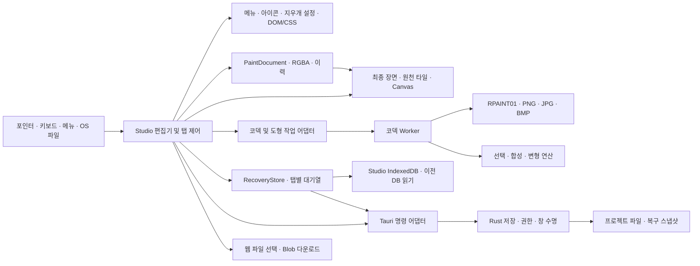

# myPaint Studio 코드베이스 재감사

2026-11-15 · `codex/studio-recovery` · 기준 커밋 `48e40587524d5b3defe2668828e517667448184e`와 기존 미커밋 복구·탭 변경을 함께 검토했다. 이번 작업은 보고서와 단계별 작업 계획을 작성했다. 픽셀·저장·UI 구현, 커밋, 배포는 기존 상태를 기준으로 한다.

myPaint는 로컬에서 그림을 편집하고 프로젝트 또는 이미지로 저장하기 위해 시작한 그림판이다. 초기 C++/Qt 앱과 WebAssembly 편집 경로는 TypeScript Studio로 이어졌다. 현재 웹과 데스크톱이 DOM/CSS 편집기와 Canvas 2D 렌더러를 공유한다. Windows/macOS의 설치형 앱은 Rust/Tauri가 파일 선택기·파일시스템·창 수명을 맡는다. Classic 98은 CSS 외관이다. Qt의 CMake·앱 실행 경로는 제거됐고, 비교용 픽셀 fixture와 이전 사용자 복구 데이터의 읽기 경계는 남아 있다. GPUI는 기술 비교 단계에 머물렀으며 이번 Windows 패키지는 Tauri 계열이다. [작업 연혁](PROJECT_HISTORY.md) · [현재 검증](CURRENT_STATUS.md)

## 모듈 경계와 의존성

| 영역 | 소유 상태와 결합 지점 |
| --- | --- |
| 입력·편집·화면 | `Studio`가 이벤트, 작업 취소, 선택·문자·다각형 후보, 카메라, 활성 탭, 복구 대기열, DOM과 그리기를 함께 관리한다. 현재 문서·복구 키·이름·카메라를 `DocumentTab`과 `Studio` 필드가 나눠 가진다. 빠른 전환과 실패 시 양쪽값, DOM, Rust 활성 키의 일치가 중요하다. [편집기 부록](audit/EDITOR.md) |
| 픽셀·이력 | `PaintDocument`가 권위 RGBA, 레이어, 이력 cursor, revision·저장 revision과 제한 예산을 소유한다. 미확정 후보·렌더 캐시는 이 픽셀에서 파생된다. 동일한 유효 픽셀 결과와 저장 상태 판정은 별도 보존 조건이다. [엔진 부록](audit/ENGINE_AND_RENDER.md) |
| 작업·렌더링 | Worker 작업은 취소 가능한 후보를 만들고 UI가 적용 시점의 소유권을 확인한다. 타일 캐시가 원천 RGBA와 최종 화면의 수명을 각각 관리한다. [엔진 부록](audit/ENGINE_AND_RENDER.md) |
| 저장·권한 | TS 복구/네이티브 어댑터는 키·generation·임시 선택 티켓을 넘긴다. Rust가 파일 선택 및 읽기·쓰기 권한, 탭 바인딩, 외부 수정 감지와 원자 교체를 소유한다. 웹 IndexedDB는 Studio 신규 저장소와 이전 읽기 전용 경로를 분리한다. [저장 부록](audit/PERSISTENCE.md) |
| 배포·검증 | Vite/TS 빌드는 같은 편집기를 정적 페이지와 Tauri에 공급한다. Python은 검증한 manifest를 후보 경로에 준비하고 사이트 디렉터리를 교체한다. fixture, 플랫폼 smoke와 자동 브라우저 검사는 서로 다른 경계를 확인한다. [검증·배포 부록](audit/VERIFICATION_AND_DELIVERY.md) |

프로덕션 TypeScript 15개 파일에서 AST로 확인한 내부 의존성 31개를 조사했다. 실행 의존성 순환은 발견되지 않았다. `codec.ts`와 Worker, `main.ts`와 동적 `native-smoke.ts`는 역방향 타입 의존성이 있어 전체 소스 그래프에서만 순환이 생긴다. 의존성의 우선 위험은 `Studio` 내부 필드 의존, 문서 활성화 순서, Worker 계약 분산이다. 네이티브 `lifecycle.rs`의 macOS 콜백이 `request_close`를 호출하는 것은 창 종료의 역호출 경계다. [편집기 부록](audit/EDITOR.md) · [엔진 부록](audit/ENGINE_AND_RENDER.md) · [저장 부록](audit/PERSISTENCE.md)

## 핵심 실행 경로와 실패 시 유지할 상태

| 경로 | 흐름과 검증할 불변식 |
| --- | --- |
| 포인터·단축키 편집 | 입력 소유권 → 획 또는 선택·문자 후보 → 히스토리 발행 → dirty 타일 무효화 → 다음 rAF 렌더. 실패나 취소 시 픽셀, 활성 레이어, 이전 Redo와 저장 revision을 함께 비교한다. |
| 파일 열기·변형 | 선택/클립보드 → 형식·크기 사전 검사 → 디코드/작업 → 문서·revision·epoch 등 적용 조건 재검사 → 같은 탭 후보 또는 새 탭 발행. 취소한 결과와 다른 문서의 지연 응답은 폐기하고 작업 자원을 정리한다. |
| 탭 전환·닫기·종료 | 현재 문서 작업 상태 → 다음 탭과 종료 의도 확인 → Rust 활성 세대 전환 → UI 후보 반영과 탭 소유권 갱신 → 이전 탭 복구 예약·닫힌 바인딩 제거. 일반 전환 성공 시 편집이 확정된다. 닫기·종료 취소는 이전 탭 및 활성 탭의 후보·Redo를 보존해야 한다. |
| 프로젝트 저장·내보내기 | 대상 탭의 revision 후보 → 인코딩 → 웹 다운로드 또는 네이티브 티켓 → 파일 정체성·세대 재검사 → 원자 교체 → 소유자의 저장 상태 갱신. 같은 이름, 외부 수정, 지연 쓰기, 닫힌 탭과 별칭 파일을 확인한다. |
| 복구 | 탭 키·revision의 후보 → 직렬 저장 → 브라우저 DB 또는 네이티브 `.rprec` → 다음 시작의 목록·선택·형식 검증 → 새 탭 및 legacy 복제. 목록 일부 실패, stale 토큰, 손상·읽기 권한 제한, 재시도 시 기록을 보존한다. |
| 정적 배포 | 빌드 출력 → 경로·용량·hash·HTML 검증 → lock 아래 후보 설치 → 동일 디렉터리에서 교체 및 실패 복원. 이전 정상 사이트가 부분 파일·stale lock으로 손상되지 않는지 확인한다. |

## 우선순위와 비용

P0은 사용자의 기존 영구 파일에 손상이 발생할 수 있는 경로, P1은 편집/Redo 또는 활성화 일관성, P2는 응답성·작업 가용성·계약 검증, P3은 정리와 유지보수다. S는 국소 수정과 집중 검증, M은 인접 호출자와 회귀, L은 다중 상태 소유자·플랫폼을 함께 변경하고 검증하는 상대 비용이다. Windows 앱, Windows Chrome, 모델·실패 주입, 코드 추론을 구분했다.

| 우선순위 · 비용 | 발견 및 수정 범위 | 근거 |
| --- | --- | --- |
| P0 · M | 현재 보호가 활성 탭 경로에 국한돼 있어 비활성 탭에 연결된 프로젝트를 이미지 내보내기 대상으로 고르면 원자 교체까지 진행될 후보가 남는다. 선택 직후와 교체 직전 모두 열린 바인딩의 경로 및 파일 정체성을 비교하고 Save As와 일반 내보내기를 검증한다. | 저장 경로 코드 추적. [저장 부록](audit/PERSISTENCE.md) |
| P1 · L | 수정된 비활성 탭을 닫으려다가 취소하면 활성 탭의 텍스트 편집이 의도와 다르게 확정되고 Redo가 소실된다. 대상 탭에 속한 닫기 확인과 후보 전환을 분리한다. 전체 종료도 여러 탭을 순회한 뒤 취소하는 경우를 검증한다. | 현재 Chromium 번들에서 탭 닫기 및 종료 취소를 확인했다. 종료에서는 네이티브 IPC 대역을 사용했다. [E1](audit/EDITOR.md#우선순위) · [검증·배포 부록](audit/VERIFICATION_AND_DELIVERY.md) |
| P1 · M | 픽셀 패치 처리와 Undo의 두 번째 행 작업에서 예외를 주입하자 일부 행만 적용됐다. 패치 적용의 Redo도 사라졌다. 후보 준비에서 실패할 수 있는 할당·view 작성과 경계 검증을 완료한 뒤 발행한다. | Windows Node 실패 주입. [엔진 부록](audit/ENGINE_AND_RENDER.md#우선순위) |
| P1 · L | Rust 활성화가 성공한 이후 JS 후보 검증 실패에 이르는 순서가 가능하다. 인증된 소유권과 후보를 미리 확정하고 결과 적용 실패를 재현해 복원 경로를 검증한다. | 조건부 코드 경로. [E2](audit/EDITOR.md#우선순위) |
| P2 · S–M | 레이어 이름 선두 U+FEFF가 저장 후 열기에서 빠진다. 마지막 타일 yield 중 취소된 디코더는 결과를 반환할 수 있으며 UI가 별도로 가드한다. 유효한 비정렬 RGBA view에 대한 검증과 연산의 가정도 다르다. | 저장 round-trip과 집중 Node 모델. [엔진 부록](audit/ENGINE_AND_RENDER.md#우선순위) |
| P2 · M | Rust 복구 목록 실패가 브라우저 저장소 조회까지 막는다. 작업 대상이 먼저 닫히거나 동시에 새 목록이 열리는 경우도 확인할 필요가 있다. 이미 읽을 수 있는 복구 항목은 유지하고 실패 원천과 가능한 재시도를 표시한다. | 복구 어댑터 모델 및 코드 추적. [저장 부록](audit/PERSISTENCE.md) |
| P2 · M | 키보드 탭 전환 후 포커스가 사라지고 진행 중인 Worker 취소 버튼의 Enter·Space가 막힌다. 준비한 웹 다운로드도 탭 전환으로 사라진다. | 현재 Chromium 번들에서 개별 재현. [E3–E5](audit/EDITOR.md#우선순위) |
| P2 · M–L | 탭 단위 픽셀 예산 후에 이력·Worker 복제·인코딩·캐시가 더해진다. JPEG 헤더, 자유 선택점, stage 검증의 총 처리량 한도가 각각 부족한 곳이 있다. 유효 입력을 기준으로 예산을 재고 취소와 회수를 먼저 강화한다. | 할당 순서·용량 계산과 합성 입력 실험. [엔진 부록](audit/ENGINE_AND_RENDER.md) · [검증·배포 부록](audit/VERIFICATION_AND_DELIVERY.md) |
| P2 · M | 로컬 stage의 Windows junction 확인이 빠져 있고 HTML 검증의 자원 범위가 제한적이다. 빌드 artifact 손상 방어와 로컬 전용 실행 정책의 검증 범위를 각각 강화한다. | 격리 fixture로 재현. [검증·배포 부록](audit/VERIFICATION_AND_DELIVERY.md) |
| P2 · M–L | 브라우저 테스트는 예전 UI 선택자와 픽셀·준비·타이밍 실패를 함께 포함한다. 단위·네이티브 smoke 성공은 전체 브라우저 회귀 통과를 보장하지 않는다. 재현 분류와 회귀 복구를 첫 단계에서 병행한다. | Chrome 독립 테스트·소스 대조. [검증·배포 부록](audit/VERIFICATION_AND_DELIVERY.md) |
| P3 · S–M | 소비자 없는 CSS·복구 메서드, 반복된 상태 소유권 검사·알파 계산, fixture 재생 문서의 삭제 경로, 겹치는 테스트 도우미가 보인다. 운영 호환 읽기와 독립 픽셀 oracle은 보존한다. | 각 소스와 부록의 사용처·주석 검토. [편집기](audit/EDITOR.md) · [엔진](audit/ENGINE_AND_RENDER.md) · [저장](audit/PERSISTENCE.md) · [검증·배포](audit/VERIFICATION_AND_DELIVERY.md) |

## 호환성 보존 순서와 작업 영역

각 변경을 자체 관찰 테스트와 묶는다. UI에 보이는 의도된 취소·오류 교정과 사용자 흐름 개선은 사람이 재현할 수 있는 사례를 남긴다. 실패 빈도가 낮더라도 후보와 커밋 경계는 실제 저장·재편집·재시도로 확인한다.

| 단계 | 소유 코드 및 작업 | 인수·복귀 기준 |
| --- | --- | --- |
| 0. 기준 고정 | `tests/`, `src/engine/format.ts`, `src/platform`, Rust persistence. `.rpaint` 기존 바이트 fixture, 파일 이름/UTF-8/CRC, PNG 투명 RGB와 기존 디코더 허용 범위, JPG/BMP 배경색, 명령명과 복구 DB·envelope 키, 이전 복구 읽기, 키보드·포인터·저장 의미를 기준으로 기록한다. | 양방향으로 기존 파일을 읽고 같은 픽셀·레이어와 호환 가능한 바이트를 확인한다. Linux·웹·네이티브 결과를 환경별로 별도 기록한다. 첫 실패 이후 테스트가 숨는 경우 개별 실행과 첫 실패 로그를 남긴다. |
| 1. 데이터 안전 | `src-tauri/src/persistence.rs`, `src/main.ts`의 닫기/종료, `src/engine/document.ts` 발행을 각각 작업한다. 열린 문서 바인딩 보호 → 취소 후 모든 관련 탭 상태 보존 → 없는 취소/예외 가드 추가 순서다. | 유효한 기존 저장은 유지한다. 동일 경로/별칭, 세대가 지난 티켓, 지연 완료, 여러 탭 중간 실패, 실패 주입과 재시도에서 파일·픽셀·Redo·저장 ID·활성 키가 일치한다. 한 변경씩 되돌려도 저장 형식과 기존 사본이 유지된다. |
| 2. 상태 소유권 정리 | `src/main.ts`에 탭 또는 문서 단위 작업 식별자를 만들고 `captureTab`/`activateTab` 필드 중복을 제거한다. 전환 대상과 닫기 의도는 탭 제어가 소유한다. `PaintDocument` 후보 발행과 네이티브의 경로·세대 소유권은 유지한다. | 활성·비활성 clean/dirty/새 탭, 브라우저·네이티브, 저장·취소·실패 후 앱을 다시 사용한다. 대상 문서에서만 revision과 recovery가 변경되는지 비교한다. |
| 3. 책임과 성능 | 툴별 입력 세션, 장면 작업, 작업별 코덱 메시지와 저장소 I/O를 실제 상태·자원 수명에서 나눈다. 픽셀/알파 수식과 타일 좌표 규칙은 fixture 동등성을 확보한 뒤 공유한다. 읽기·디코딩의 사전 비용, 할당과 타이머를 측정하며 작은 경계부터 수정한다. | 픽셀 fixture, 실제 WebView 장면, 취소 이후 Worker/Canvas/Blob 회수, 분수 DPR, cold/dirty 프레임 p95와 메모리를 기존 조건에서 비교한다. 내부 이동 자체는 파일·메뉴·테마·오류 계약 변경과 분리한다. |
| 4. UX·도구·문서 | 탭/레이어 키보드 포커스, 이름 있는 대화상자, 취소 버튼 도달, 탭별 다운로드, 복구 재시도와 좁은 화면을 적용한다. 사용처 확인된 dead code·기한 지난 주석과 fixture/인수 링크를 정비한다. Python stage 범위와 CI 실패 분류를 강화한다. | 두 테마, 실제 OS 파일 선택기, 한글 IME, 펜·터치·HiDPI, 작은 화면·오류 복구를 검수한다. 스테이징 실패 시 이전 사이트가 열리고 빌드 결과 hash를 재현한다. |

UI 시작은 탭·레이어에서 포커스를 유지하고, 모달의 일반 입력과 데이터 손실 경고를 별개의 키 동작으로 확인하는 작업이 적합하다. 취소 가능 상태에서는 버튼을 키보드로 조작할 수 있어야 하고, 파일을 받기 대기 중이라면 원래 탭으로 돌아왔을 때 이어갈 수 있어야 한다. 복구 화면은 읽을 수 있는 항목, 실패한 항목, 재시도 가능한 동작을 표시한다. 저장 이름이 같거나 외부 변경을 발견한 경우 기존 파일을 보존한 상태에서 현재 선택 가능한 조작을 제공한다. 모바일 좁은 화면은 잘린 저장 버튼과 두 줄 이상 도구 모음의 실제 캔버스 여유를 확인한다. [편집기 부록](audit/EDITOR.md) · [저장 부록](audit/PERSISTENCE.md)

## 검토 및 검증 범위

현재 런타임 소스는 편집기·UI, 엔진·코덱·렌더, Rust/Tauri·저장 세 부록에서 함수군과 호출자를 추적했다. 테스트와 빌드·staging·CI·fixture·문서 및 라이선스는 별도 부록에서 각 검사 범위, 재현 결과 및 공백을 기록했다. 일반 Chrome, 네이티브 모형, 실제 Windows WebView2 결과의 범위는 부록에서 구분한다. 설치 마법사 전체, macOS, 실기기 입력과 전체 Windows MSVC Clippy는 추가 검증 대상이다. [검증·배포 부록](audit/VERIFICATION_AND_DELIVERY.md)
