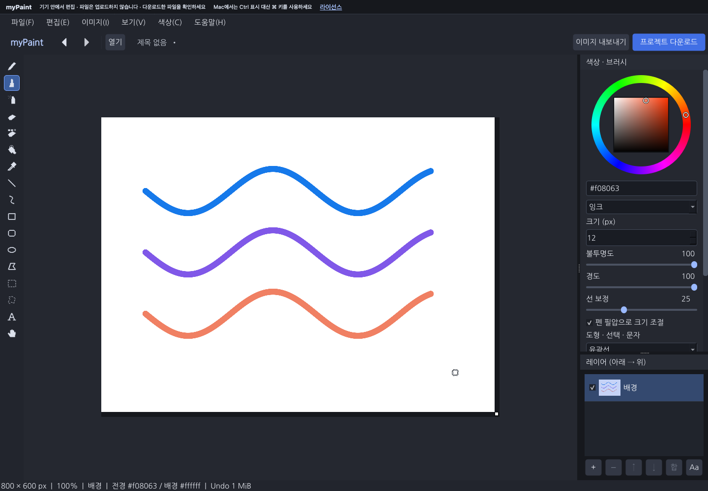

# 공통 드로잉 화면과 브러시 개선

2026-11-04. 사용자 선택에 따라 웹과 데스크톱을 함께 개선했다. 기존 Qt Widgets 편집 경로와 `.rpaint` 형식을 유지했다.

## 적용한 내용

Magma의 어두운 작업 공간, 왼쪽 도구, 중앙 종이, 오른쪽 색상/브러시·레이어 구성을 참고했다. 해당 서비스의 그림·사용자 정보·자산은 가져오지 않았다. 기존 벡터 도구 아이콘을 어두운 배경에 맞춰 표시하고, 상단에 열기·Undo/Redo·내보내기·프로젝트 저장을 배치했다. 웹의 마지막 버튼은 다운로드 준비 기능이다.

색상환과 명도/채도 사각형, HEX 입력, 잉크·부드러운 붓·픽셀 연필 프리셋을 추가했다. 잘못된 HEX는 마지막 유효한 색으로 복원한다. 크기 1~100px, 불투명도 1~100%, 경도 0~100, 선 보정 0~75를 조절할 수 있다. 연필/사각 브러시/스프레이/색 지우개는 기존 픽셀 도구 동작을 유지한다. 불투명도·경도·선 보정은 둥근 브러시와 일반 지우개에 적용된다. 오른쪽 패널은 공간이 부족하면 스크롤하며, 레이어 패널은 기본 표시하고 미리보기를 제공한다.

둥근 브러시는 소수 좌표, 짧은 곡선 보간, 간격 보간과 경계 혼합을 사용한다. 선 보정이 높으면 흔들림은 줄지만 포인터를 늦게 따라온다. 같은 획이 겹쳐도 설정 불투명도가 계속 진해지지 않도록 획별 마스크를 사용한다. 펜 필압은 크기에 적용하며 체크박스로 끌 수 있다. 마우스는 일정 크기를 사용한다. 필압이 없는 장치에서도 그릴 수 있다.

## 보존과 예외 처리

- 마지막 해제 좌표까지 획을 그린 뒤 기존 Undo 기록으로 확정한다. Esc·입력 소유권 상실·메모리 예외는 임시 획을 정리한다.
- 획을 시작한 장치와 버튼이 소유권을 가진다. 펜 입력을 처리한 뒤 중복 마우스 합성을 차단한다.
- 진행 중인 획에서 저장 등 명령을 누르면 버튼을 놓고 실행하도록 안내한다. 명령 때문에 획을 취소하지 않는다.
- 저장·내보내기·미확정 선택·복구의 기존 의미와 파일 형식은 유지한다. Qt 대화상자의 기본 버튼을 Enter로 확정하는 웹 초점 경로도 보완했다.
- 브러시 마스크는 문서 픽셀당 약 1바이트의 임시 메모리를 추가한다. 큰 브러시·긴 이동은 더 많은 픽셀을 처리하며 모든 장치의 지연 시간을 보장하지 않는다.

## 사용법

캔버스에 초점이 있을 때 B 브러시, N 연필, E 지우개, I 스포이트, G 채우기, T 문자, V 사각 선택, H 이동을 사용한다. [ / ]는 크기를 조절한다. HEX·문자 입력 중에는 도구 단축키가 입력 내용을 가로채지 않는다. 상세 파일/저장 안내는 [README](../README.md)와 [웹 빌드](WEB_BUILD.md)를 따른다.

## 검증 범위

macOS ARM64의 offscreen Qt UI, ASan/UBSan, 로컬 Chrome의 실제 Wasm 앱을 사용한다. 자동 입력은 하드웨어 펜이나 손의 체감 검증을 대신하지 않는다. Windows, Safari/Firefox, 실제 펜 장치·Retina/터치, 실제 GitHub Pages 게시 후 인수는 별도 확인이 필요하다. 협업·공동 편집·사용자 계정은 이번 범위에 포함하지 않았다.

검증 환경은 macOS 27.0 ARM64, Qt 6.12.0, Emscripten 5.0.5, Chrome 156.0.8078.80이다.

| 검사 | 결과 |
| --- | --- |
| 네이티브 CTest | 5개 그룹 통과: stage·core·할당 실패·smoke·UI |
| UI | 63개 통과: 획 끝점·Undo/취소·불투명도·경도·소수 좌표·합성 펜 필압/소유권·색상 포함 |
| Core | 23개 통과, Linux 전용 파일 크기 제한 fault injection 1개 제외 |
| ASan/UBSan | core·UI 그룹 통과, leak detection 제외 |
| 배포 도구 | 15개 통과: 중복 방지·prune·수동/staged 변경 보존·실패 복원 포함 |
| 실제 웹 패키지 | 14개 통과, page error 0: 파일·Undo/Redo·취소·복구·브러시 색상/경계·라이선스 링크 포함 |
| 웹 저장소 경계 | 9개 통과: 동시 탭·quota·늦은 완료·Blob 해제·손상/권한 거절 |
| 문법/정렬 | clang-format, Python compile, Node syntax, git diff --check |

화면 연결 상실 검증은 실제 raster canvas에 합성 context-loss 이벤트를 보낸 안내 경로 시험이다. 실제 GPU 장애 복구 시험은 아니다. Qt Wasm의 접근성 DOM에는 사용자 정의 캔버스와 편집란 이름의 제약이 있어 화면 검출·키 입력·내보낸 픽셀을 함께 검증했다. 실제 보조공학 사용성은 별도 확인이 필요하다.

결과는 [네이티브](evidence/studio-native-ctest.log), [Sanitizer](evidence/studio-sanitize.log), [Chromium](evidence/studio-chromium.json), [웹 저장소 경계](evidence/studio-storage.json), [최종 용량/보존 검사](evidence/studio-size.json)에 남겼다.

## 홈페이지 반영

최종 `mypaint/`는 21,385,630바이트(20.40 MiB)다. 최초 109,532,751바이트(104.46 MiB)보다 80.48% 감소했다. 활성 release `29dda4272737fff6f21839c8` 한 개, Wasm 한 개이며 앱 소스·라이선스·빌드 안내를 유지한다. Qt의 수정 없는 대응 소스는 정확한 공식 commit 다운로드 링크로 제공한다. [정리 원인과 정책](WEB_SIZE_CLEANUP.md)을 참고한다.

마지막 주석 정정에 따른 앱 소스 압축파일 갱신 후에도 실행 파일 네 개의 해시와 release 경로가 동일한지 확인했다. 최종 라이선스 페이지의 같은 사이트 링크 48개가 HTTP 200이며, 공식 Qt 소스 링크는 패키지 브라우저 검사에서 확인했다. [링크 확인 기록](evidence/studio-package-links.json)을 남겼다.

원래 홈페이지 파일 18개의 해시는 모두 동일하다. 작업 중 홈페이지 HEAD가 별도로 `55767a8`로 변경됐으므로 최초 index 바이트와 비교해 보존했다고 주장하지 않는다. 최종 검사 시 staged 변경은 없었다. 새 UI 산출물은 해당 HEAD 이후 미커밋 변경이다. 이 작업에서 Git commit·reset·push·리모트 변경을 실행하지 않았다. Git 이력 용량은 현재 배포 용량과 별도이며 자동 재작성하지 않았다.

## 참고

- [Magma 편집기 구성](https://help.magma.com/en/articles/6871160-magma-s-editor-user-interface)
- [Magma 브러시 설정](https://help.magma.com/en/articles/6871478-brush)
- [Magma 선 보정과 그리기 지연 안내](https://help.magma.com/en/articles/6413629-i-m-experiencing-lag-when-drawing)
- [Qt QTabletEvent](https://doc.qt.io/qt-6/qtabletevent.html), [QPointingDevice](https://doc.qt.io/qt-6/qpointingdevice.html)
