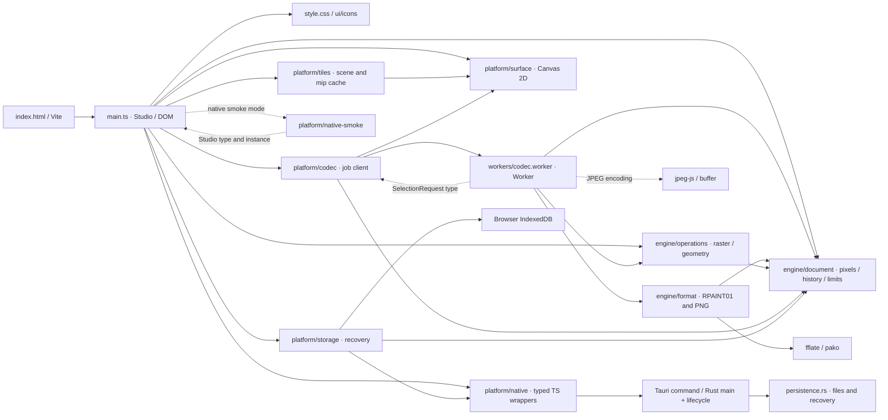
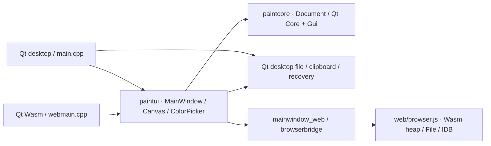

# myPaint 프로젝트 연혁과 아키텍처 리팩터링 보고서

2026-11-15 KST · 현재 작업 트리 `main` (`c4e8608`) · 비교 대상 `origin/style/win98-paint-skin` (`48e4058`, 로컬 원격 추적 ref)

## 결론

myPaint는 Windows 98 그림판처럼 간단하게 조작하고 파일을 기기 안에서 다룰 수 있는 독립형 그림판으로 시작했다. Qt/C++ 데스크톱에서 출발해 Qt WebAssembly로 브라우저 실행 범위를 넓혔고, 현재 제품인 Studio는 TypeScript 픽셀 엔진과 DOM UI를 웹과 설치형에서 공유한다. 설치형에서는 Tauri/Rust가 로컬 파일과 창 수명을 맡는다. [제품 안내](../../README.md) · [Qt 이탈 평가](https://github.com/parkjh2568/myPaint/blob/c4e8608c24b4a83de6a2f89b197a82ee8100e010/docs/QT_EXIT_ASSESSMENT.md) · [Studio 구현 기록](STUDIO_IMPLEMENTATION.md)

감사 기준 `main`에는 Studio와 Qt 기준 구현이 모두 있다. 7커밋 앞선 `48e4058`에는 Qt 제거와 탭·메뉴·투명 캔버스 변경이 이미 들어 있다. 후속 수정은 이 브랜치를 후보 기반으로 삼아 실제 브라우저와 양쪽 네이티브 패키지에서 먼저 인수하고, 실패가 드러난 경계를 좁게 보강한 뒤 편집 세션을 교체하는 순서를 권한다. 기존 데이터를 보호할 수 있다면 메뉴·내부 IPC·히스토리 표현·소스 배치를 한 번에 바꿀 수 있다. 공개 배포 이력과 원격 체크 상태는 이번 로컬 분석으로 확인하지 않았다.

가장 먼저 검증할 경계는 **같은 origin에 남아 있는 Qt 웹 탭과 Studio의 복구 저장소**, **문서 탭을 떠날 때 확정한 편집의 복구 순서**, **탭을 닫아도 남는 네이티브 저장 경로 바인딩**이다. 구조상 가장 큰 작업은 `Studio`가 같이 소유하는 문서 세션·제스처·렌더러·저장 수명을 분리하는 일이다. Studio `main.ts`는 `main`에서 4,599줄이며 비교 브랜치에서 4,792줄이다. 모듈 간 런타임 import 그래프는 비순환이지만 UI를 통하는 상태 결합은 강하다.

## 프로젝트가 시작된 이유와 변경 이력

날짜는 커밋에 기록된 KST 기준이다. 초기 커밋에는 README가 없고, 최초 구현 `942eb16`의 README가 Windows 98 계열 조작감과 독립 오프라인 실행을 명시한다. 이 README와 당시 검증 문서에는 Windows 실행 파일이나 REA 코드를 가져오거나 실행·수정·재배포하지 않았다고 기록돼 있다. 개인 프로젝트의 발단에 관한 Git 바깥 대화는 확인 범위에 포함되지 않는다. [최초 검증 기록](https://github.com/parkjh2568/myPaint/blob/c4e8608c24b4a83de6a2f89b197a82ee8100e010/docs/VERIFICATION.md#결과)

| 시기와 기준 | 작업 이유 | 코드와 제품에 반영된 변화 |
| --- | --- | --- |
| 10/30 `cbd5b34` → `942eb16` | 단순한 로컬 그림판과 재현 가능한 개발 환경 | RetroPaint 0.1.0. C++20/Qt Widgets, CMake, 기본 드로잉·도형·선택·클립보드·문자·레이어, 이미지와 `.rpaint`, Undo/Redo·복구. Linux 검증 후 다른 OS 빌드 설정 제공. |
| 11/04 `11fbde1` | 편집 취소, 저장 실패, 잘못된 입력에서 기존 문서를 지키고 설치 없이 쓰기 | 미확정 편집과 저장의 후보 처리, 검증·복구 보강, 아이콘·사용성, Qt UI를 공유하는 Wasm 빌드. 브라우저 파일·다운로드·클립보드·IndexedDB와 홈페이지 `/mypaint/` 반영 도구. |
| 11/06 `429f135` | Qt SDK/Wasm 운영 비용과 초기 자산 크기, 모바일 입력·배치 한계를 줄이면서 로컬 편집 의미 유지 | Studio 0.2.0. TypeScript 픽셀, Canvas·DOM·Vite, codec/geometry Worker, Tauri/Rust 저장·종료, 웹 전용 모바일. Qt는 동작·픽셀 비교 기준으로 유지. 홈페이지 용량 원인에는 Qt 소스 제공 압축 파일과 중복 release도 포함돼 있었다. |
| 11/08 `cbf299d` 및 PR #1, `c4e8608` | 픽셀 계약을 지키며 합성 비용·저장 실패·테스트 재현성 개선 | 합성의 투명·불투명 fast path, Windows staged 파일 수명 및 실패 처리, 동일 크기·메타데이터 외부 편집을 잡는 bounded SHA-256, 정확한 Shift 8방향 직선. 화면 스크린샷·viewport·mip oracle 보정, 브라우저 CI 분할, macOS 15 runner. |
| 11/12 `cc5f099`, `c10a29a`, `76438ff` | 후속 브랜치 문서에 기록된 Classic 98 요청, 한글 실행 안내, Qt 정리 | CSS 외관 보강, 플랫폼별 앱·웹 테스트 안내, CMake·Qt GUI/Wasm과 해당 CI·생성기 제거, Studio 전용 staging. 고정 픽셀 JSON과 기존 파일·복구 보호 계약 유지. |
| 11/12 `43ffb2f`, `8637fad`, `d57fe5d`, `48e4058` | 새 그림의 투명 배경과 지우개 설정, 범주 메뉴, 여러 그림의 독립 편집 | 투명 기본값, 지우개 모드·색과 설정, 6개 메뉴 범주, 문서 탭별 Undo/Redo·카메라·저장 바인딩·복구. 실패한 탭 활성화에서 pending/Redo를 보존하도록 후보 설치 순서 조정. 마지막 커밋은 인수인계 문서 정리. |

11/08에는 시작 비용과 메모리 절감에 관해 사용자가 공유한 사례를 계기로 myPaint 자체의 병목과 실패 경로를 검토했다. 당시 합성 마이크로벤치의 중앙값은 불투명 31.30→8.67 ms, 혼합 알파 22.07→14.20 ms였다. 표본은 알고리즘 출력 비교를 포함한 과거 실행이며, 현재 UI 지연·설치형 메모리·GPUI 대체 효과에는 별도의 측정이 필요하다. 비교 브랜치의 작업 동기는 `git show 48e4058:docs/PROJECT_HISTORY.md`, 미인수 항목은 `git show 48e4058:docs/CURRENT_STATUS.md`에 있다. [Qt 수정 결과](https://github.com/parkjh2568/myPaint/blob/c4e8608c24b4a83de6a2f89b197a82ee8100e010/docs/IMPLEMENTATION_RESULTS.md) · [Qt 웹 이식](https://github.com/parkjh2568/myPaint/blob/c4e8608c24b4a83de6a2f89b197a82ee8100e010/docs/WEB_IMPLEMENTATION_RESULTS.md) · [용량 정리](https://github.com/parkjh2568/myPaint/blob/c4e8608c24b4a83de6a2f89b197a82ee8100e010/docs/WEB_SIZE_CLEANUP.md) · [합성 변경과 측정](MEASURED_REFACTOR.md)

## 모듈 경계와 의존성

### Studio의 소스·실행 경계

실선은 주요 런타임 의존 또는 호출이며, 점선은 조건부 연결이나 타입 의존이다. Worker와 Rust는 브라우저 UI와 별도의 실행 경계다. 파일 이름과 코드를 양쪽 ref에서 열어 정적 import, dynamic import, Worker URL과 타입 관계를 확인했다.

`document.ts`는 모듈 import 없이 문서·RGBA·이력·합성·브러시 래스터·프로필을 소유한다. `operations.ts`와 `format.ts`는 문서 모델에 의존한다. `tiles.ts`는 엔진을 import하지 않고 UI가 넘기는 raster descriptor에 기대며 source/overlay·mip·타일 캐시와 Canvas 리소스를 관리한다. `surface.ts`는 HTML/OffscreenCanvas의 작은 어댑터다. `main.ts`는 부트스트랩, 상태·이벤트, 타입 변환, 작업 순서와 렌더 정책을 함께 갖고 있다. 후속 브랜치의 `ui/eraser.ts`, `ui/menu.ts` 추출은 메뉴·설정의 일부를 옮겼으며 문서 전환과 저장은 여전히 `main.ts`에 있다. [UI 진입](../../web-app/src/main.ts#L1) · [문서 모델](../../web-app/src/engine/document.ts#L39) · [타일 캐시](../../web-app/src/platform/tiles.ts#L1119) · [Worker](../../web-app/src/workers/codec.worker.ts#L1)

`web-app/src`의 TS 소스는 타입 선언 파일 포함 `main` 13개, 비교 브랜치 15개다. 외부 라이브러리와 CSS를 포함한 고유 연결은 각각 34개, 37개였다. 양쪽의 런타임 import와 Worker URL만으로 순환하는 모듈 묶음은 없었다. 타입과 런타임을 함께 표시하면 `main.ts ↔ native-smoke.ts`, `codec.ts ↔ codec.worker.ts` 두 묶음이 생긴다. 역방향은 빌드에서 지워지는 타입 참조다. 다만 smoke가 실행 중 `Studio` 인스턴스 내부 메서드와 필드를 직접 바꾸므로 테스트 결합은 실재한다. Rust의 macOS `main.rs → lifecycle.rs → crate::request_close`는 호출 책임이 양방향인 경계다. 소스에서 그 경로의 재귀는 확인되지 않았다. [Smoke 로딩](../../web-app/src/main.ts#L4589) · [Smoke 인스턴스 접근](../../web-app/src/platform/native-smoke.ts#L67) · [Worker 생성](../../web-app/src/platform/codec.ts#L64) · [macOS delegate](../../web-app/src-tauri/src/lifecycle.rs#L9)

### Qt와 배포 경계

`MainWindow`가 `Document`와 `Canvas`를 관리하고 `Canvas`는 `Document`를 참조한다. `paintcore`는 Widgets·브라우저 브리지를 링크하지 않지만 `QImage`, Qt 코덱, `QSaveFile`로 인해 Qt Core/Gui와 결합한다. `Canvas`가 포인터·필압·도구 래스터·선택·문자·미리보기를, `MainWindow`가 창·레이어 UI·저장·복구·플랫폼 분기를 함께 맡는다. 헤더와 CMake 링크 방향에서 C++ 모듈 순환은 확인되지 않았다. Qt와 Studio는 각각 별도의 빌드/실행물이며 `.rpaint`, 복구 데이터, 고정 fixture에서 만난다. [Qt 빌드 그래프](https://github.com/parkjh2568/myPaint/blob/c4e8608c24b4a83de6a2f89b197a82ee8100e010/CMakeLists.txt#L7) · [소유권](https://github.com/parkjh2568/myPaint/blob/c4e8608c24b4a83de6a2f89b197a82ee8100e010/src/mainwindow.h#L43) · [미확정 편집](https://github.com/parkjh2568/myPaint/blob/c4e8608c24b4a83de6a2f89b197a82ee8100e010/src/canvas.cpp#L140) · [Qt 웹 브리지](https://github.com/parkjh2568/myPaint/blob/c4e8608c24b4a83de6a2f89b197a82ee8100e010/src/browserbridge.cpp#L11)

Studio 웹은 `tools/build_studio.py`에서 Vite 산출물을 검증·패킹하고 `tools/stage_web.py`가 검증된 릴리스를 `/mypaint/`에 반영한다. 스테이저는 산출물 검사, release 재사용, 이전 자산 보존, 실패 복원을 담당한다. `build_web.py`는 `main`에 남은 Qt/Wasm 쪽 진입이다. 설치형은 같은 Vite 번들을 Tauri에 담으며 `desktop.mjs`가 Windows/macOS 타깃을 제한한다. Tauri 설정은 로컬 자산과 IPC 중심의 CSP를 사용한다. 별도 리포지터리에 반영하는 단계와 앱 런타임 경계가 분리돼 있다. [웹 반영 절차](../WEB_BUILD.md) · [스테이저](../../tools/stage_web.py#L125) · [설치형 타깃](../../web-app/tools/desktop.mjs#L5) · [CSP 및 asset 경로](../../web-app/src-tauri/tauri.conf.json#L5)

## 상태 관리와 핵심 실행 경로

| 상태 | 현재 소유자와 수명 | 커밋·취소·저장과의 관계 |
| --- | --- | --- |
| 문서 RGBA, 레이어 순서·이름·가시성·활성 인덱스, 배경 | `PaintDocument.state`와 TS pixel buffer | 후보 검증 후 교체. 가시성과 순서는 메타데이터 patch로 처리. 활성 인덱스 클릭은 UI가 현재 객체에 직접 대입한다. [문서](../../web-app/src/engine/document.ts#L259) · [활성 레이어](../../web-app/src/main.ts#L788) |
| Undo/Redo·저장 상태 | `revision`, `savedRevision`, `nextRevision`, `history`, `cursor`, `historyBytes` | 저장 여부는 고유 revision으로 판단한다. 타일 before/after, 메타데이터 delta 또는 구조 변경 전후 스냅샷. 최신 변경 한 건은 예산보다 커도 유지 가능한 정책이다. [이력 준비와 설치](../../web-app/src/engine/document.ts#L313) · [예산 테스트](../../web-app/tests/history.test.ts#L42) |
| 획·선택·텍스트·도형·카메라 | 획의 임시 타일은 `PaintDocument.stroke`, drag·selection·IME DOM·도형 점·pointer capture·zoom/pan은 `Studio` | 획을 끝내면 변경을 이력에 반영하고 취소 시 타일을 복원한다. 선택·문자 등은 후보로 만든 뒤 확정하거나 버린다. 카메라는 파일 바깥의 뷰 상태다. [포인터](../../web-app/src/main.ts#L1453) · [획 완료](../../web-app/src/engine/document.ts#L1147) · [pending](../../web-app/src/main.ts#L2763) |
| 화면과 준비 리소스 | `FinalSceneCache`, RAF/dirty queue·camera transform·DOM overlay | 래스터·타일을 무효화해 화면을 투영한다. context loss/문서 교체에서 준비 작업을 정리한다. 화면 축소 필터와 내보내기 출력 픽셀은 목적이 다르다. [렌더 진입](../../web-app/src/main.ts#L1015) · [렌더 준비](../../web-app/src/main.ts#L1181) |
| 비동기 작업과 문서 소유권 | `Studio`의 `busy`, `epoch`, `AbortController`, 작업별 token·revision·active, Worker slot | 새 문서, 레이어 또는 revision으로 잘못 반영되지 않도록 각 호출자가 소유 조건을 확인한다. Worker는 reply 계약을 검사한다. [선택 작업](../../web-app/src/main.ts#L2476) · [Worker client](../../web-app/src/platform/codec.ts#L27) |
| 저장 파일 바인딩 및 네이티브 창 | JS epoch와 Rust generation, open/save ticket, `Stage`와 `Persistence`, 종료 flag·macOS delegate | 디스크 파일 교체가 성공하면 receipt를 통해 저장 상태를 갱신한다. 원래 문서와 연결된 저장만 통과하며 기존 대상 identity·내용을 점검한다. [IPC](../../web-app/src-tauri/src/main.rs#L54) · [파일 교체](../../web-app/src-tauri/src/persistence.rs#L395) |
| 자동 복구와 앱 설정 | `RecoveryStore`와 UUID/sequence, IDB 또는 Rust local app data. 설정은 UI/localStorage | 30초 자동 복구의 단위는 확정 revision이다. 복구 사본을 열면 기존 경로에 바인딩하지 않은 편집 문서가 된다. 후속 브랜치는 탭별 문서·이력·뷰·바인딩으로 수명이 늘어난다. [복구 타이머](../../web-app/src/main.ts#L639) · [스냅샷](../../web-app/src/main.ts#L3925) · [저장소](../../web-app/src/platform/storage.ts#L113) |

1. **획과 화면.** 포인터 입력 → 도구·좌표 변환·소유권 확인 → `beginStroke`와 coalesced 이동 → 활성 레이어의 dirty tile → `endStroke` 확정 또는 `cancelStroke` 복원 → RAF에서 raster 조립, tile/mip 준비, checker·미리보기·DOM overlay 합성. 확대율·DPR·VisualViewport와 마우스·펜·터치 소유권이 화면 갱신과 얽혀 있다. [이동](../../web-app/src/main.ts#L1738) · [포인터 종료](../../web-app/src/main.ts#L1953) · [렌더](../../web-app/src/main.ts#L1081)
2. **선택·문자·채우기·기하 편집.** 작은 선택·도형·문자는 local surface/버퍼에서 준비한다. 큰 올가미·채우기·resize 등은 Worker 또는 분할 실행을 거친다. 선택이 원본 영역을 지우는지, 붙여넣기처럼 원본이 없는지, mask와 알파가 어떤지에 따라 후보가 달라진다. `settle`과 `prepareState`가 후보를 검증한 뒤 커밋한다. 외부 반영과 결합된 경로는 준비와 설치를 나눠 취소·실패 시 기존 pending과 Redo를 보존한다. [선택 준비](../../web-app/src/main.ts#L2442) · [pending 확정](../../web-app/src/main.ts#L2845) · [후보 설치](../../web-app/src/engine/document.ts#L347)
3. **파일 열기와 삽입.** 브라우저 File/드롭 또는 Tauri 파일 선택·읽기 token → 입력 길이·포맷/치수 검증 → 프로젝트/PNG Worker, 또는 이미지 입력의 브라우저 디코딩 분기 → 문서 후보 검증 → 새 문서 설치 또는 임시 붙여넣기. 네이티브 파일 선택 token은 검증된 새 문서 활성화 시 저장 바인딩으로 이어진다. [열기와 삽입](../../web-app/src/main.ts#L3225) · [디코딩 경계](../../web-app/src/platform/codec.ts#L210) · [프로젝트 reader](../../web-app/src/engine/format.ts#L334)
4. **프로젝트 저장과 이미지 내보내기.** `.rpaint`는 pending을 포함할 수 있는 후보를 Worker로 인코딩한다. 웹은 Blob URL로 다운로드를 제공하고 현재 이력·저장 상태를 보존한다. 네이티브는 선택·세대 ticket, 임시 파일 쓰기, 대상 확인, OS 교체, receipt 순으로 완료한다. 성공 후 동일 문서 소유권에서 후보 설치와 `savedRevision`을 갱신한다. 내보내기는 합성 이미지 옵션과 미리보기를 갖고 프로젝트 바인딩과 이력을 건드리지 않는다. [저장·내보내기](../../web-app/src/main.ts#L3391) · [네이티브 IPC](../../web-app/src/platform/native.ts#L54) · [publish](../../web-app/src-tauri/src/persistence.rs#L1380)
5. **복구·종료.** 주기적으로 확정 스냅샷을 복제·인코딩하고 동일 revision/epoch에서 쓰기를 요청한다. 웹은 같은 IDB transaction에서 head와 snapshots를 갱신하고, 네이티브는 generation/sequence의 복구 사본을 로컬에 쓴다. 복구 열기는 선택한 bytes 검증 후 진행한다. 네이티브 종료는 UI의 저장·버리기·취소 결정과 OS 종료 허용의 핸드셰이크다. [복구 로드](../../web-app/src/main.ts#L3961) · [IDB 쓰기](../../web-app/src/platform/storage.ts#L182) · [Rust 복구](../../web-app/src-tauri/src/persistence.rs#L1276) · [종료 요청](../../web-app/src-tauri/src/main.rs#L332)
6. **Qt 경로.** `Canvas::pendingState`에서 QImage/QTextDocument 후보 준비 → `Document::prepare/install`에서 상태와 revision/이력 검사. 데스크톱 저장은 새 파일 staging과 QSaveFile 완료 후 문서에 반영한다. Qt/Wasm은 요청 ID·epoch·revision·활성 레이어를 묶고 브라우저와 Wasm 힙 사이에 bytes를 복사한다. [.rpaint 계약](../FILE_FORMAT.md) · [Qt 커밋](https://github.com/parkjh2568/myPaint/blob/c4e8608c24b4a83de6a2f89b197a82ee8100e010/src/document.cpp#L108) · [Qt 저장](https://github.com/parkjh2568/myPaint/blob/c4e8608c24b4a83de6a2f89b197a82ee8100e010/src/mainwindow.cpp#L1036) · [Wasm 요청](https://github.com/parkjh2568/myPaint/blob/c4e8608c24b4a83de6a2f89b197a82ee8100e010/src/mainwindow_web.cpp#L19)

## 위험과 수정 비용의 우선순위

P0는 데이터 손실을 막아야 하는 출시 차단 조건, P1은 저장·복구·닫기나 회귀 검증을 막는 경로, P2는 빈번한 변경의 회귀 가능성과 변경 비용을 키우는 구조, P3는 좁은 청소 항목이다. 비용은 작업의 상대 규모다. **S**는 한 경계와 집중 회귀, **M**은 여러 모듈이나 한 저장 플랫폼을 아우르는 변경, **L**은 엔진·브라우저·양쪽 네이티브 중 여러 경계를 함께 인수하는 변경이다. 같은 등급에서는 자료 보호와 수정의 선행 관계를 우선했다.

| 우선순위 · 비용 | 문제와 조건 | 근거 수준과 고칠 범위 |
| --- | --- | --- |
| **P0 · M** | **동일 origin의 구형 Qt 웹 탭이 Studio 복구 사본까지 삭제한다.** 두 앱이 `retropaint-local-v1`의 `heads`와 `snapshots`를 함께 쓰며 구형 UI는 두 store를 통째로 비운다. 이전 런타임을 staging에서 보존하거나 예전 탭을 계속 열어 두면 후속 브랜치에서 Qt 소스를 제거해도 조건이 성립한다. | 실제 두 모듈을 사용한 Node/모형 IDB에서 Studio 사본 쓰기·읽기 성공 → Qt `clear` 성공 → 사본 1→0, 재읽기 실패를 재현했다. 같은 origin 공존 가능 시 출시 차단으로 처리하고 Studio DB 이름, 이전 DB 읽기 전용 이관, 키 단위 삭제를 도입한다. [Qt 저장소](https://github.com/parkjh2568/myPaint/blob/c4e8608c24b4a83de6a2f89b197a82ee8100e010/web/browser.js#L24) · [전체 삭제](https://github.com/parkjh2568/myPaint/blob/c4e8608c24b4a83de6a2f89b197a82ee8100e010/web/browser.js#L215) · [Studio 저장소](../../web-app/src/platform/storage.ts#L113) · [이전 릴리스 보존](../../tools/stage_web.py#L143) |
| **P1 · M** | **비활성 탭에서 직전에 확정된 편집이 복구 사본에 빠진다.** `48e4058`의 `switchTab`과 `replaceDocument`는 pending 후보 준비 → 이전 확정 revision 복구 → 네이티브 활성화 → pending 설치 순서다. 비활성 탭은 복구 타이머의 대상이 아니며, 전환 전에 복사한 `recoveredRevision`은 이미 성공한 복구를 잊을 수 있다. | 실제 브랜치 메서드와 엔진, 모형 UI/IO에서 깨끗한 문서+pending은 복구 쓰기 없이 새 revision으로 비활성화됐고, 이미 dirty인 경우 이전 픽셀만 저장됐다. 실패 시 pending/Redo를 지킨 `d57fe5d`의 보장은 유지하면서 탭별 복구와 revision 귀속을 정리한다. `git show 48e4058:web-app/src/main.ts`의 3283, 3329, 3388, 4111행. |
| **P1 · M** | **후속 네이티브 탭의 닫기와 바인딩 수명이 갈라진다.** Rust `tab_bindings`에 닫힌 저장 문서 key가 남는다. 64개 저장 바인딩 이후에는 현재 앱에 열린 탭이 적어도 새로운 key가 있는 활성화가 거절될 수 있다. 마지막 탭 닫기는 새 그림을 추가하는 경로를 재사용해 삭제할 문서까지 512 MiB 판정에 포함한다. | 정적 경로 확인. 12개 동시 탭 한도와 과거 바인딩 64개의 수명은 다르다. 탭 해제 IPC, in-flight ticket 정리, 마지막 탭 교체 시 순증분 계산, A/B 저장 경로·외부 수정 검증을 묶는다. `48e4058:web-app/src-tauri/src/persistence.rs` 652, 778–817행, `48e4058:web-app/src/main.ts` 3372–3400행. |
| **P1 · M** | **손상된 복구 항목 하나가 정상 사본 접근 또는 새 복구를 막는다.** 웹 목록은 비정상 head에서 전체 요청을 실패시키며 쓰기도 보수적으로 차단한다. 네이티브는 건강한 항목과 경고를 나눠 표시하지만 엄격한 스캔 때문에 새 쓰기가 막힐 수 있다. | 모형 IDB에서 웹 목록·후속 쓰기 실패와 기존 정상 Blob 보존을 재현했다. 읽기는 항목별로 실패를 반환하고 안전한 격리·복제 경로를 추가한다. 한도 계산을 완화하는 대신 읽기와 쓰기 검증을 구분하고 알 수 없는 bytes를 보존한다. [웹 목록과 쓰기](../../web-app/src/platform/storage.ts#L154) · [네이티브 스캔](../../web-app/src-tauri/src/persistence.rs#L1003) |
| **P1 · M, Qt 유지 시** | **Qt에서 현재 경로를 다시 열고 저장을 고르면 이전에 읽은 후보를 깨끗한 상태로 설치할 수 있다.** `openFile`은 저장 확인 전에 디코딩하고 `requestReplacement` 후 그 후보를 설치한다. 그 뒤 저장하면 방금 기록한 내용이 덮일 수 있다. Qt 수동 저장의 원본 변경 검사는 Studio의 fingerprint 바인딩보다 약하다. | 정적 경로 확인. Qt를 배포 대상으로 유지하는 경우 같은 파일 재열기와 외부 변경을 먼저 재현한 뒤, 저장 후 후보 다시 읽기 및 대상 검증을 추가한다. [Qt 열기](https://github.com/parkjh2568/myPaint/blob/c4e8608c24b4a83de6a2f89b197a82ee8100e010/src/mainwindow.cpp#L1179) · [Qt 저장](https://github.com/parkjh2568/myPaint/blob/c4e8608c24b4a83de6a2f89b197a82ee8100e010/src/mainwindow.cpp#L1105) · [후보 교체](https://github.com/parkjh2568/myPaint/blob/c4e8608c24b4a83de6a2f89b197a82ee8100e010/src/mainwindow.cpp#L1325) |
| **P1 · S** | **Windows CRLF 체크아웃에서 기준 fixture 검증이 깨진다.** raw 파일 SHA-256을 검사하지만 체크아웃 줄 바꿈은 로컬 Git 설정에 좌우된다. `.editorconfig`는 편집기 설정이다. | Windows `core.autocrlf=true`에서 실제 두 검사 실패. `main`의 매니페스트 16개 모두 Git blob 해시가 일치했고 작업 트리 해시는 0개 일치했다. 두 ref의 LF 아카이브에서 검사를 다시 통과했다. 해시 대상에 `text eol=lf`를 명시하고 CRLF 기본 환경에서도 기준 검사를 CI에 연결한다. [매니페스트 검사](../../web-app/tests/fixture-inventory.test.ts#L52) · [생성기 검사](../../web-app/tests/color-eraser-qt.test.ts#L56) |
| **P1 · L** | **편집과 파일·탭·렌더 수명이 `Studio`에서 결합돼 있다.** `busy`, `epoch`, `revision`, `active` 검사와 준비/설치 흐름이 선택·저장·복구·탭·열기에 흩어져 있다. `Drag.mode`가 문자열과 여러 선택 필드로 표현돼 유효한 조합을 호출자가 기억해야 한다. | 구조 확인. 파일이 바뀐 뒤 UI 커밋이 실패할 수 있는 경계, 전환 중 pending과 Redo, 오래된 Worker 응답을 공통 소유권 계약으로 옮긴다. [Drag](../../web-app/src/main.ts#L44) · [작업 상태](../../web-app/src/main.ts#L113) · [명령 분기](../../web-app/src/main.ts#L4047) |
| **P1 · L** | **큰 문서에서 history와 복제의 메모리 압력이 탭 수명과 합산된다.** 데스크톱 레이어 합산 최대 `64 × 1024²` 픽셀은 RGBA 한 상태당 256 MiB다. 구조 편집에서 이전 상태·후보·이력용 `after` 복제만 같은 크기로 함께 살아 있으면 약 768 MiB다. Worker, 타일, 기본 WebView 메모리는 별도다. | 코드 경로 기반 상한 사례 추산. RSS 실측은 별도다. 정상 범위의 문서가 중요 동작에서 실패하는지 1·다중 탭으로 계측하고, 할당 전 예약·공유 가능한 불변 타일·이력 보존 정책을 설계한다. 512 MiB는 후속 브랜치의 새 탭 허용 계산에만 적용된다. [프로필](../../web-app/src/engine/document.ts#L62) · [스냅샷과 이력](../../web-app/src/engine/document.ts#L347) · [최대 문서 기록](STUDIO_MAX_DOCUMENT.md) |
| **P2 · M–L** | **화면·편집 확정·내보내기에서 래스터 규칙을 중복 소유한다.** 선택 원본 지우기의 viewport와 commit 경로, 선택·문자·도형의 alpha 합성 반복, 배경색의 premultiplied 동등성 판정이 여러 곳에 있다. 화면의 mip 및 checker와 실제 export는 다른 출력 목적을 갖는다. | 구조 확인. commutative 여부나 반올림·투명 RGB 의미가 다른 루프를 합치기 전에 독립 픽셀 fixture로 계약을 고정한다. geometry·coverage·mask·합성 규칙을 먼저 공유하고 투영·필터 경로를 분리한다. [화면 선택 원본 처리](../../web-app/src/main.ts#L1139) · [선택 확정](../../web-app/src/main.ts#L2630) · [pending 합성](../../web-app/src/main.ts#L2763) · [키 동등성](../../web-app/src/engine/operations.ts#L158) |
| **P2 · S–M** | **활성 레이어가 문서 형식과 UI 상태에 걸쳐 있다.** `.rpaint`에는 활성 레이어를 저장하지만 단순 선택은 revision 및 dirty를 바꾸지 않는다. 이미 복구된 revision이라면 레이어 선택만은 다음 자동 복구에 기록되지 않는다. | 실제 엔진에서 `active`만 0→1, revision·dirty·이력 불변을 확인했다. Qt에도 의도적으로 이력을 만들지 않는 정책이 있다. 세션 상태로 정의하고 명시 저장 시 값만 투영하거나, 문서 메타데이터로 정의하고 revision에 정책을 부여한다. [Qt 정책](https://github.com/parkjh2568/myPaint/blob/c4e8608c24b4a83de6a2f89b197a82ee8100e010/docs/ARCHITECTURE.md#변경-기록) · [UI 대입](../../web-app/src/main.ts#L793) · [파일 헤더](../../web-app/src/engine/format.ts#L309) |
| **P2 · M** | **Worker 요청이 비슷해 보이지만 소유권·응답 규칙은 작업마다 다르다.** `runCodec(operation: string, state?, bytes?, …)`가 압축, geometry, fill, selection까지 처리하고 호출마다 주고받는 필드가 바뀐다. geometry는 JSON을 bytes에 담고 전달 목록의 버퍼는 detach된다. | 작업별 판별 가능한 요청·응답 타입과 실제 바이트 검증을 한 프로토콜 경계에 둔다. 작업별 메모리 예약, 취소와 늦은 응답 폐기, 자원 해제를 실행기의 책임으로 지정한다. 새 I/O나 런타임 교체 없이 정리할 수 있다. [Worker client](../../web-app/src/platform/codec.ts#L27) · [transfer](../../web-app/src/platform/codec.ts#L160) · [작업 dispatch](../../web-app/src/workers/codec.worker.ts#L147) |
| **P2 · M–L** | **네이티브 교체의 취소 타이밍과 창 종료가 강하게 결합돼 있다.** 최종 지문 검사와 파일 교체·동기화가 Session mutex 안에 있어 그 구간의 취소가 경합한다. macOS 종료는 Tao delegate를 Objective-C에서 바꾸고, JS 전달 `eval`의 결과가 실패해도 OS 닫기를 거부할 수 있다. | 정적 위험. 저장 취소가 더 이상 효력을 갖지 않는 게시 지점을 명시하고 release 패키지로 시험한다. OS 어댑터와 종료 승인 상태를 분리하고 UI 응답이 없는 경로를 검증한다. 대상 확인과 교체 syscall 사이에 비협조적 외부 변경을 완전히 막는 CAS는 제공되지 않는다. [최종 교체](../../web-app/src-tauri/src/persistence.rs#L395) · [취소 경합](../../web-app/src-tauri/src/persistence.rs#L955) · [publish lock](../../web-app/src-tauri/src/persistence.rs#L1380) · [delegate](../../web-app/src-tauri/src/lifecycle.rs#L23) · [닫기 요청](../../web-app/src-tauri/src/main.rs#L337) |
| **P2 · M** | **검증 코드가 실제 동작 검증과 소스 배치에 동시에 묶여 있다.** 일부 단위 테스트가 `main.ts`에서 AST로 메서드·클로저를 꺼내 실행하고, 네이티브 smoke는 배포 빌드의 조건부 chunk와 IPC에서 UI 내부를 조작한다. 여러 CI 그룹은 같은 포맷·단위·빌드를 반복하며 네이티브 job은 패키지 실행까지 이어지지 않는다. | 정적 확인. 메서드 추출은 공개된 세션/selection API의 직접 시험으로 옮기고 별도 smoke 빌드 사용을 검토한다. `48e4058`의 `test:document-tabs`, `test:eraser-settings`를 기존 매트릭스에서 호출하게 한다. [AST 의존](../../web-app/tests/settle-noop.test.ts#L8) · [Studio CI](../../.github/workflows/studio.yml#L9) · [설치 앱 harness](../../web-app/tests/native-desktop.mjs#L13) |
| **P3 · S** | **현재 참조가 없는 타입 재노출과 타깃별 도달 불가 함수가 있다.** `codec.ts`의 `GeometryChange` 재노출은 tracked 소비자가 없고, `document.ts`의 `limits` 별칭은 테스트가 사용한다. Qt/Wasm의 `openFile`, `isRecoveryPath`는 desktop 진입에서 사용되며 해당 Wasm 경로에는 호출자가 없다. `save()`의 Wasm 분기는 항상 `false`이고 실제 파일 동작은 비동기 요청이다. | 타입 재노출을 삭제하고 테스트를 `webLimits`로 옮길 수 있다. Qt를 유지할 경우 target별 저장 API에서 도달 불가 분기를 정리한다. Qt/CMake 대상 전체와 fixture, 조건부 smoke는 사용 경로가 있다. [타입 재노출](../../web-app/src/platform/codec.ts#L13) · [별칭 소비자](../../web-app/tests/profiles.test.ts#L12) · [Qt save](https://github.com/parkjh2568/myPaint/blob/c4e8608c24b4a83de6a2f89b197a82ee8100e010/src/mainwindow.cpp#L1094) |

## 후속 수정의 작업영역과 인수 조건

아래 파일 경계는 목표 책임을 표시한다. 이동 과정에서 공통 알고리즘이나 자원 소유권이 분명한 경우만 추출하고, 하나의 작업을 위한 중간 클래스나 호출 계층을 늘리지 않는다.

### 1. 기반 확정과 회귀 게이트

- **작업 위치.** `48e4058` 기반의 별도 작업 브랜치에서 진행하는 것을 전제로 규모를 잡았다. 현재 `main`에서 Qt 제거를 다시 구현할 필요는 없다. `76438ff` 직전 `c10a29a`를 기준 소스 및 fixture 재생성 ref로 기록하고, 후속 브랜치의 `matched-core-README.md`, `square-README.md`에서 삭제된 오라클 경로를 해당 Git 이력으로 연결한다. `main`에서 Qt 배포를 계속해야 한다면 동일 경로 재열기 보강은 좁은 유지보수로 별도 적용한다.
- **수정 영역.** `.gitattributes`, `web-app/tests/fixtures/`, `.github/workflows/studio.yml`, `web-app/package.json`. 기준 해시는 Git에 있는 LF bytes를 사용한다. 보존할 Qt 기준은 프로젝트/PNG, 17개 도구 관련 고정 픽셀 및 실패·취소 사례의 provenance와 재생성 명령이다. 브라우저 suite와 OS 실제 패키지 단계는 같은 커밋의 산출물로 연결한다. 웹 정적 빌드는 검증된 번들 해시를 그룹 간 재사용하도록 할 수 있다.
- **완료 조건.** `npm test`, 타입·포맷·Vite, Python staging, 모든 Chromium 그룹과 신규 탭/지우개 suite, Rust fmt/Clippy/test 및 Windows/macOS 패키지 smoke가 같은 기준 SHA로 기록된다. Qt 유지보수에 한해 Qt CTest와 offscreen UI도 필요하다. 현재 `48e4058`의 제품 변경에는 실제 패키지와 브라우저 인수 증거가 필요하다. [기준 목록](STUDIO_FIXTURE_BASELINE.md) · [브라우저 그룹과 네이티브 CI](../../.github/workflows/studio.yml#L9)

### 2. 복구 저장소 이관과 문서 탭 수명

- **복구 이관.** `platform/storage.ts`에서 Studio 쓰기를 새 이름의 DB로 격리한다. 같은 origin의 구 DB는 importer로만 열고 유효한 head와 payload를 짝지어 검증 후 새 저장소에 복제한다. 구 데이터는 원위치에 보존하고 동일 키·sequence의 복제 재시도를 안전하게 처리한다. 검증된 `.rpaint`를 내보내는 경로도 마련한다. 브라우저 목록 읽기와 데이터 복구 쓰기의 권한을 분리하고 잘못된 항목을 명시적으로 격리할 수 있게 한다.
- **탭 수명.** 문서별 객체가 `PaintDocument`, 파일 표시 이름, viewport, 복구 revision/queue, 저장 바인딩 식별자를 소유한다. 앱 전역은 활성 키와 한 번에 배타적으로 진행할 작업만 소유한다. 전환은 pending 후보 준비 → 대상 활성화 확인 → 이전 문서 설치와 화면 전환 → 이전 문서의 확정 revision을 대상으로 복구 예약 순으로 설계한다. 이전 문서 복구가 활성 전환에 종속돼 있으면 Rust IPC의 쓰기 검증을 열린 세션의 key/sequence 기준으로 바꿔야 한다. 실패·취소에서 양쪽 세션과 native binding이 일치하도록 전환의 경계와 복구 실패 보고를 정의한다.
- **닫기와 해제.** `persistence.rs`에 닫힌 문서 key와 in-flight token의 유효성을 정리하는 동작을 도입한다. 참조가 남은 작업은 끝내거나 취소하고, 닫기는 이전 탭을 빼고 최종 메모리 보유량을 계산한다. 바인딩 해제와 복구 사본 삭제는 서로 다른 요청이다. 기존 종료 확인과 복구 보존 정책을 테스트로 고정한다.
- **완료 조건.** 동일 origin에 구형·신형 탭을 동시에 두고 구형 전체 삭제 시 새 사본 보존, 중단된 이관의 다시 실행, 정상+손상 사본 공존을 확인한다. 깨끗한 탭의 pending만 확정한 직후 앱을 강제 종료해 비활성 문서를 복구한다. 적은 동시 탭으로 64번 이상 경로 바인딩을 순환하고 A/B 각각의 원본 저장·외부 변경 충돌·실패 후 Redo, 큰 마지막 탭 닫기, 모든 미저장 탭의 종료 확인을 확인한다.

### 3. 편집 세션과 문서 트랜잭션 교체

- **입력과 세션.** `main.ts`를 composition root, DOM 입력/대화상자 어댑터, 문서 세션, 화면 표시로 나눈다. 포인터 조작은 각 가능한 mode의 필수 필드를 가진 union으로 옮긴다. 도구 전환·Esc·blur·pointer cancel·다른 탭 활성화가 세션의 명시적인 전이를 통과하도록 한다. DOM은 focus, IME, capture 및 접근성 상태를 유지한다.
- **엔진 API.** `PaintDocument`는 변경이 없는 명령을 이력에 넣지 않고 `revision/savedRevision`과 history cursor를 직접 관리한다. UI에 stroke/history의 배열·타일을 노출하던 자리를 변경 결과의 레이어/dirty 영역 통지로 바꾼다. `prepare`는 불투명 후보와 `documentId, baseRevision, layerId, pendingVersion`의 소유권을 결합한다. `commit`은 동일 소유권에만 한 번 적용한다. 멀티탭 이동 또는 UI 취소 뒤 Worker reply는 폐기한다. 활성 레이어를 세션 상태로 두고 파일의 활성 인덱스를 열기/명시 저장에서 읽고 투영하는 설계를 기본안으로 삼았다.
- **메모리.** 현재보다 먼저 4 Ki/8 Ki 문서, 여러 레이어, 서로 다른 크기의 탭을 고정 입력으로 측정한다. 전체 상태 복제와 history 스냅샷이 겹치는 지점을 기록하고, 타일 또는 변경 레이어만 보유하는 방법을 비교한다. 단일 구조 변경이 이력 예산보다 큰 경우의 Undo 지원 여부와 미리 예약할 최대 bytes를 제품 계약으로 둔다. 후보·Worker transfer·렌더 cache에는 서로 다른 소유자를 둔다.
- **완료 조건.** 실제 엔진 API로 no-op·취소·할당 실패의 픽셀/dirty/revision/active/Redo 보존을 비교한다. 지연 응답을 다른 문서와 다음 탭에 적용하지 않는다. 올가미 원본, 붙여넣기 source-less, 투명 키, 알파 문자·IME, 펜과 보조 버튼, 연속 resize와 기존 Redo를 브라우저에서 검사한다. 최대 문서/탭의 peak 메모리와 입력 지연은 동일 문서·DPR·비교 도구·OS에서 기록한다. [문서 계약](../STUDIO_DOCUMENT_CONTRACTS.md) · [성능 측정 범위](STUDIO_MEASUREMENT_METHOD.md)

### 4. 래스터·렌더·Worker의 경계 고정

- **래스터 설계.** `engine/document.ts`, `engine/operations.ts`, UI의 pending/scene 구성에서 공유하는 픽셀·마스크 규칙을 엔진의 작은 단위로 집약한다. 선택 원본 영역 지우기와 좌표/크기 변환을 같은 geometry 입력으로 설명하고, 화면 미리보기·정확한 프로젝트 확정·이미지 바이트가 목적별로 소비한다. straight/premultiplied 변환과 숨은 RGB, integer nearest, 8방향 선의 반올림 규칙은 독립 fixture로 고정한다.
- **표시 설계.** `platform/tiles.ts`와 `main.ts`의 camera/render 구간에 단일 scene descriptor를 전달한다. 엔진이 알려주는 dirty 영역과 cache lifetime만 사용하고 pointer/문서 저장에 의존하지 않는다. mip/타일의 가시 범위, DPR, context loss, bounded 협력 작업을 유지한다. 미리보기와 최종 export는 같은 출처·geometry를 사용하고 각각의 샘플링을 시험한다.
- **Worker 프로토콜.** `platform/codec.ts`와 `workers/codec.worker.ts` 사이에 공용 payload 타입·validator를 둔다. decode/encode와 편집 연산을 나누고, 작업별 request/reply tag 및 transfer 가능한 owned buffer만 경계로 넘긴다. 최대 2개 job과 timeout이라는 현재 안전장치를 기준으로, 작업 크기별 메모리 예약·시간·취소 정책을 정한다. 종료 시 worker/listener/slot/버퍼가 회수되는 실패 시험을 둔다.
- **완료 조건.** PNG/.rpaint의 독립 판독, 타일 원시 bytes와 표시 비교를 각 oracle로 판단한다. GPU/CPU, 서로 다른 clip 분할의 차이는 검증 환경으로 기록한다. 큰 올가미·축소·여러 레이어에서 현재 픽셀 의미를 비교하고 시간 및 메모리 회귀를 측정한다. 제품 코드의 private AST를 뽑아 쓰던 테스트는 새로 노출한 동작 API의 시험으로 교체한다. [Codec 계약](STUDIO_CODEC_REPLY.md) · [출력 미리보기](STUDIO_EXPORT_PREVIEW.md) · [타일 검사](../../web-app/tests/tiles.mjs)

### 5. 설치형 저장·종료와 제품 전환

- **Rust 저장.** `persistence.rs`의 대상/지문·stage·게시·복구와 `main.rs`의 Tauri 명령을 역할에 맞춰 정리한다. 준비·검증·취소 가능 구간과 OS 교체 시작 이후 구간을 분리한다. 같은 디렉터리 임시 파일, owner token, 파일 identity/내용 확인, Windows 부분 교체 실패의 stage 보존, 성공 receipt 이후에만 UI 저장 상태 갱신을 인수한다. 기존 포맷과 복구 사본 경로·잠금·크기 제한을 읽을 수 있어야 한다.
- **종료와 테스트 빌드.** 공통 종료 요청·사용자 결정·OS 허용과 AppKit/Windows 전달을 구분한다. 설정의 Tauri CSP와 앱의 로컬 자산 경계를 유지한다. native smoke가 필요한 전용 빌드에 계측을 두고, 배포 빌드에서 shell/remote/upload 권한 없이 실제 로컬 저장, 취소와 종료를 확인한다. 기존 Qt Linux 네트워크 probe 제거를 보완하는 설치형 오프라인 실행 검증을 포함한다.
- **완료 조건.** 실제 Windows/macOS 패키지에서 OS 파일 대화상자, 새 파일·기존 파일·내보내기·같은 크기의 외부 변경·심볼릭 링크·공유 위반·디스크 쓰기 실패·재시도를 시험한다. OS의 창 닫기와 메뉴·Dock 종료에서 busy/pending/dirty·취소·승인을 확인한다. 브라우저 입력 외에도 macOS IME/HiDPI와 Windows WebView2, iOS Safari/Android의 웹 터치·펜·다운로드를 해당 환경에서 직접 확인한다. 서명·공증과 Pages 공개 반영은 배포 시에 검증한다. [네이티브 저장 계약](../STUDIO_NATIVE_PERSISTENCE.md) · [플랫폼 인수](STUDIO_ACCEPTANCE_MATRIX.md)

### 전환 범위 선택

| 선택 | 변경 범위 | 판단 |
| --- | --- | --- |
| 후속 브랜치 인수 후 결합도 낮추기 | 1·2를 먼저 완료하고 3·4·5를 관측 가능한 흐름 단위로 적용 | 권장. 자료 손실과 막힌 조작부터 낮추고 오라클을 유지한 채 큰 구조 변경을 할 수 있다. |
| Studio 내부 빅뱅 | 편집 세션, 내장 명령, 렌더러 입력, Worker 메시지, Tauri IPC, 메뉴를 새 계약으로 한 번에 교체 | 허용된 범위다. 배포 전에 웹과 설치형의 기준 픽셀·취소/실패·복구 이관을 검증한다. 개발 중에는 기준 번들과 fixture를 별도 보관한다. |
| 런타임·엔진 전체 재작성 | GPUI 또는 새 Rust 렌더러, 파일 형식 및 웹 UI까지 별도로 구축 | 가장 큰 비용. DOM·Canvas·IME·웹 파일·복구 계약을 새로 가져가야 한다. 저장소 기록에는 GPUI 이점의 직접 비교가 없으므로, 실측 병목이 확인되면 해당 커널 또는 렌더러부터 비교한다. |

외부 계약도 바꿀 수 있지만 기존 작업을 열고 보존하는 경계의 가치는 높다. 내부 API는 교체하고, `.rpaint`를 의도적으로 바꿀 경우 새 버전을 쓰면서 `RPAINT01` 읽기 또는 검증 가능한 일회성 변환을 제공하는 범위를 기본안으로 잡았다. IDB와 네이티브 복구는 전환 후 새·이전 사본을 구분해 확인하고, 웹 rollback은 이전 고정 release에서 검증한다. 구형·신형이 같은 DB에 동시에 쓰는 rollback 경로는 복구 분리 이후 폐기한다.

## 이번에 검증한 범위

| 검증 | 이번 실행과 결과 |
| --- | --- |
| 소스·Git | 현재 `main` 24커밋, 비교 ref는 `main`을 포함하며 7커밋 앞섬. 양쪽 파일, CMake/TS import/Worker URL/Tauri IPC 선언과 workflow, Git diff와 삭제된 코드의 테스트 소비자를 대조했다. 실제 원격 checks, 공개 Pages의 배포 버전과 헤더는 조사 범위 밖이다. |
| Node 계약 일부 | Windows, Node `v24.17.0`. `git -c core.autocrlf=false archive`로 두 ref의 임시 LF 스냅샷을 만들었다. Node의 `--experimental-transform-types`에 확장자 없는 로컬 import를 해석하는 hook을 붙였다. 외부 패키지가 들어가는 파일을 제외한 동일 20개 테스트 파일에서 Worker 직접 호출 한 건을 필터링해 `c4e8608` **133/133**, `48e4058` **133/133** 통과. 픽셀·이력·메타데이터·변형·복구 저장소와 fixture 검사를 포함한다. |
| Windows fixture 실패 | `main`의 기본 CRLF 체크아웃에서 `color-eraser-qt.test.ts`의 오라클 생성기 해시와 `fixture-inventory.test.ts`의 JSON raw SHA-256이 실패했다. 후속 브랜치에서도 raw JSON 해시 실패가 재현됐다. blob/CRLF/LF 정규화의 해시를 각각 비교하고 LF 아카이브에서 재확인했다. |
| Python 빌드·staging 단위 테스트 | Python 3.12.14, 저장소 안의 격리된 임시 경로로 `tempfile.tempdir`을 지정하고 두 LF 스냅샷의 `unittest`를 실행했다. `c4e8608` 44개 중 39 통과·4 건너뜀·1 오류, `48e4058` 43개 중 38 통과·4 건너뜀·1 오류. 양쪽 오류는 `test_symlink_destination_is_rejected`의 fixture 생성이 Windows 권한 오류 1314로 실패한 것이다. 링크 검사 네 건도 이 환경에서 건너뛰었다. |
| 집중 모델 실행 | 실제 브리지와 `RecoveryStore`를 모형 IDB에 연결해 구형 탭의 일괄 삭제와 손상 head의 영향 재현. 실제 `48e4058` 탭 메서드와 `PaintDocument`로 비활성 탭 복구 누락 및 오래된 복구 revision 재현. 실제 `PaintDocument`의 활성 레이어 대입과 dirty 불변 확인. 모형 IO의 결과다. |
| 전체 빌드와 OS | `npm ci --ignore-scripts` 시 npm registry 이름 해석 실패(`ENOTFOUND`)가 발생했다. 전체 npm/TypeScript/Vite와 실제 브라우저 통합은 미검증이다. CMake/Qt·Rust 도구를 찾지 못해 Qt CTest/offscreen, Rust 및 네이티브 패키지 인수도 수행하지 못했다. 작업 트리에 추가한 파일은 이 보고서다. |

기존 [측정 기반 리팩터링 결과](MEASURED_REFACTOR.md), [네이티브 실행 기록](STUDIO_NATIVE_CURRENT.md), `48e4058:docs/CURRENT_STATUS.md`의 테스트 수치와 실기기 관측은 각각 당시 SHA와 환경에 해당한다. 이번 로컬 일부 테스트 결과에 합산하지 않았다.
