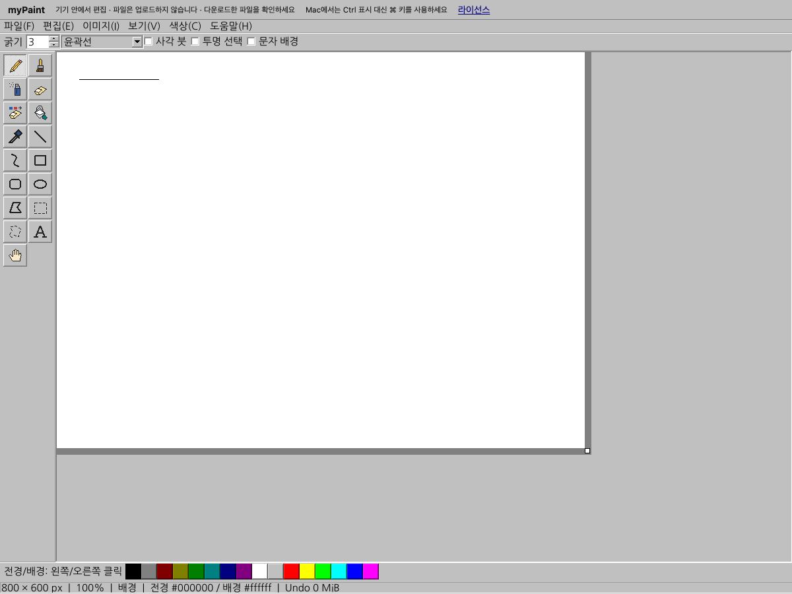

> 과거 검증·설계 기록입니다. 현재 실행 방법은 [루트 안내](../../README.md)를 따르세요. 아래 수치는 기록 당시 환경에만 적용됩니다.

# 웹 버전 구현·검증 결과

> 아래는 2026-11-03 구현 시점 기록이다. 2026-11-04 배포 용량·소스 제공 방식 변경은 [용량 정리 결과](WEB_SIZE_CLEANUP.md)를 따른다.

2026-11-03. 기존 네이티브 개선분을 보존하면서 Qt Widgets 웹 버전, 안전한 브라우저 입출력·복구, 형제 홈페이지 산출물 반영을 구현했다. 최종 산출물은 `/Users/jhpark/code/myService/parkjh2568.github.io/mypaint/`에 있다. 홈페이지의 기존 파일 18개와 Git index 해시는 그대로이며 commit·push·pull·인증·리모트 변경은 수행하지 않았다. 실제 공개 Pages 인수는 사용자의 별도 게시 이후 단계다.

초기 게시용 최종 release는 `2c6e8b800f0b183a3fadc1c8`, 관리 파일 56개, 전체 89,321,748바이트(약 85.2 MiB)다. 작업 중 생성한 미게시 시험 버전은 홈페이지 밖 `build-web-work`의 unpublished/pre-gesture/pre-atomic-recovery preview 폴더에 보관했다. 평소 재빌드는 게시된 이전 release를 자동 삭제하지 않는다.

## 구현 범위와 구조

| 경계 | 구현과 보존한 계약 |
| --- | --- |
| paintcore / Document | Core·Gui만 사용. 경로와 QByteArray가 QIODevice 파서/인코더를 공유. 버퍼 write/seek 전 상한 검사. `.rpaint` v1·네이티브 QSaveFile 교체·고유 revision·Redo 보존 |
| Canvas / 공통 MainWindow | 기존 도구 아이콘·그리기·선택·문자·변형·레이어 UI 재사용. 대화상자는 소유 객체와 완료 콜백 사용. 네이티브에서는 기존 동기 사용 흐름 유지 |
| webmain | main 반환 뒤 QApplication·창 유지. 예외를 Qt 이벤트 경계에서 처리. 로컬 NanumGothic으로 한글 표시 |
| mainwindow_web | 전면 요청 번호·문서 세대·revision·활성 레이어 확인. 전면 작업 동안 입력 차단. 큐에 전달된 완료 콜백에서 후보만 검증·적용 |
| BrowserBridge / browser.js | File·Blob·클립보드·IndexedDB·DOM 자원 소유. paintcore에 브라우저 API를 넣지 않음 |
| HTML shell | 같은 사이트 자산만 로딩. 다운로드 명시 버튼·시작 오류·Canvas 오류 안내. 헤더/다운로드 영역 변화에 Qt 화면 크기도 갱신 |
| build_web / stage_web | 동일 버전 SDK 검사, 빌드·소스 해시 기록, 대응 소스/고지 수집, 홈페이지의 mypaint 하위만 검증 후 교체. 자동 Git 쓰기 없음 |

일회성 문장을 헬퍼로 분리하지 않았다. 공유 직렬화, 제한 버퍼, 대화상자와 비동기 요청의 수명처럼 공통 의미·자원 소유권이 있는 경계만 분리했다. 별도 웹 도구 UI나 복제 Document 구현을 만들지 않았다.

## 우선순위별 해결 내용

| 우선순위 | 확인한 위험 | 적용한 처리 |
| --- | --- | --- |
| P0 | 기본 Qt Wasm 예외 구성과 동기 dialog의 중첩 이벤트 루프 | 예외 지원 Qt 소스 빌드, 별도 웹 진입점, QDialog open/finished. Asyncify·JSPI·스레드 없음 |
| P0 | 파일/버퍼의 검증 차이, 출력 후 한도 검사 | 공유 파서/인코더와 할당 전 write/seek 제한. 크기·레이어 합계·레코드 길이 검사 유지 |
| P0 | 다운로드 요청을 저장 성공으로 간주해 원본을 버림 | 파일 받기 버튼과 실제 파일 확인 안내. 다운로드 후 dirty·Undo/Redo·미확정 편집 유지. 새 그림/열기에서 다운로드 선택 시 현재 문서 유지 |
| P0 | 마우스 버튼을 누른 채 저장 단축키 실행 시 진행 중인 획이 취소될 수 있음 | 활성 제스처가 끝날 때까지 웹 명령을 보류. 실제 Mac ⌘ 단축키와 획 픽셀로 확인 |
| P0 | 지연 결과가 다른 문서/레이어에 적용됨 | 요청·세대·revision·활성 레이어 확인과 전면 편집 차단. PreparedEdit을 브라우저 Promise 대기 중 보관하지 않음 |
| P0 | 권한 거절 전에 잘라내기가 적용됨 | 브라우저 쓰기 성공 뒤에만 이미지/문자 삭제. 실패는 현재 픽셀과 pending 보존 |
| P0 | 웹 자원 한도에서 긴 동기 인코딩 | 실측 후 레이어 합계를 8에서 6 Mi 픽셀로 낮춤. PNG 압축 생략. 한도 내 채우기·코덱은 동기 실행임을 명시 |
| P1 | 복구 head와 Blob 불일치·저장 실패·다중 탭 덮어쓰기 | 단일 transaction 완료 확인, 탭/문서별 키, 과거 문서 작업 무효화, 기존 사본 보존, 이전 사본 선택 UI. 선택 뒤 갱신된 사본은 세대 번호로 거부하고 head·Blob을 같은 읽기 transaction에서 가져옴 |
| P1 | 문자 편집기 기본 clipboard/context/drop 경로의 우회 | 편집 메뉴/단축키를 권한 처리 경계로 연결. 기본 context clipboard·문자 drop 비활성화. IME·키 입력·붙여넣기 누적 길이 검사 |
| P1 | 다운로드 패널 변화 후 화면과 입력 좌표가 달라짐 | HTML ResizeObserver에서 Qt 화면 갱신 API 호출. 실제 연속 다운로드·파일 열기로 확인 |
| P1 | 산출물 복사 실패나 수동 수정 덮어쓰기 | 소유 manifest·해시·경로·symlink·staging 검사. 임시 폴더 검증, 교체 실패 복원. 미확인 파일과 빈 폴더도 보존 |
| P1 | 정적 Qt 배포의 대응 소스·고지 누락 | 앱 빌드 소스, 실제 Qt commit 전체 소스, Qt/런타임/폰트 고지와 재빌드·재링크 절차를 로컬 링크로 포함 |

Mac 웹에서는 Qt의 Ctrl 표시가 실제 ⌘ 키에 대응하므로 HTML 헤더에 안내를 추가했다.

완료 TODO·임시 진단 코드를 제품 경로에 남기지 않았다. 별도 JS/Python linter 설정은 없어 Node/Python 문법 검사와 동작 시험을 적용했다. C++ 포맷·컴파일 경고·diff 공백 검사도 확인했다. 기존 네이티브 검토와 수정 내역은 [코드 검토](https://github.com/parkjh2568/myPaint/blob/cc5f0994df35553b987c523b164cfe0ac0fd738c/docs/CODE_REVIEW.md), [네이티브 결과](IMPLEMENTATION_RESULTS.md)를 따른다.

## 사용자 동작과 실패 계약

프로젝트 다운로드는 현재 후보의 픽셀·레이어를 보존한 `.rpaint`다. 이미지 내보내기는 합성 PNG/JPEG/BMP다. 미확정 선택/문자는 다운로드 후보에 반영하지만 편집기를 확정하지 않는다. 다운로드 패널에서 파일 받기를 눌러 실제 파일을 확인한다. 닫기는 준비한 Blob URL만 해제한다.

로컬 파일은 File.size를 확인한 다음 읽는다. 잘린 프로젝트·지원하지 않는 형식·한도 초과·파일 선택 취소는 기존 문서를 교체하지 않는다. 정상 후보를 읽은 후에도 현재 그림을 버릴지 별도로 묻는다. 사용자 파일을 업로드하지 않는다.

복구는 30초마다 확정된 문서 revision을 저장한다. 저장 중 계속 그릴 수 있고 같은 문서의 과거 revision도 사본으로 유지한 뒤 다음 주기에 최신 상태를 시도한다. 새 문서는 자신의 이전 키만 정리하며 다른 탭의 사본은 남긴다. 목록에서 시각·이름·크기를 확인하고 사본을 고른다. 손상 사본을 읽어도 원본을 삭제하지 않는다. 전체 사본 삭제는 사용자 확인을 거친다.

복구는 32개·총 64 MiB를 넘으면 기존 사본을 지우지 않고 실패한다. IndexedDB가 차단되거나 quota에 걸려도 문서는 유지하며 오류를 알린다. 사이트 데이터 삭제·private 모드·강제 종료·브라우저 정책에서 사본이 사라질 수 있어 프로젝트 다운로드가 필요하다. 미확정 편집과 마지막 사본 이후 변경은 복구 대상이 아니다.

## 웹 작업 프로필과 측정

| 항목 | 웹 한도 |
| --- | --- |
| 이미지 / 레이어 합계 | 4 Mi / 6 Mi 픽셀 |
| 한 변 / 레이어 수 | 4096 / 최대 16개; 합계 한도 동시 적용 |
| 입력·최종 출력 / 레이어 PNG | 40 MiB / 20 MiB |
| 이력 예산 / Wasm 메모리 최대 | 32 MiB / 512 MiB |
| 문자 | 65536 UTF-16 단위 |

JS Blob·GPU·브라우저 전체 메모리는 Wasm 메모리 상한에 포함되지 않는다. 마지막 이력 한 항목을 남기는 기존 규칙도 동일하다. 네이티브 한도는 변경하지 않았다.

macOS ARM64 / Qt 6.12.0 / Emscripten 5.0.5 / Chrome 156.0.8078.80 headless에서 최대 4 Mi 픽셀 채우기와 합계 6 Mi 픽셀의 결정적 난수 2개 레이어를 3회 측정했다. 최종 3회 범위는 채우기 28~31ms, 프로젝트 인코딩 187~191ms, 프로젝트 디코딩 56~60ms, PNG 인코딩 104~110ms다. 정확한 수치는 [성능 JSON](../evidence/web-performance.json)에 있다. 단일 코어 호출 측정이며 전체 사용자 입력 지연의 p95나 다른 기기의 상한을 뜻하지 않는다. 동기 코덱 호출 중 즉시 취소가 가능하다고 표시하지 않는다.

초기 실행 자산은 Wasm 19,969,640바이트, JS 199,826바이트, Qt 로더 13,437바이트와 HTML이다. 약 85.2 MiB의 전체 게시 폴더에는 초기 실행 때 읽지 않는 대응 소스·라이선스 자료도 포함된다. 실제 Pages의 전송 압축·네트워크 시작 시간은 게시 후 측정해야 한다.

## 검증 결과

| 시험 | 실제 결과와 증거 |
| --- | --- |
| 네이티브 Release CTest | web_stage·core·allocation_failure·smoke·ui 5개 그룹 통과. [로그](../evidence/web-native-ctest.log) |
| ASan/UBSan | core·ui 2개 그룹 통과. macOS, detect_leaks=0. [로그](../evidence/web-native-sanitize.log) |
| 로컬 홈페이지 실제 /mypaint/ | 버전별 JS/Wasm 요청, 라이선스/대응 소스 링크 확인. 실제 획 픽셀, Undo/Redo, 미확정 선택 다운로드, PNG, 손상/대용량/취소, cut 거절, 재로딩 후 정확한 복원 통과. [JSON](../evidence/web-chromium.json) |
| 시작·그래픽 오류 | Wasm 요청 차단 시 시작 오류 안내. Qt 래스터 Canvas의 합성 contextlost 이벤트로 안내 확인. 실제 GPU 장애를 재현한 검증은 아님 |
| 브라우저 저장소 경계 | 실제 IndexedDB에서 다중 탭·quota/transaction 실패·이전 문서 지연 완료·손상·명시적 삭제·접근 거절, Blob URL 교체/해제 통과. [JSON](../evidence/web-storage.json) |
| 폴더 반영 실패 | 정상 반영·중복·기존 홈페이지/staging·수동 수정·미확인 파일/빈 폴더·symlink·경로 탈출·잘못된 manifest·복사 실패·설치 실패 복원 등 11개 시험 통과. [로그](../evidence/web-stage-tests.log) |
| 실제 홈페이지 보존 | 기존 파일 18개와 Git index 해시 불변, 산출물 manifest 전체 검증, 재반영 check changed=false. [JSON](../evidence/web-homepage-stage.json) |
| 정적 확인 | 전체 src/tests C++ 포맷, Node 문법, Python 컴파일, git diff --check 통과. 최종 Release/Web/Sanitizer 빌드 로그에서 compiler warning/error 없음 |

UI 자동화는 Playwright 1.62.1과 별도 임시 Chrome 프로필을 사용했다. 앱 제품 의존성이 아니다. 저장소 실패 시험은 실제 IndexedDB 위의 명시적 실패 주입이며 실제 디스크를 가득 채운 시험은 아니다. 웹 자산 요청은 같은 origin으로 한정됐고 외부 글꼴·사용자 파일 업로드·telemetry를 추가하지 않았다.

## 다음 실행과 남은 인수

[빌드 문서](../WEB_BUILD.md)의 한 명령으로 재빌드하고 형제 홈페이지에 반영한다. 각 저장소의 [pull·push 절차](https://github.com/parkjh2568/myPaint/blob/cc5f0994df35553b987c523b164cfe0ac0fd738c/docs/GIT_WORKFLOW.md)는 분리돼 있다. 홈페이지 폴더에서 `git add -- mypaint/` 전후의 전체 staging을 확인하고 사용자가 별도로 commit·push한다. 목표 공개 URL은 `https://parkjh2568.github.io/mypaint/`다.

P0 게시 인수는 홈페이지의 기존 main 게시 workflow 성공, 공개 URL의 실제 MIME/캐시·새로고침·파일 왕복·복구와 기존 홈페이지 보존 확인이다. 이번에는 원격 push와 Pages 게시를 수행하지 않았다.

P1 플랫폼 인수는 설치된 Safari·Firefox, 실제 OS 한글 IME·클립보드 권한/제스처, Retina·배율·장시간 편집·저사양 기기다. 브라우저 IME 길이 방어 코드와 네이티브 합성 이벤트 시험을 실제 OS 입력기 검증으로 바꾸어 말하지 않는다. 모바일 전체 기능·PWA/오프라인 재시작은 현재 지원 범위가 아니다.

수동 웹 CI workflow를 추가했으나 원격 실행은 하지 않았다. 동일 Qt 호스트·Wasm 소스 빌드가 필요해 workflow_dispatch로 제공하며 기존 네이티브 CI는 유지한다. 원격 CI 통과 여부와 Windows/Linux의 이번 변경 검증은 로컬 macOS 성공과 구분한다.

후속 최적화는 실제 공개 전송 크기/시작 시간과 저사양 입력 지연 측정부터 한다. 그 결과에 따라 크기 최적화 SDK 또는 Worker/분할 코덱 경계를 검토한다. 현재 단계에서 타일 엔진·서비스 계층·도구별 추상화를 추가하지 않았다.
