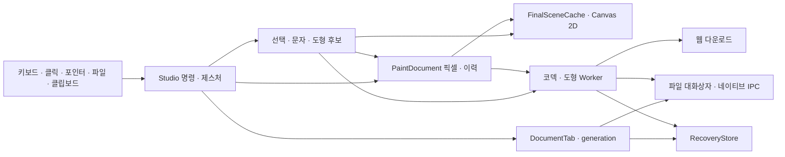

# Studio 편집기와 UI 재감사

2026-11-15 기준 `codex/studio-recovery`의 `48e4058`과 작업 트리 변경을 함께 확인했다. 편집기 입력, 화면 합성, 탭·파일·복구의 UI 경계, 브라우저 및 데스크톱의 사용 흐름을 다룬다. 가장 먼저 수정할 동작은 비활성 탭의 닫기를 취소할 때 다른 탭의 미확정 편집과 Redo가 바뀌는 것이다.

## 상태와 모듈 경계

`index.html`의 `#app`에서 `Studio` 하나를 생성한다. 생성자가 화면 구조, 입력 구독, 환경 설정, 데스크톱 활성화, 자동 복구 타이머를 설치한다. 이후 입력은 클릭·단축키 명령, 포인터 제스처, 파일·클립보드로 나뉘고 대부분 `run`을 지나 상태 표시와 그리기를 요청한다. 런타임에 따라 리소스 한도와 파일·복구 어댑터를 선택한다. [부트스트랩](../../../web-app/index.html#L10) · [화면과 이벤트 설치](../../../web-app/src/main.ts#L199) · [공통 실행 경로](../../../web-app/src/main.ts#L699) · [진입점](../../../web-app/src/main.ts#L4838)

| 소유 상태 | 실제 경계와 계약 |
| --- | --- |
| 문서와 이력 | `PaintDocument`가 레이어 버퍼, revision, 저장 revision, Undo/Redo 및 진행 중인 획을 가진다. 확정 후보는 `prepareState`에서 이력과 비교한 뒤 `installPrepared`에서 현재 문서와 후보가 같은지 다시 확인한다. [후보 준비 및 설치](../../../web-app/src/engine/document.ts#L347) |
| 탭 | `DocumentTab`이 문서·복구 키·카메라를 보존한다. 현재 값은 각각 `Studio.doc`, `recovery`, `name`, `zoom` 및 오프셋에도 존재해 `captureTab`과 `activateTab`이 양쪽을 맞춘다. 성공한 활성화는 이전 탭의 후보를 확정하고 복구 대기열에 올린다. [탭 상태](../../../web-app/src/main.ts#L3283) · [탭 활성화](../../../web-app/src/main.ts#L3340) |
| 현재 상호 작용 | 선택 및 이동, 문자 textarea, 다각형 점, 포인터 캡처, IME 조합, 진행 중인 Worker·타이머는 현재 `Studio`에 속한다. 상태 객체·revision·epoch·레이어·픽셀 참조를 함께 비교하는 함수들이 작성 시점과 결과 적용 시점 사이의 변경을 검출한다. [필드](../../../web-app/src/main.ts#L91) · [선택 크기 조절](../../../web-app/src/main.ts#L2175) · [레이어 및 문서 변형](../../../web-app/src/main.ts#L2715) |
| 화면 출력 | `draw`가 픽셀 버퍼별 dirty rect를 합쳐 다음 프레임에 그린다. 캐시와 지연 준비는 확대율·DPR·선택 미리보기의 소유자를 따라 무효화된다. 그리기 예외에서 캔버스 준비 표시와 캐시를 초기화한다. [갱신 예약과 실패 처리](../../../web-app/src/main.ts#L1071) · [렌더링](../../../web-app/src/main.ts#L1137) |
| 저장과 복구 | 프로젝트 저장은 스냅샷을 만들고 코덱→웹 Blob 또는 네이티브 저장으로 보낸다. 네이티브 성공 응답 후에 저장 revision을 갱신한다. 복구는 탭 스냅샷을 별도의 직렬 대기열에서 인코딩하므로 저장 경로와 수명이 다르다. [저장](../../../web-app/src/main.ts#L3591) · [복구 대기열](../../../web-app/src/main.ts#L4125) |

정적 import는 UI 진입점에서 엔진과 플랫폼 쪽으로 흐른다. `ui/eraser.ts`는 엔진의 `Color` 타입만 참조한다. 이 범위에서 확인한 역참조는 동적 import된 네이티브 스모크 코드가 `Studio` 타입과 인스턴스 내부에 의존하는 경로다. 타입 역참조는 런타임 순환 import를 만들지 않지만, 내부 메서드 이동에 직접 영향받는다. 스모크는 사용자 동작을 호출하는 좁은 인터페이스와 재현에 필요한 읽기 전용 관측 API로 이동할 수 있다. [지우개 환경 설정](../../../web-app/src/ui/eraser.ts#L1) · [스모크 연동](../../../web-app/src/main.ts#L4840) · [스모크 소비자](../../../web-app/src/platform/native-smoke.ts#L1)

## 우선순위

P1은 사용자의 편집 보존 또는 네이티브·JS 상태 일치에 직접 영향이 있는 항목이다. P2는 일반 작업 흐름, 접근성, 자원 및 회귀 위험이다. P3은 정리와 사용성 개선이다. 비용은 기존 경계를 유지한 변경에서 낮음은 국소 수정, 중간은 상태·UI 계약과 회귀 검증, 높음은 저장 경계나 여러 모듈의 조정이 필요한 작업이다.

| 순위 | 항목 | 영향, 근거 및 수정 방향 | 비용 · 확신 |
| --- | --- | --- | --- |
| P1 E1 | 비활성 탭 닫기의 취소가 활성 탭을 변경 | A의 Redo가 있고 미확정 문자가 열린 상태에서 수정된 B의 닫기를 누른 다음 취소했다. B가 활성 상태로 남았고, A로 돌아가자 문자가 확정되어 제목에 별표가 붙었으며 Redo가 없어졌다. 닫기 타당성 확인 전에 `switchTab`이 이전 A를 확정한다. 깨끗한 비활성 탭 닫기도 불필요하게 활성 탭을 바꿀 수 있다. 창 종료도 순회하며 먼저 전환하므로 취소가 앞선 탭에 미치는 영향을 별도 재현해야 한다. 닫을 탭을 초기 키로 잡고, 깨끗한 비활성 탭은 네이티브 경로 해제 후 그 탭만 삭제한다. 수정된 비활성 탭 저장은 활성 탭과 분리된 대상 저장 작업으로 설계한다. [닫기](../../../web-app/src/main.ts#L3388) · [이전 탭 후보 준비](../../../web-app/src/main.ts#L3347) · [앱 종료](../../../web-app/src/main.ts#L608) | 높음 · 높음, 브라우저 재현 |
| P1 E2 | 후보 확정과 네이티브 탭 전환 사이에 실패 구간 | 네이티브 활성화가 성공한 뒤 `installPrepared`가 후보·현재 이력을 검증한다. 이 검증이 예외를 내면 네이티브 generation은 이미 바뀌었고 JS 필드는 이전 값을 가진다. 닫기와 분리한 일반 전환에서도 같은 순서다. 일반 UI에서 guard를 어기는 실행은 확인하지 않았다. 후보 수정 불가능성과 활성화 중 doc 소유권을 명시해 설치 경로를 검증된 교체로 좁히고, 실패 주입으로 동기화 회복과 저장 오대상 거부를 확인한다. [활성화 순서](../../../web-app/src/main.ts#L3354) · [설치 검증](../../../web-app/src/engine/document.ts#L399) | 높음 · 중간, 실패 구간 분석 |
| P2 E3 | 키보드 탭과 레이어 포커스 유실 | 키보드 Enter로 탭을 바꾸면 활성 DOM 요소가 `BODY`가 됐다. 탭 상태 서명이 바뀔 때 모든 노드를 재생성하므로 변경한 내용 표시나 레이어 전환에서도 같은 종류의 포커스 유실이 가능하다. 문서 탭의 방향키 이동이 없어 선택이 있으면 전역 화살표가 픽셀 선택을 이동할 수 있다. 탭 key에 대응하는 노드를 유지하고 방향키·Home·End와 닫기 후 포커스의 위치를 정의한다. 레이어는 현재 순서와 포커스 이동이 예측 가능한 방식으로 갱신한다. 캔버스 포커스에는 현재 꺼진 outline 대신 편집 표면의 안쪽 표시를 제공한다. 메뉴에 별도 탭 키 탐색 구현이 있어 같은 동작 규칙을 검토할 수 있다. [탭 재생성](../../../web-app/src/main.ts#L3302) · [레이어 재생성](../../../web-app/src/main.ts#L797) · [메뉴 탐색](../../../web-app/src/main.ts#L3145) · [전역 방향키](../../../web-app/src/main.ts#L4792) · [캔버스 스타일](../../../web-app/src/style.css#L167) | 낮음–중간 · 높음, 탭 포커스 재현 |
| P2 E4 | 작업 취소와 대화상자의 키 입력 | 저장 Worker 응답을 지연시켜 바쁜 상태에서 Tab으로 취소 버튼에 도달하지 못함을 확인했다. 해당 버튼을 포커스한 뒤도 Enter·Space로 작업이 중단되지 않았고 Esc만 취소했다. 일반 새 그림 창은 접근성 트리에 이름 없이 노출됐고 너비 입력에서 Enter가 첫 submit인 취소를 실행했다. 작업 중에는 편집 단축키만 차단하고 취소에 포커스를 제공한다. 일반 창은 제목으로 이름을 정하고 `type=button` 취소와 submit 확인을 구분한다. 저장 경고 창의 기존 제목 연결과 기본 버튼 동작을 참고한다. [작업 표시](../../../web-app/src/main.ts#L3253) · [키 차단](../../../web-app/src/main.ts#L4714) · [일반 대화상자](../../../web-app/src/main.ts#L3052) · [저장 경고](../../../web-app/src/main.ts#L3203) | 낮음–중간 · 높음, 브라우저 재현 |
| P2 E5 | 웹 다운로드 준비의 수명이 활성 탭 전환에 묶임 | `파일 받기`를 누르기 전 전환하면 준비한 Blob URL이 폐기되고 돌아와도 받을 버튼이 없다. 새 다운로드도 이전 URL을 제거한다. 웹에서 실제 파일을 확인해야 하는 계약은 유지하고, 준비한 파일과 원본 탭을 연결해 돌아왔을 때 다시 받을 수 있도록 한다. 보존 개수와 바이트 상한을 두고 명시적 해제 시 URL을 회수한다. [다운로드 생성](../../../web-app/src/main.ts#L3555) · [탭 전환 시 정리](../../../web-app/src/main.ts#L3378) | 중간 · 높음, 웹 모드 재현 |
| P2 E6 | 후보 합성과 축소 미리보기에 픽셀 규칙 중복 | 선택 소스 지우기, 잘라낸 픽셀·문자·도형 alpha 합성, 레이어 합성이 편집 후보·화면·내보내기에 각각 구현돼 있다. 후보 안에서도 같은 alpha 식을 세 번 유지한다. 소스 지우기는 단일 레이어 문서의 배경과 다중 레이어의 투명 픽셀을 구분하고, 내보내기에서는 합성 후 PNG alpha 또는 JPG/BMP 바탕색을 적용한다. 픽셀 단위 의미를 공유하고 프리뷰의 축소 샘플링과 분할 스케줄은 유지한다. 작은 픽셀의 축소 표시 차이는 UI의 현재 계약이다. [화면 미리보기](../../../web-app/src/main.ts#L1195) · [선택 소스와 후보](../../../web-app/src/main.ts#L2680) · [내보내기 합성](../../../web-app/src/main.ts#L3764) | 높음 · 높음, 중복 코드 확인 |
| P2 E7 | 탭 전체 메모리 한도의 검사 시점 | 파일 해독 또는 새 그림 할당 후에 새 탭의 512 MiB 검사에 도달한다. 이후에는 문서별 자원 한도로 편집하므로 여러 탭의 편집 이력, 선택 후보, 인코딩, 캐시를 합한 실행 피크는 이 숫자에 포함되지 않는다. 해독 전 확인할 수 있는 크기부터 예약하고 이력·작업·디코딩 예산을 개별 카테고리로 관측한다. 정상 사용자에게 탭을 강제로 닫거나 Redo를 지우지 않고 다음 실패를 명확하게 표시한다. [읽기 및 탭 설치](../../../web-app/src/main.ts#L3408) · [탭 한도 설명](../../DOCUMENT_TABS.md#메뉴와-여러-그림-탭) | 높음 · 높음, 할당 순서 확인 |
| P2 E8 | 자유 선택 좌표 누적과 적용 전 동기 작업 | 자유 선택은 포인터 이동 점을 계속 저장한다. 적용 시 자르기 크기를 검사하기 전에 좌표 전체의 `Float64Array`를 만든다. 이후 픽셀 복사와 마스크 검증은 분할된다. 문자·도형 확정과 `pendingState`는 문서 복제·픽셀 반복을 동기 실행한다. 실제 최대 제스처 지속시간과 프레임 지연은 아직 계측하지 않았다. 중복 좌표 제거, 바이트 상한, 취소 가능한 조합 순으로 비용을 제한한다. 기존 마스크 경계를 바꿀 간소화는 픽셀 테스트를 통과해야 한다. [포인터 이동](../../../web-app/src/main.ts#L1995) · [좌표 패킹](../../../web-app/src/main.ts#L2569) · [확정 후보](../../../web-app/src/main.ts#L2813) · [문자 래스터](../../../web-app/src/main.ts#L3021) | 높음 · 중간, 최대 크기 미계측 |
| P2 E9 | 두 종류의 dirty와 활성 레이어 메타데이터 | `hasPending`은 변경 없는 선택과 빈 문자 입력까지 포함한다. 이 신호로 닫기·브라우저 종료를 경고하고 탭을 편집 중으로 꾸미지만, 창 제목의 별표와 자동 복구는 확정 revision의 dirty만 따른다. 활성 레이어는 `doc.state.active`에 직접 쓰고 revision을 바꾸지 않으며 프로젝트에는 저장된다. 비파괴 UI 상태, 확정 전 픽셀 후보, 파일 내용 변경을 모델에 명시해 각 신호의 용도를 결정한다. 활성 레이어를 편집 이력에 넣을지는 현재 파일·복구 계약을 명확히 한 뒤 결정한다. [종료 경고](../../../web-app/src/main.ts#L511) · [상태 표시](../../../web-app/src/main.ts#L715) · [활성 레이어 설정](../../../web-app/src/main.ts#L823) · [복구 조건](../../../web-app/src/main.ts#L4129) | 중간 · 높음, 메타데이터 정책 필요 |
| P2 E10 | 작업 소유권 검사가 복제되고 강도가 다름 | 문서 변경은 각 메서드에서 객체, revision, epoch, active, 픽셀 참조를 별도로 비교한다. 선택 크기 조절은 성공·실패에서도 같은 전제의 반대 조건을 관리한다. 수동 복구 목록은 읽기 응답 전후 같은 epoch에서 이미 다른 작업이나 창이 생겨도 자동 복구 UI에 적용한 가드를 쓰지 않는다. 공통 문서 스냅샷 식별자를 먼저 만들고, 선택·클립보드·뷰의 추가 검증은 해당 작업 자체에 둔다. 복구의 리스트·삭제·열기에서도 선택된 항목과 현재 화면의 소유자를 검증한다. [선택 리사이즈](../../../web-app/src/main.ts#L2175) · [내보내기 검증](../../../web-app/src/main.ts#L3645) · [복구 목록](../../../web-app/src/main.ts#L4173) | 중간 · 중간, 경쟁 테스트 필요 |
| P2 E11 | 브라우저 시작 시 안전한 컨텍스트 의존 | 로컬 번들을 일반 HTTP 비루프백 주소에서 열자 `crypto.randomUUID`가 없고 초기 `RecoveryStore` 생성이 실패해 앱이 마운트되지 않았다. HTTPS 가상 주소에서 같은 번들이 동작했다. 공개·테스트 주소가 HTTPS인 경우의 영향은 확인하지 않았다. 실행 전제 안내를 문서와 초기 UI에 표시할지, 안전한 난수 기반 UUID 생성과 클립보드 제한 안내로 HTTP 개발 흐름까지 지원할지 결정한다. [복구 키](../../../web-app/src/platform/storage.ts#L85) · [초기 인스턴스](../../../web-app/src/main.ts#L184) | 낮음–중간 · 높음, 브라우저 재현 |
| P2 E12 | 제스처 상태가 선택적 필드 묶음 | `Drag`의 `mode`와 필수 값이 타입상 연결되지 않아 `!`와 보조 필드에 의존한다. 취소·정상 완료·작업 실패에서 포인터, 타이머, 후보 리소스를 각기 닫아야 한다. 포인터 종류와 실제 모드를 판별 가능한 union으로 두고 단계마다 종료 자원을 호출 가능한 하나의 소유자에 둔다. 두 손가락 직후 새 손가락을 끼웠을 때 카메라 재기준점, 캡처 유실, 펜 압력과 보조 버튼 전환을 기존 테스트와 실제 장치에 맞춰 검증한다. [제스처 타입](../../../web-app/src/main.ts#L58) · [포인터 해제](../../../web-app/src/main.ts#L2003) · [취소](../../../web-app/src/main.ts#L2119) | 중간–높음 · 중간, 실제 장치 미검증 |
| P3 E13 | 메뉴 및 키 바인딩의 명령 ID가 분산 | 문자열이 마크업, 그룹, `command`, 단축키, 상태 동기화에 중복된다. 메뉴 섹션 제목과 바로 가기 도움말도 따로 관리한다. `Tool`처럼 명령 ID를 컴파일 시점에 제한하고 그룹·레이블·아이콘·disabled 조건만 등록한다. 조합 키까지 하나의 UI로 완전히 통합하기 전에 편집기에 포커스가 있는 범위와 기본 브라우저 동작을 정의한다. [메뉴 정의](../../../web-app/src/ui/menu.ts#L1) · [명령 실행](../../../web-app/src/main.ts#L4290) · [키보드 라우팅](../../../web-app/src/main.ts#L4708) | 중간 · 높음, 코드 검색 |
| P3 E14 | 파일·복구 조작의 안내와 실패 범위 | 여러 파일 중 하나가 실패하면 순차 열기 전체가 중단된다. 드롭은 첫 파일의 삽입만 수행하며 열기와 효과가 다르다. 복구 목록에 읽기 전용·삭제 가능 항목이 섞이면 읽기 전용 항목에도 삭제를 선택할 수 있다. 드롭 위치와 수신 동작을 보여주고 다중 열기의 성공·실패를 항목별로 알린다. 읽기 전용 항목에서 삭제를 비활성화하고 삭제 후 선택과 메시지를 갱신한다. [드롭](../../../web-app/src/main.ts#L517) · [웹 열기](../../../web-app/src/main.ts#L3538) · [복구 동작](../../../web-app/src/main.ts#L4221) | 중간 · 높음, 코드 경로 확인 |
| P3 E15 | UI 동기화의 범위가 넓고 CSS 미사용 후보 존재 | `run` 종료마다 `sync()`와 `draw()`를 호출하고 레이어 리스트를 재생성한다. 실제 픽셀 변경과 무관한 메뉴 닫기·설정도 전체 갱신된다. 화면 구성 요소별 변경 범위를 나누고 레이어 DOM은 순서·이름·가시성 변화만 갱신한다. 정적 코드 검색에서 `.layer-row img`, `.topbar .desktop-secondary`를 사용하는 마크업과 생성 경로를 찾지 못했다. 삭제 전 작은 화면 및 레이어 전환을 검증한다. [실행 후 동기화](../../../web-app/src/main.ts#L699) · [레이어 DOM](../../../web-app/src/main.ts#L797) · [스타일](../../../web-app/src/style.css#L278) · [좁은 화면 스타일](../../../web-app/src/style.css#L936) | 낮음 · 높음, 코드 검색 |
| P3 E16 | 터치 상단 막대의 359–360px 불연속 | 모바일 Chromium 에뮬레이션에서 359px의 상단 막대 높이는 131px, 360px에서 61px였다. 360px에서는 프로젝트 버튼 오른쪽 3px가 뷰포트를 벗어났다. 고정된 폭·gap과 브레이크포인트가 터치 모드의 48px 버튼을 담는 데 필요한 실제 너비를 반영하도록 조정한다. 작은 화면에서는 필요한 동작을 메뉴로 이동하고 상단 막대가 캔버스 공간을 과하게 차지하지 않도록 한다. [터치 목표](../../../web-app/src/style.css#L796) · [버튼 폭 축소 금지](../../../web-app/src/style.css#L1001) · [줄바꿈](../../../web-app/src/style.css#L1062) | 낮음–중간 · 높음, Chromium 모바일 에뮬레이션 |

## 구현 순서와 인수 기준

1. **닫기 트랜잭션부터 고친다.** 변경 검사를 닫을 탭의 key에 결합한다. 비활성 탭의 저장 경로 해제는 네이티브에서 활성 generation과 해당 key를 검증한다. 저장·버리기·취소의 결정을 별도 값으로 받고 전환 경로와 닫기 경로를 분리한다. 현재 탭만 닫을 때는 마지막 탭의 빈 문서 대체와 네이티브의 원자적 경로 해제를 유지한다. 창 종료는 문서들에 대한 확인 중 활성 탭을 바꾸지 않고, 취소 시 그 이전에 명시적으로 저장 완료한 파일만 저장된 상태여야 한다. 브라우저 E2E와 실제 Windows 앱에서 실패, 디스크 저장 성공, IPC 응답 지연, 활성 탭 유지, Redo 결과 픽셀, 닫힌 키의 경로 해제를 검증한다.
2. **탭·레이어·작업 UI와 명령을 정리한다.** 접근 가능한 대화상자, 안정적인 탭 버튼과 포커스, 포커스 영역별 단축키, 준비된 다운로드의 수명을 도입한다. 탭과 레이어 동작을 작은 DOM 컴포넌트로 옮겨 UI가 전용 명령을 호출하도록 한다. 편집 후보 없이 선택만 하거나 빈 textarea를 열었을 때 저장 경고를 표시하는 기준을 정한다. 모바일의 파일·도구·레이어 접근, 키보드 편집, IME, 터치 크기 및 고대비를 현재 계약과 비교한다.
3. **문서 세션과 상호 작용의 소유권을 명시한다.** 탭 세션은 문서·이력·카메라·복구 상태의 단일 소유자가 된다. 현재 탭의 포인터·문자·선택 후보와 코덱 작업은 각자 dispose하고 적용 전 현재 세션을 검증한다. `selection.modified`의 소스·좌표·픽셀 비교는 네 군데에서 동일한 함수로 옮길 가치가 있다. 주석에 적힌 반환 소유권과 마스크 및 nearest-neighbor 동작을 유지한다. [이동](../../../web-app/src/main.ts#L1898) · [즉시 크기 조절](../../../web-app/src/main.ts#L1968) · [지연 크기 조절](../../../web-app/src/main.ts#L2296) · [키보드 이동](../../../web-app/src/main.ts#L4807)
4. **후보 합성·렌더 보존을 검증하면서 빠른 경로를 만든다.** 선택·문자·도형 및 투명도를 같은 픽셀 함수로 구현하고 화면·확정·내보내기에서 호출하도록 한다. 컷 소스의 외부 클리핑, 레이어 정렬, 반올림, 배경 alpha, 다각형 완결 시점은 관찰 가능한 결과다. 축소 미리보기는 분할 실행과 샘플링이 필요하고, 화면은 dirty rect 및 cache invalidation을 유지한다. 기존 `paintShape`와 `paintText`의 공용 래스터 로직은 살린다. 전체 문서 복제를 제거하기 전에 레이어 복사·Undo 이력·전송 버퍼의 소유권을 확인한다. 성능 계측은 새 탭 해독 전·후, 비활성 복구 중, 최대 문서의 선택·문자 확정, 스크롤과 확대 조작을 각각 다룬다.
5. **템플릿과 스타일을 범위별로 옮긴다.** 메인 마크업은 단일 긴 문자열이어서 요소와 동작을 함께 검토하기 어렵다. DOM 마크업에 가까운 탭·레이어·대화상자 렌더러를 만들고, `style.css`의 토큰·창 레이아웃·편집 표면·패널·테마·응답형 순서를 유지한 채 성격별 묶음을 분리한다. `any-pointer`·좁은 화면·낮은 화면·강제 색상 규칙은 우선순위가 교차하므로 360/600/840px 주변, 가로 모드, 키보드 표시, 브라우저 확대 상태, 두 스킨을 점검한다. SVG 아이콘과 도구 정의는 내장 자원으로 유지한다. [메인 템플릿](../../../web-app/src/main.ts#L201) · [터치·반응형 규칙](../../../web-app/src/style.css#L796) · [강제 색상](../../../web-app/src/style.css#L754)

Desktop과 웹 사이에서 유지할 동작은 같은 그림의 편집 픽셀, `.rpaint` 읽기·쓰기, 작업 취소 시 원본·Redo 보존, 레이어와 이미지 변형 의미, PNG alpha와 JPG/BMP matte, 파일 및 클립보드 권한의 기존 경계다. 새 그림·파일 열기·복구는 각각 새 탭이고 삽입은 현재 탭의 후보라는 동작도 유지한다. 변경된 UX는 취소가 다른 탭을 편집하지 않도록 하고 키보드 사용자가 포인터 없이 다음 동작을 선택할 수 있도록 한다. 복구의 legacy Qt/브라우저 읽기는 현재 사용자 데이터 경로이므로 삭제 작업 전에 파일 소비자를 확인한다.

## 코드 읽기 범위와 검증

| 범위 | 확인한 주요 경로 |
| --- | --- |
| [`main.ts` 1–678](../../../web-app/src/main.ts#L1) | 파일 의존성, 세션·캐시 필드, DOM 마운트, 팔레트·도구 및 레이어 이벤트, 키·포인터·파일·붙여넣기, VisualViewport, 네이티브 초기 활성화·종료, 복구 타이머 |
| [`main.ts` 679–1501](../../../web-app/src/main.ts#L679) | 중앙 예외 처리와 동기화, 편집 중 상태, 레이어 선택·가시성, 색상환·지우개 환경 설정, 크기·줌·DPR, RAF·dirty rect·순차 캐시 준비 |
| [`main.ts` 1502–2679](../../../web-app/src/main.ts#L1502) | 좌표, 마우스·펜·터치 제스처, 필압·coalesced events, 브러시·채우기·스프레이, 캔버스 및 선택 크기, 셰이프 및 다각형, 선택 마스크와 Worker 전송 |
| [`main.ts` 2680–3252](../../../web-app/src/main.ts#L2680) | 소스 복구, 계층 및 기하 후보, selection/문자/도형 확정, textarea 및 IME, 정확한 픽셀 레이아웃, 대화상자/메뉴/저장 확인 |
| [`main.ts` 3253–3644](../../../web-app/src/main.ts#L3253) | AbortController 및 busy UI, 탭 캡처·전환·닫기·새 탭 한도, 그림 읽기/삽입, 파일 선택·다운로드·저장 |
| [`main.ts` 3645–4289](../../../web-app/src/main.ts#L3645) | 내보내기 스냅샷 및 축소 미리보기, 텍스트·이미지 클립보드 잘라내기와 붙여넣기, 복구 대기열·오류 및 이전 저장소 처리 |
| [`main.ts` 4290–4849](../../../web-app/src/main.ts#L4290) | 명령 문자열과 단축키, 비지 상태 및 포커스/IME, 문서 진입점과 지원 환경의 스모크 IPC |
| [`style.css`](../../../web-app/src/style.css#L1), [`index.html`](../../../web-app/index.html#L1), [`icons.ts`](../../../web-app/src/ui/icons.ts#L1), [`menu.ts`](../../../web-app/src/ui/menu.ts#L1), [`eraser.ts`](../../../web-app/src/ui/eraser.ts#L1) | 기본 레이아웃·폼·색상·폰트, Classic 98, forced colors, 터치, 화면 너비·낮은 높이, resize·탭 스타일, 로컬 SVG, 도구·메뉴 등록, 기본 환경 값 |

기존 주석에서 협업 시 보존할 내용은 모바일 뷰포트 재기준점, 로컬 합성 프리뷰의 catch와 fallback, 캔버스 좌표와 단일 픽셀 정합, 포인터 chord와 캡처 수명, 펜 release에서 마지막 접촉 압력, 라이브 레이어를 detach하지 않는 자르기 버퍼, 클립보드 권한과 이미지 쓰기의 순서다. `ui/eraser.ts`의 지우개 설정과 문서 배경 분리는 사용자에게 보이는 동작이고 CSS의 Classic 98 출처 및 리사이즈 hit area 주석도 현재 역할이 있다. `syncEraserPreferences`의 역할과 다른 커서 숨김은 상위 동기화 상태로 이동 후보이며, 같은 안내가 마크업과 상태 동기화에 중복된 경우에는 상주 UI와 동적 문구를 한 곳에서 제공할 수 있다. [뷰포트](../../../web-app/src/main.ts#L561) · [픽셀 렌더](../../../web-app/src/main.ts#L1300) · [입력](../../../web-app/src/main.ts#L1985) · [마스크 전송](../../../web-app/src/main.ts#L2615) · [클립보드 순서](../../../web-app/src/main.ts#L4030) · [테마 출처](../../../web-app/src/style.css#L458)

새 Vite 배포용 번들을 별도 로컬 출력 경로에서 생성했다. 설치된 Windows Chrome 158.0.8127.37에서 Playwright가 가상 HTTPS 주소로 로컬 자원을 제공했다. 문서 닫기 및 탭 포커스 재현에는 저장·복구 IPC를 모델링하는 저장소의 [네이티브 하네스](../../../web-app/tests/native-harness.mjs#L1)를 사용했다. 새 그림 창의 이름과 Enter 동작, 웹 모드의 준비된 다운로드 및 작업 취소 키는 같은 브라우저로 관측했다. 모바일 에뮬레이션에서 상단 막대와 프로젝트 버튼의 실제 경계값을 320–840px의 열 가지 뷰포트 너비로 비교했다. 이 범위에서는 실제 Windows 앱의 IPC, macOS, 브라우저 스크린 리더, 실제 터치·펜의 결과를 관측하지 않았다. 전체 검증 이력과 패키지 수준 결과는 상위 재감사 결과를 따른다.
