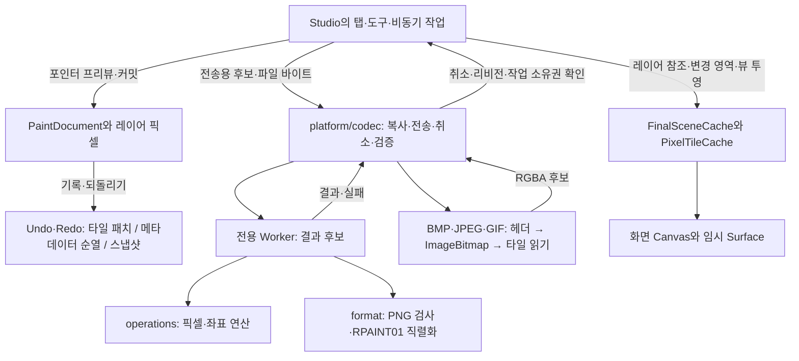

# 픽셀 엔진·코덱·렌더링 감사

## 검토 기준

Windows의 `codex/studio-recovery` 작업 트리에서 HEAD `48e4058`과 실제 파일을 대조했다. `engine/{document,operations,format}.ts`, `platform/{codec,surface,tiles}.ts`, `workers/codec.worker.ts`, `env.d.ts`가 이 장의 전체 대상이다. 이 파일들은 HEAD 대비 작업 트리에서 동일하다. 커밋 밖의 `main.ts`와 복구·플랫폼 코드, 테스트 호출은 실제 작업 트리에서 추적했다. 아래 재현은 현재 코드의 Windows Node 모델이며 WebView·GPU·실제 입력장치 확인이 포함되는 브라우저 검증은 별도다.

작업 전 [인계](../../../PROJECT_HANDOFF.md), [현재 상태](../../CURRENT_STATUS.md), [변경 이력](../../PROJECT_HISTORY.md), [문서 계약](../../STUDIO_DOCUMENT_CONTRACTS.md), [데이터 형식](../../FILE_FORMAT.md)과 저장소 지침을 대조했다. Qt 동작을 기록한 픽셀 fixture, PNG·RPAINT01의 기존 수용 범위, 숨겨진 RGB 값, 활성 레이어 선택과 저장 리비전 의미는 변경 검증 기준이다.

## 소유권·실행 경로

- 문서의 권위 데이터는 레이어 순서와 메타데이터를 가진 `State` 및 straight RGBA 바이트다. 현재, 저장, 다음 리비전과 히스토리 커서는 `PaintDocument`가 관리한다. 메타데이터 히스토리는 바이트 복사 없이 상태 프레임과 순열을 저장한다. 구조 변경은 전후 스냅샷을 저장하고 픽셀 변경은 타일 패치를 저장한다. 일반 활성 레이어 선택은 비히스토리 동작인 반면 명시적인 후보의 활성 레이어 변경에는 히스토리가 생긴다. [문서 상태와 기록](../../../web-app/src/engine/document.ts#L207) · [활성 레이어 계약](../../../web-app/tests/metadata.test.ts#L441)
- 그리기는 첫 접촉 때 128×128 단위로 변경 전 픽셀을 확보하고 화면에 보일 픽셀을 문서 배열에서 갱신한다. 둥근 붓은 한 스트로크의 최대 coverage를 기준으로 변경 전 값에서 색을 계산한다. 사각 붓은 별도 정수·고정소수점 경로에서 현재 색에 합성한다. 확정 시 달라진 타일만 기록하고 취소 시 원래 바이트·가시성을 복구한다. 숨긴 레이어를 작업 중 보이는 규칙과 실제 확정 시의 Undo가 연결된다. [스트로크 시작](../../../web-app/src/engine/document.ts#L590) · [확정과 복원](../../../web-app/src/engine/document.ts#L1147)
- 선택·채우기·문서 변형은 편집기에서 별도 소유의 후보를 구성한 다음 Worker로 넘긴다. Worker 종료, 응답 검증, 요청 제한은 코덱 계층이 담당한다. 편집기는 응답을 받은 뒤 취소, 원본 문서 참조·리비전·활성 레이어·작업 시점을 다시 확인하며, 준비된 후보의 설치에는 별도 일관성 검사가 있다. 현재 `main.ts`가 레이어 활성값·스트로크 데이터·히스토리 내부 패치를 직접 읽거나 쓰므로 소유권을 줄이는 작업은 해당 경로와 같이 진행해야 한다. [편집기 변형 진입](../../../web-app/src/main.ts#L2715) · [준비된 후보 설치](../../../web-app/src/engine/document.ts#L399) · [Undo/Redo 렌더 통지](../../../web-app/src/main.ts#L4290)
- 내보내기는 별도 버퍼를 사용한다. PNG는 합성 이미지를 직렬화하고 RPAINT01에는 레이어별 픽셀과 메타데이터를 기록한다. PNG·RPAINT01은 Worker의 자체 검사를 통과한다. BMP·JPEG·GIF 가져오기는 먼저 크기 정보를 확인하고, 브라우저가 반환한 실제 크기를 다시 확인한 뒤 최대 512×512 단위로 RGBA를 읽고 비트맵과 임시 Surface를 닫는다. JPEG 이미지 방향과 GIF 첫 프레임 확장 처리가 이 경계에 있다. [가져오기](../../../web-app/src/platform/codec.ts#L182) · [내보내기](../../../web-app/src/workers/codec.worker.ts#L48)
- 렌더링은 권위 레이어를 복제한 화면용 타일을 사용한다. 소스 캐시 키에는 소유자·배열·크기·mip 단계·crop이 관여하며, 동일한 배열의 수정은 변경 영역을 통지해야 보인다. 최종 캐시는 화면 배율과 배치를 포함한 키로 종이와 레이어를 보관하며, 선택선·도형 미리보기와 같은 오버레이를 그리기 전에 캡처한다. 타일 예산이 모자라면 전체 예산의 소스 캐시를 사용하는 경로가 있다. [편집기 캐시 사용](../../../web-app/src/main.ts#L1385) · [소스와 최종 장면 캡처](../../../web-app/src/platform/tiles.ts#L1349)

`engine/document`는 앱·Canvas·Worker를 import하지 않는다. `operations`와 `format`은 `document`를 사용하며, `format`은 압축 의존성을 가진다. `tiles → surface`는 독립 브랜치다. `codec → worker`는 번들된 Worker 실행 의존성이고 `worker → codec`의 `SelectionRequest`는 소거되는 타입 의존성이다. 이 범위에 런타임 import 순환은 확인되지 않았다. Worker와 메인 양쪽이 작업 이름과 결과 형태를 각각 해석하는 계약은 남아 있다. [메인 코덱 import](../../../web-app/src/platform/codec.ts#L1) · [Worker import](../../../web-app/src/workers/codec.worker.ts#L1)

## 우선순위

P1은 문서 데이터나 되돌리기 보존에 영향을 주는 문제, P2는 계약 위반·작업 응답성·결과 검증 문제, P3은 유지보수와 낮은 빈도의 방어 개선이다. S는 대체로 한 파일과 집중 테스트, M은 인접 호출자와 회귀 검증, L은 출력 호환성과 성능 검증까지 함께 필요한 범위다. 현재 앱의 관찰된 실패, 실패 주입, 코드 경로에서 계산한 상한을 구분했다.

| 우선순위 · 비용 | 현재 근거와 영향 | 수정 지점과 완료 조건 |
| --- | --- | --- |
| **P1 · M** | **픽셀 패치 발행이 실패에 원자적이지 않다.** `replacePixels`는 `record`에서 Redo를 버리고 리비전을 옮긴 후 행별 view를 만들며 픽셀을 갱신한다. 2×2 문서에서 적용 중 두 번째 행의 view 생성이 예외를 내도록 주입했을 때 첫 행만 쓰이고 Redo가 사라졌다. 같은 주입으로 픽셀 패치 Undo도 커서·리비전이 유지된 상태에서 첫 행만 복원됐다. `cancelStroke` 또한 복원 중 새 view를 만들며, 초기 `beginStroke`는 가시성·스트로크를 바꾼 뒤 첫 이동을 호출한다. 정상 동작 및 실제 메모리 부족 빈도는 이번 실험 범위를 벗어난다. [패치 발행](../../../web-app/src/engine/document.ts#L513) · [Undo/Redo 적용](../../../web-app/src/engine/document.ts#L1203) | `PaintDocument`가 검증, 소유 버퍼·행 계획과 히스토리 계획을 모두 확보한 후 발행을 완료하도록 한다. 커밋과 Undo/Redo의 행 복사에서 쓰기 중 할당·변환을 제거하고 취소는 이미 보유한 변경 전 바이트로 완료한다. 픽셀 배열 동일성, 숨은 레이어 가시성, 최신 1개 초과 예산 허용, 저장된 ID, 기존 Redo를 실패·재시도 전후에 비교한다. 숨겨진 문서에서 첫 타일·두 번째 행 실패와 순방향·역방향 재생을 별도 주입한다. |
| **P2 · S** | **레이어 이름 앞의 U+FEFF가 저장 후 열기에서 소실된다.** 유효한 `'\uFEFF층'`을 작성하면 UTF-8 바이트는 기록되지만 현재 기본 BOM 처리의 디코더가 선두 문자를 제거하고 `'층'`을 반환한다. 이름 대화상자의 FormData와 레이어 이름 변경 경로는 값을 그대로 쓴다. 재현은 코덱에서 확인했다. [인코더·디코더](../../../web-app/src/engine/format.ts#L11) · [레이어 레코드 읽기](../../../web-app/src/engine/format.ts#L350) · [이름 변경](../../../web-app/src/main.ts#L4627) | RPAINT01의 개별 이름 필드에서 U+FEFF를 보존하는 fatal UTF-8 디코더를 사용한다. 이미 작성된 파일에서 여전히 들어 있는 바이트를 회복한다. 기존 헤더, 레코드, 잘린·비정상 UTF-8 거부, 일반 한글·보조 평면 문자 및 이름 길이 계약을 고정한다. |
| **P2 · S** | **여덟 번째 타일의 마지막 양보 동안 취소해도 `readArtwork`가 후보를 반환할 수 있다.** 2048×1024 BMP 헤더와 Bitmap·Canvas 대역으로 마지막 timer에 취소를 주입하면 함수가 resolve되고 Bitmap 및 Surface는 정리된다. 현재 Studio `loadFile`이 결과 수신 직후 signal을 검사해 이 경로의 뒤늦은 문서 교체를 막는다. [타일 읽기와 반환](../../../web-app/src/platform/codec.ts#L279) · [편집기 가드](../../../web-app/src/main.ts#L3459) | 코덱 반환 경계에서 마지막 취소 확인을 보장한다. 타일 수 7·8·9, Bitmap 생성 전·직후·마지막 yield, 예외 시 닫기와 다음 입력 파일 열기를 검증한다. JPEG 헤더 양보를 별도 변경에서 다루면 같은 취소 계약을 사용한다. |
| **P2 · M** | **State 형태 검증과 Worker 연산의 실제 전제 조건이 다르다.** `validate`가 구멍 네 개가 있는 바탕색 배열과 길이만 맞는 일반 배열 픽셀을 수용하는 것을 확인했다. 응답 검증은 밀집 컬러와 `Uint8ClampedArray`를 별도로 검사한다. 정상 타입의 경우에도 byteOffset 1인 1×1 픽셀은 `validate`를 통과하지만 Worker `clear`가 `Uint32Array` 정렬 예외를 반환한다. 현재 Studio의 복사 후보는 정렬된다. [상태 검증](../../../web-app/src/engine/document.ts#L109) · [응답 검증](../../../web-app/src/platform/codec.ts#L98) · [clear](../../../web-app/src/workers/codec.worker.ts#L158) | 외부에서 도착한 State의 밀집 컬러, 픽셀 자료형·크기, 이름, 가시성을 실제 연산의 신뢰할 수 있는 단위에서 검증한다. 유효한 offset view는 바이트 fallback으로 지원하거나 전송용 소유 버퍼에서만 정규화한다. Worker 응답의 현재 사용자용 메시지와 유효한 unaligned·offset fixture를 보존하고 같은 ArrayBuffer를 공유하는 view, 잘린 view, 이미 분리된 버퍼의 기대 동작을 고정한다. |
| **P2 · M** | **JPEG 헤더 검색이 오랫동안 메인 스레드에 머무를 수 있다.** JPEG 스캔은 연속 `0xff`에 대한 동기 루프 안에서 처리한다. 40 MiB synthetic 버퍼 끝에 1×1 SOF를 둔 Node 모델이 `createImageBitmap` 대역에 도달하는 데 약 65 ms였다. 파일 읽기 프로미스 이후 헤더까지의 단일 관측이며 엔진 일반 성능 수치로 사용할 수 없다. GIF 쪽에는 누적 바이트와 시간 체크포인트가 있다. [JPEG·GIF 헤더 탐색](../../../web-app/src/platform/codec.ts#L217) | 취소·양보가 가능한 사전 검사로 두 형식을 단계적으로 맞춘다. marker에 도달하는 정상 JPEG, 늦은 SOF, 반복 fill·TEM, 잘린 입력, EXIF 방향, 가짜 크기와 취소 직후 Bitmap 미호출을 비교한다. 입력 허용량과 브라우저 픽셀 방향은 기존 계약을 유지한다. |
| **P2 · M** | **라쏘 경로의 점 개수와 Edge 처리량은 픽셀 예산에 포함되지 않는다.** 포인터에서 연속 중복만 제거한다. 이후 `Float64Array(path.length * 2)`, Worker의 재구성 객체 배열, 먼 경로 클립 최대 네 차례, edges/스캔라인 active 배열이 있다. 좌표와 문서 크기는 확인하나 전송 배열 개수와 총 작업량에 별도 검사가 없다. 기존 871개 Qt 마스크, 긴 retrace·dense fixture는 정책 변경 시 직접 영향을 받는다. UI 자원 고갈을 이번에 재현하지는 않았다. [포인터 수집](../../../web-app/src/main.ts#L1995) · [점 배열 확보](../../../web-app/src/main.ts#L2569) · [Worker 재구성](../../../web-app/src/workers/codec.worker.ts#L100) · [스캔라인](../../../web-app/src/engine/operations.ts#L17) | 우선 경로 압축·외부 배열 길이 검증·타이머 종료를 각자 검토하고, 중간 객체 복사를 줄이는 typed 입력 경계를 만든다. 개수 한도를 도입하기 전 기존 유효 경로 크기·좌표 양자화·self-crossing의 parity를 재현한다. 취소·실패 시 원본 선택과 잠재적 Redo를 유지하고 크기 축소 또는 경로 단축을 안내한다. |
| **P2 · L** | **디코드·변형·내보내기의 순간 메모리/할당량이 입력 상한과 별도로 누적된다.** desktop의 전체 레이어 원본은 최대 256 MiB, 32 Mi픽셀의 RGBA16 PNG는 해제 행이 약 256 MiB이며 출력 RGBA 약 128 MiB가 별도다. `encodeProject`는 압축 레코드를 모은 뒤 같은 내용을 최종 버퍼에도 쓴다. `exportBytes`는 라이브 보호를 위해 전체 후보를 복사한다. 채우기 보조 배열은 전체 문서 픽셀당 1+4바이트이며, 변형 hot loop에도 픽셀별 임시 배열·view를 만드는 경로가 있다. 숫자는 배열 할당 기준 추산이다. [PNG 해제](../../../web-app/src/engine/format.ts#L150) · [프로젝트 레코드](../../../web-app/src/engine/format.ts#L290) · [채우기 공간](../../../web-app/src/engine/operations.ts#L404) · [변형 루프](../../../web-app/src/engine/operations.ts#L335) | 같은 입력·픽셀 결과·압축 CRC·Worker 실패 경계를 유지한 상태로 행 버퍼 재사용, aligned word/byte fallback, 임시 배열 제거부터 별도 변경으로 검증한다. Chrome·WebView2에서 콘텐츠/Worker 메모리 peak와 frame p95, 반복 취소 후 회수, 20초 Worker 한계 전 복구를 측정한다. 스트리밍 또는 전체 예산 변경은 출력 호환과 다중 작업 측정 후 판단한다. |
| **P3 · M** | **코덱의 타입과 책임이 실제 프로토콜보다 느슨하다.** 작업 문자열·optional payload의 조합이 두 진입점에 반복된다. `SelectionRequest`는 Worker에서 플랫폼 파일을 타입 import하며 `GeometryChange.operation`은 임의 문자열이다. transfer 리스트는 view의 전체 buffer를 넘기고 소유권·중복 여부를 일괄 검증하지 않는다. JPEG lazy import와 Buffer 전역 설치는 Worker의 동일 분기에서 이뤄지고 있으므로 현재 격리된 수명을 유지한다. [runCodec](../../../web-app/src/platform/codec.ts#L19) · [전송 리스트](../../../web-app/src/platform/codec.ts#L168) · [Worker 기하 디스패치](../../../web-app/src/workers/codec.worker.ts#L191) | 런타임 의존성 없는 요청/응답 계약에서 작업별 필수 데이터·결과·전송 주체를 표현한다. 현재 작업 문자열은 내부 경계에서 단계적으로 어댑트하고 빈 fill의 `image: undefined`, 두 동시 작업 상한, 20초, 오류 문자열·예외, 취소의 `finally` 및 하나의 Worker만 종료되는 계약을 고정한다. |
| **P3 · M** | **뷰포트/타일 좌표 규칙이 중복되고 검증 범위가 다르다.** factor 1의 clip·pixel-rounding과 510 셀 경계는 원천 타일과 최종 장면 캡처 경로 모두에 있다. mip 변경 영역의 floor/ceil 변환도 무효화와 직접 draw 경로에 중복된다. 최종 장면 `prepare`는 변환의 유한성을 검사하나 `walkTiles`의 축 검사에는 `NaN` 경로가 남는다. 현재 Studio의 렌더 변환은 제한된 경로에서 들어온다. [원천 타일](../../../web-app/src/platform/tiles.ts#L432) · [원천 셀 투영](../../../web-app/src/platform/tiles.ts#L688) · [최종 장면 계획](../../../web-app/src/platform/tiles.ts#L1226) | 현재 clip 규칙을 순수한 좌표 계산으로 뽑는다. 두 캐시의 타일 소유권과 저장 수명은 별도로 유지한다. 분수 DPR, 음수 오프셋, 509/510/511 경계, 투명도, 교차 dirty, 최종 캐시 miss/hit, minification, 렌더 예외 뒤 자원 해제와 정상 재호출을 수치·화면으로 확인한다. |
| **P3 · M** | **메서드에 좌표 계산·발행·예산 정책이 함께 들어 있다.** `record`와 `prepareState`가 히스토리 가지치기를 각각 수행한다. `historyBudget` setter의 과거와 먼 미래 제거 정책은 실행 조건이 다르다. `moveSquareStroke`는 점·얇은 선·두꺼운 선의 clip/quantization과 쓰기를 한 경로에서 한다. `walkTiles`는 입력 검사, 키, 타일 예약·업로드·투영을 한 generator에 둔다. [히스토리 정책](../../../web-app/src/engine/document.ts#L289) · [사각 스트로크](../../../web-app/src/engine/document.ts#L855) · [타일 generator](../../../web-app/src/platform/tiles.ts#L432) | 편집 시 발행 가능한 히스토리 계획과 예산 재설정의 명시적인 변수를 먼저 정리한다. 사각 도구는 좌표 또는 span 생성 경계를 정리한 뒤 golden으로 확인한다. sync draw와 단계적 prepare는 이미 동일 generator를 쓰므로 공유된 픽셀 경로를 유지한다. keep/release와 예산이 개별 helper로 흩어져 타일 소유권을 추적하기 어려워지는 분리는 피한다. |

## 함수와 기존 검증 범위

| 모듈 및 함수 묶음 | 실행·실패 경로 및 관련 테스트 |
| --- | --- |
| [document.ts의 상태 기초](../../../web-app/src/engine/document.ts#L39) · `profileById`, `validateProfile`, `validateSize`, `validate`, `createState`, `cloneState`, `sameState`, `composite` | 불변 canonical profile, 웹 4096/4 Mi픽셀/합 6 Mi픽셀·40 MiB, desktop 32768/32 Mi픽셀/합 64 Mi픽셀·300 MiB를 사용한다. 허용 레이어 수 16과 포맷 레이어 바이트 상한이 별도다. 비교는 동일 배열 및 정렬된 word와 unaligned byte 경로, 합성은 불투명 fast path와 비가시 레이어 제외를 포함한다. [프로필](../../../web-app/tests/profiles.test.ts) · [코어](../../../web-app/tests/core.test.ts) · [합성 알파](../../../web-app/tests/composite.test.ts) |
| [document.ts의 문서 히스토리](../../../web-app/src/engine/document.ts#L259) · constructor, `historyBudget` get/set, `dirty/canUndo/canRedo`, `reset`, `markSaved`, `record`, `prepareState`, `installPrepared`, `commitState`, `edit`, `editMetadata`, `undo`, `redo`, `apply` | 4096 항목, 예산과 oversized 최근 항목 예외, 히스토리 커서·저장 리비전, 메타데이터 순열과 active 비히스토리 선택, 후보 소유·유효성·무변경 처리 및 늦은 후보 거부가 검증 대상이다. Undo 중 스트로크는 먼저 취소한다. [히스토리](../../../web-app/tests/history.test.ts) · [메타데이터·후보](../../../web-app/tests/metadata.test.ts) · [settle 무변경](../../../web-app/tests/settle-noop.test.ts) · [브라우저 pending 계약](../../../web-app/tests/pending-contract.mjs) |
| [document.ts의 픽셀 쓰기](../../../web-app/src/engine/document.ts#L513) · `replacePixels`, `beginStroke`, `captureStrokeTile`, `moveStroke`, `moveSquareStroke`, `rasterMultiplyAdd`, `endStroke`, `cancelStroke` | clip, 원본/결과 타일, 지정 레이어 재표시, 좌표·필압 입력 검증, 부드러운 경로, 점 단위 `dabsOnly`, premultiplied 색상 교체, square 정수/고정소수점 및 취소. `rasterMultiplyAdd`는 실제 사각 클리핑의 single rounding에 사용한다. 원형 최대 coverage와 사각의 기존 픽셀 합성 순서에 차이가 있다. [픽셀·스프레이](../../../web-app/tests/pixel.test.ts) · [지우개](../../../web-app/tests/eraser.test.ts) · [색 교체 Qt](../../../web-app/tests/color-eraser-qt.test.ts) · [사각 Qt](../../../web-app/tests/square.test.ts) · [포인터 브라우저](../../../web-app/tests/pointer-contract.mjs) |
| [operations.ts의 선택·채우기](../../../web-app/src/engine/operations.ts#L9) · `snapLineDelta`, `polygonMask`, `applySelectionMask`, `flood` | 스냅은 거리 유지 및 8방향의 정확한 성분, 마스크는 원거리 clip 이후 26.6/16.16 양자화 및 even-odd crossing, dense 교차점 parity와 짝 홀 fallback. 마스크/채우기는 premultiplied 비교 및 손대지 않은 숨은 RGB를 보존한다. `flood`는 no-op/범위 밖에서 undefined, 발견된 연결 영역에서 경계와 raster 반환. [스냅](../../../web-app/tests/line-snap.test.ts) · [마스크](../../../web-app/tests/polygon-mask.test.ts) · [선택 준비](../../../web-app/tests/selection-preparation.test.ts) · [채우기 키](../../../web-app/tests/flood-key.test.ts) · [채우기 실패 UI](../../../web-app/tests/fill-failure-contract.mjs) |
| [operations.ts의 기하](../../../web-app/src/engine/operations.ts#L177) · `resizeNearestSteps`, `resizeState`, `cropState`, `transformState`, `shearState` | nearest는 실제 경계 pixel tie에서 Qt의 아래 인덱스를 선택하고 같은 행·2배·unaligned 전용 경로가 있다. smooth는 premultiplied 보간, 비스케일 resize와 crop은 바깥 영역의 최하단 레이어만 지정 배경으로 초기화, shear는 음수·정각에서 별도 좌표 규칙을 사용한다. 회전·반전은 모든 레이어의 원래 RGBA를 옮긴다. [nearest](../../../web-app/tests/nearest-bulk.test.ts) · [Qt nearest](../../../web-app/tests/nearest-qt.test.ts) · [crop](../../../web-app/tests/crop.test.ts) · [shear](../../../web-app/tests/shear.test.ts) · [연속 선택 변형](../../../web-app/tests/selection-resize.test.ts) |
| [format.ts](../../../web-app/src/engine/format.ts#L1) · CRC 테이블, `crc`, `encodePng`와 내부 chunk builder, `decodePng`와 검사·inflate callback 및 각 pass, `encodeProject`, `decodeProject` | PNG는 타입·chunk 순서/CRC·palette/tRNS·출력 상한·Adam7·filter를 처리한다. 8-bit RGBA fast path는 숨은 RGB를 직접 저장한다. RPAINT01은 28바이트 헤더, little-endian 필드, UTF-8 레이어 이름과 PNG 레코드를 읽으며, PNG 본 해제 전 프로젝트 레이어 크기를 대조한다. 쓰지 않은 IDAT 잔여와 ancillary의 reserved property bit를 수용하는 동작은 fixture로 명시한다. [포맷·호환성](../../../web-app/tests/format-compat.test.ts) · [선검사·Worker 경계](../../../web-app/tests/decoder-boundaries.test.ts) · [파일 계약](../../FILE_FORMAT.md) |
| [codec.ts](../../../web-app/src/platform/codec.ts#L19) · `runCodec`와 abort·error·messageerror·onmessage 콜백, `readArtwork`, `exportBytes`, `runGeometry` | 작업·프로필·입력 크기 검사, 동시 active 2개, 개별 20초 만료, Worker 종료·listener/timer 해제, 필수 응답 필드/채우기 위치/mask 크기 검증. 파일 descriptor의 size와 실제 바이트 비교, GIF 첫 프레임 preflight·JPEG 방향, 8타일 단위 양보 및 정리. [코덱 Node 모델](../../../web-app/tests/codec-contract.test.ts) · [브라우저 응답](../../../web-app/tests/codec-reply-contract.mjs) · [GIF 경계](../../../web-app/tests/gif-boundaries.test.ts) · [JPEG 방향](../../../web-app/tests/jpeg-orientation.mjs) |
| [codec.worker.ts](../../../web-app/src/workers/codec.worker.ts#L24) · `channel.onmessage`의 전체 작업 분기 및 전송·오류 | project-read/write 및 png-read/write, jpg/bmp-write는 alpha flatten과 출력 검사, selection은 path→mask·픽셀, fill은 packed seed/color→영역, layer-edit는 clear/invert/merge, geometry는 검증한 resize/transform/shear/crop이다. 모든 작업은 canonical profile ID를 결과와 함께 돌려준다. Worker와 수신자의 가드 및 편집기의 리비전 가드가 함께 작동한다. [코덱 응답](../../../web-app/tests/codec-reply-contract.mjs) · [bulk](../../../web-app/tests/bulk-edit.mjs) · [선택 실패](../../../web-app/tests/selection-mask-failure.mjs) · [내보내기](../../../web-app/tests/export-preview-contract.mjs) |
| [tiles.ts의 소스 캐시](../../../web-app/src/platform/tiles.ts#L47) · constructor, `stats`, `beginFrame`, `discard`, `retain`, `clear`, `markDirty`, `invalidate`, `drawReduced`, `draw`, `prepare`, `cancelPrepare`, `walkTiles`와 내부 타일 생성/업로드 callback | viewport와 device 좌표의 cull, halo, mip·초소형 device 샘플, crop와 타일 변환, 64 타일·128 MiB 모델, stage별 할당·업로드, LRU·dirty 이후 재사용. 렌더 예외에서 캐시를 초기화하고 임시 surface를 닫는다. stats는 canvas backing과 배열의 모델 값이며 브라우저 RSS를 측정하지 않는다. [타일·예산](../../../web-app/tests/tiles.mjs) · [렌더 단계](../../../web-app/tests/render-preparation.mjs) · [성능](../../../web-app/tests/performance.mjs) |
| [tiles.ts의 최종 장면 캐시](../../../web-app/src/platform/tiles.ts#L1053) · constructor, `stats`, `clear`, `fallbackSource`, `prepare`, `finish` 및 capture·dirty 투영 | 화면·대상·변환·래스터 순서의 키와 viewport, source/scene 공용 예산 분할, 변경된 캡처와 기존 타일 재합성, size·target 불일치 및 clear/finally. 반투명 레이어와 오버레이를 포함한 결과는 화면 계약에서 확인한다. [장면 계약](../../../web-app/tests/scene-contract.mjs) · [오라클 도구](../../../web-app/tools/scene-contract.mjs) · [카메라 경계](../../../web-app/tests/camera-viewport-contract.mjs) |
| [surface.ts](../../../web-app/src/platform/surface.ts) · `createSurface`, `context2D` / [env.d.ts](../../../web-app/src/env.d.ts) | OffscreenCanvas 또는 DOM canvas에 대해 2D context를 확보하고 null이면 사용자용 오류를 만든다. 소비자가 일시 Surface의 수명을 관리한다. `env.d.ts`는 Vite, Tauri invoke, JPEG encoder의 타입 선언으로 런타임 함수는 없다. 실제 Core invoke와 Worker 출력 및 브라우저 대체 경로에 의존한다. [타일](../../../web-app/tests/tiles.mjs) · [native 모델](../../../web-app/tests/native.test.ts) |

## 중복·주석·불용 코드

- `limits = webLimits`는 프로필 테스트가 공개 계약으로 사용한다. `rasterMultiplyAdd`, Qt용 이름으로 명명된 픽셀/마스크/프로젝트 fixture, Worker의 JPEG lazy import는 호출 또는 검증 경로가 있다. 동일 타입을 한 번 더 노출하는 `platform/codec.ts`의 `GeometryChange` 재export는 이 체크아웃의 tracked 소비자를 찾지 못했다. 앱·테스트 호출자는 `Parameters<typeof runGeometry>[1]` 또는 원본 타입을 사용한다. [프로필 별칭](../../../web-app/tests/profiles.test.ts#L22) · [타입 재export](../../../web-app/src/platform/codec.ts#L12) · [기하 호출](../../../web-app/src/main.ts#L2715)
- `format.ts`의 IDAT 재순회 주석은 chunk별 view를 남기지 않는 이유를 적고 있다. IDAT 잔여·ancillary 수용의 호환성 이유는 테스트 이름과 데이터에 있다. 사각과 polygon 양자화, nearest tie, straight RGB 보존을 위한 premultiplied 비교, 렌더의 halo·clip 경계는 결과 차이를 설명한다. “legacy”의 출처는 차후 해당 Qt fixture를 직접 연결하면 판단이 쉽다. `tiles.ts`와 일부 엔진 주석에는 `alpha0`, `at most32768`, `up to65536` 같이 단위 구분이 어색한 표기와 루프당 샘플 목표를 읽기 어려운 위치가 있다. 바뀌는 경로에서 단위와 상한의 의미를 정리한다. [IDAT 읽기와 검사](../../../web-app/src/engine/format.ts#L186) · [채우기 키 이유](../../../web-app/src/engine/operations.ts#L419) · [타일 양보 구현](../../../web-app/src/platform/tiles.ts#L432)
- Flood의 좌우·인접 스캔에 premultiplied 동등성 검사 세 벌이 있다. 문서 색 교체와 선택 투명 키도 같은 비교 의미를 각자 구현한다. 일괄 추출은 alpha 0/255 최적화와 숨은 RGB 의미, hot loop 비용을 동시에 확인한 후 진행한다. `replacePixels` over, 일반 붓, 사각 붓은 투명 픽셀 유지와 혼합의 기준 바이트가 다르므로 먼저 테스트 벡터로 의미를 고정한다. 레이어 확장·crop의 배경 fill이 동일한 곳부터 작은 공통 연산을 검토한다. [flood 좌우·인접](../../../web-app/src/engine/operations.ts#L448) · [문서의 색 교체](../../../web-app/src/engine/document.ts#L712) · [crop/resize](../../../web-app/src/engine/operations.ts#L277)
- `tsc --noEmit`는 `noUnusedLocals/noUnusedParameters`를 사용하고 형식 검사는 Prettier를 사용한다. 이 옵션은 외부 참조 없는 export를 판정하지 않는다. 이번 범위에서 정적 읽기와 참조 검색으로 위 재export를 확인했다. 제품 코드 formatter 결과와 테스트 실행 상태는 통합 검증 항목에서 확인한다. [TypeScript 옵션](../../../web-app/tsconfig.json#L12) · [검증 스크립트](../../../web-app/package.json#L6)

## 수정 작업 순서와 검증 기준

1. 문서 발행 원자성을 먼저 고친다. 실패 주입 harness에서 픽셀 바이트 전체, 문서·픽셀 배열의 소유·동일성, Undo/Redo 커서·리비전과 저장 ID, 가시성, 취소 상태를 기록한다. 현재 변경 및 후보 보존 테스트에 스냅샷·메타데이터·패치 종류별 실패 데이터를 추가한다.
2. 이름 디코드 및 마지막 취소 지점을 각각 작은 변경으로 닫는다. 이름 앞 U+FEFF와 잘못된 UTF-8, BMP·JPEG·GIF의 마지막 타일 전후 취소 및 자원 해제를 고정한다. 기존 PNG 호환성의 IDAT 잔여·ancillary 수용, PNG 알파·원본 바이트, RPAINT01 포맷에 대한 전체 검증을 병행한다.
3. 현재 작업과 응답 의미를 먼저 고정한 뒤 codec/worker의 요청 및 소유 버퍼 경계, State 형태 검증, 레이어 clear의 정렬 문제를 단계적으로 정리한다. 브라우저 취소·timeout, fault 재시도, 창이나 활성 탭 변경으로 늦은 후보가 무효가 되는 케이스를 함께 확인한다.
4. JPEG/라쏘 작업량과 렌더 좌표 중복은 기능 수정 이후 측정으로 진행한다. 510 셀 이음선과 분수 확대, 확대 후 작아진 viewport 및 minification, 16개의 표시 레이어 렌더, 프로필별 최대 문서, 같은 큰 입력의 연속 실패·취소에서 화면·메모리·다음 작업 성공을 관찰한다. `test:tiles`, `test:render-preparation`, `test:scene-contract`, `test:max-document`, `test:performance`와 실제 WebView2 관측을 사용한다. 코덱의 양보와 렌더의 생성·release는 자원 소유 단위 안에서 변경한다.
5. 변경된 연산이 들어간 실제 Windows 빌드에서는 정상 열기·편집·저장·다시 열기와, 탭 전환 후 미저장 편집의 복구·닫힌 탭 저장 대상 해제를 사용자 흐름으로 확인한다. 이 검사에는 Worker의 오류가 대화상자로 정상 전달된 뒤 다시 실패 없이 작동하는 흐름도 포함한다. 기존 벤치마크 및 golden 결과는 비교 기준으로 사용한다.

### 현재 코드에서 실행한 집중 재현

Windows PowerShell에서 `web-app` 기준으로 임시 Node 모듈을 `node --import tsx --input-type=module`에 표준 입력으로 넣었다. 제품과 테스트 파일을 수정하지 않고 현재 모듈을 불러왔다.

| 모델 입력 | 관찰 |
| --- | --- |
| 2×2 `PaintDocument`, 첫 변경을 되돌려 Redo가 존재하는 상태에서 다른 패치 적용. `Uint8ClampedArray.prototype.subarray`를 임시 교체하여 커밋 후 두 번째 행에서 예외를 발생 | 리비전 1→3, 커서 0→1, Redo 소실, 첫 행만 새 픽셀. 원래 prototype을 `finally`에서 복구 |
| 2×2 `PaintDocument`, 픽셀 16바이트를 1로 설정한 변경의 Undo 중 두 번째 `subarray`를 예외 처리 | 리비전 2와 커서 1 유지. 위 행 8바이트만 255로 돌아가고 아래 행은 1로 유지 |
| 1×1 `createState`의 레이어 이름을 `'\uFEFF층'`으로 바꾸고 `decodeProject(encodeProject(state))` | U+FEFF 바이트가 출력 파일에 있으며 다시 읽은 이름은 `'층'` |
| `validate`에 바탕색 `new Array(4)`와 길이가 맞는 일반 픽셀 배열. 별도로 `new Uint8ClampedArray(new ArrayBuffer(5), 1, 4)`를 사용하여 실제 Worker 핸들러에 clear 메시지 | 앞의 입력들이 검증을 통과. 정렬되지 않은 정상 typed view는 clear에서 `start offset of Uint32Array should be a multiple of 4` 응답 |
| 2048×1024 BMP 헤더, Bitmap·Canvas 대역과 마지막 8번째 타일 timer에서 AbortController 취소 | resolve, `aborted=true`, Bitmap close, Surface 0×0. 픽셀 읽기·이벤트 순서를 모사한 모델 결과 |
| 1 MiB 및 40 MiB JPEG-like 바이트의 끝에 1×1 SOF. Bitmap 대역에 도달하면 계측 종료 | 단일 샘플 약 7 / 65 ms. 파일 입력 청크 이후 디코딩 전 헤더 순회 구간에서 관측 |
| 1~17 크기의 고정 시드 12,000개 RGBA 입력, 4방 연결 단순 BFS와 `flood` 결과를 문서 전체 바이트로 비교 | 모두 일치. 일부 투명·저알파 키와 경계/부분 패치 케이스에 대한 독립 모델 확인 |

실제 Windows 설치 앱의 입력·화면 검증, GPU 메모리, 브라우저 응답시간은 위 모델 결과에서 추론하지 않는다.
